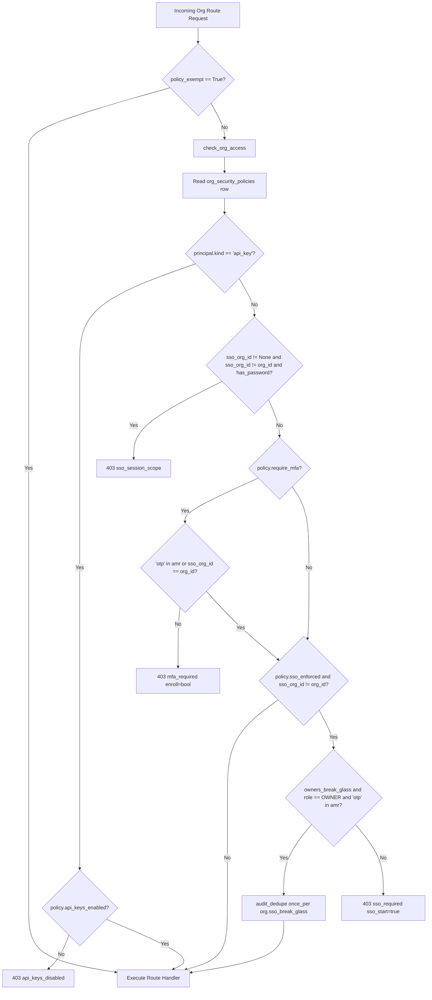

# SPEC: Milestone 11 - Phase 6: Org Security Policy and Step-Up Wiring

## 1. Context & Objectives

Phase 6 implements the per-organization security policy and wires server-side step-up re-authentication across all protected mutations in M4–M7 services:
- **`identity/policy.py` & `identity/router_policy.py`:**
  - `GET /orgs/{org_id}/security-policy`: permission `org.read`, `policy_exempt=True` (RT13: members blocked by MFA still see the policy). Returns `SecurityPolicyOut` (default values if no row exists).
  - `PUT /orgs/{org_id}/security-policy`: permission `security.manage`, requires step-up (`StepUpAction.SECURITY_POLICY_UPDATE`).
  - Preconditions:
    - Enabling `require_mfa` requires the acting owner to have `"otp"` in session `amr` (`409 mfa_required_for_actor`) so owners cannot lock themselves out.
    - Enabling `sso_enforced` requires an enabled IdP with at least one verified domain, AND (acting owner's current session is an SSO session of this org OR `owners_break_glass` is True with `"otp"` in `amr`); else `409 sso_not_ready`.
    - `invite_domain_allowlist`: ≤ 20 IDNA lowercase domains.
  - Audit: `org.security_policy_updated` with `details={"from": old_dict, "to": new_dict}`.
  - Notification: enqueues `MailTemplate.NEW_OWNER_SECURITY_CHANGE` (`change="security_policy"`) to all active human owners of the organization.
- **`check_org_access(session, org_id, principal, role=None)`:**
  - Evaluated on every org route in `core/rbac.org_session` (skipped when `policy_exempt=True`).
  - Read: single indexed read of `org_security_policies` row for `org_id`.
  - Rule 0 (API keys): if `principal.kind == "api_key"`, requires `policy.api_keys_enabled` (`403 api_keys_disabled`). MFA and SSO rules do not apply to API keys.
  - Rule 1 (SSO session scope, RT2): if `principal.sso_org_id is not None and principal.sso_org_id != org_id and principal.has_password`, raises `403 sso_session_scope`.
  - Rule 2 (MFA enforcement): if `policy.require_mfa` and `"otp"` not in `principal.amr` and `principal.sso_org_id != org_id`, raises `403 mfa_required` with `extra={"enroll": not has_active_factor}`.
  - Rule 3 (SSO enforcement & break-glass): if `policy.sso_enforced and principal.sso_org_id != org_id`:
    - If `policy.owners_break_glass` and `role == MemberRole.OWNER` and `"otp"` in `principal.amr`: allowed. Audits `org.sso_break_glass` once per session via `core.audit_dedupe.once_per`.
    - Else: raises `403 sso_required` with `extra={"sso_start": True}`.
- **Step-up Wiring (`core.stepup.require_recent_auth`):**
  - TI `threat_intel/service_integrations.py`: `update_integration` (`api_key` set) & `remove_key` -> `PROVIDER_KEY_CHANGE`.
  - AI `ai/service_providers.py`: `update_provider` (`api_key` set) & `remove_key` -> `PROVIDER_KEY_CHANGE`.
  - Investigations `investigations/service.py`: `update_investigation` lowering TLP (`acknowledge_tlp_downgrade`) -> `TLP_DOWNGRADE`, turning `ai_excluded`/`ti_excluded` off -> `SHARE_POLICY_RELEASE`.
  - Reports `reports/service.py`: `_tlp_rule` returns `downgraded` across 4 call sites (create report, patch report draft, finalize report, finalize wctx) -> `TLP_DOWNGRADE`.
  - Evidence `evidence/share_policy.py`: `put_policy` turning `ai_excluded` or `ti_excluded` off -> `SHARE_POLICY_RELEASE`.
  - Retention `retention/service.py`: `put_policy` lowering any retention day value or turning `enforce` on -> `RETENTION_DESTRUCTIVE`; `create_run` in enforce mode -> `RETENTION_DESTRUCTIVE`; `release_hold` -> `LEGAL_HOLD_RELEASE`.
- **IDOR Cases:**
  - Activate `POLICY_ROUTE_CASES` in `tests/security/idor_cases_identity.py`, clearing `POLICY_PENDING_ROUTES`.

---

## 2. Architecture & Access Flow

---

## 3. Implementation Steps

1. **Fix `ApiKeysDisabled` Error:**
   - Change `ApiKeysDisabled(Conflict)` to `ApiKeysDisabled(Forbidden)` in `app/modules/identity/errors.py` (status 403).
2. **Implement Policy Module & Endpoints:**
   - Implement `check_org_access` in `app/modules/identity/policy.py`.
   - Update `app/core/rbac.py` `org_session` to pass `role=role` to `check_org_access`.
   - Implement `get_security_policy` and `update_security_policy` in `app/modules/identity/router_policy.py`.
3. **Step-Up Call Sites:**
   - Wire `threat_intel/service_integrations.py` (`update_integration`, `remove_key`).
   - Wire `ai/service_providers.py` (`update_provider`, `remove_key`).
   - Wire `investigations/service.py` (`update_investigation`).
   - Wire `reports/service.py` (`create_report`, `patch_report_draft`, `finalize_report`, `_commit_prepared`).
   - Wire `evidence/share_policy.py` (`put_policy`).
   - Wire `retention/service.py` (`put_policy`, `create_run`, `release_hold`).
4. **Update IDOR Cases:**
   - Add policy test cases in `tests/security/idor_cases_identity.py`.
5. **Comprehensive Integration Testing:**
   - `tests/integration/test_security_policy.py`: policy CRUD, preconditions, notifications, audits.
   - `tests/integration/test_org_mfa_enforcement.py`: MFA enforcement, exempt routes, factor resolution (`enroll: true/false`).
   - `tests/integration/test_sso_enforcement.py`: SSO session scope (RT2), SSO enforcement, break-glass with deduplicated audit, API key gate.
   - `tests/integration/test_step_up_wiring.py`: step-up verification on all 6 wired service areas.
   - Regression suites for touched services: `test_ti_*`, `test_ai_*`, `test_reports_*`, `test_retention_*`.
