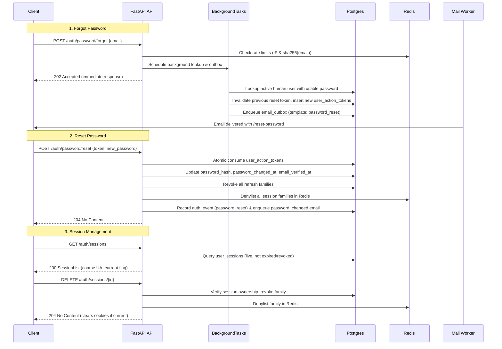

# SPEC: Milestone 11 - Phase 4: Account Recovery, Sessions & Security Events

## 1. Context & Objectives

Phase 4 implements secure self-service account recovery, session management, and personal security visibility:
- **Forgot Password (`POST /auth/password/forgot`):** Always returns `202 Accepted` immediately after rate limits (5 / 10m per IP, 3 / hr per sha256(email)). Background task performs lookup, token creation, and outbox enqueue to prevent timing attacks.
- **Reset Password (`POST /auth/password/reset`):** Single-use, atomic consumption of `user_action_tokens` (`purpose='password_reset'`). Updates password, sets `email_verified_at` if NULL, revokes **every** session via `sessions_store.revoke_all(user_id, reason=RevokedReason.PASSWORD_RESET)` (families + Redis denylist), preserves MFA factors, sends `password_changed` notification email, records `password_reset` auth event.
- **Change Password (`POST /auth/password/change`):** Authenticated session principal; refuses SSO session of a user with a password (`403 local_reauth_required`). Requires step-up (`StepUpAction.password_change`) AND current password verification. Revokes all other sessions keeping current one.
- **Session Management (`GET /auth/sessions`, `DELETE /auth/sessions/{id}`, `POST /auth/sessions/revoke-others`):** Lists user's live sessions with coarse User-Agent summary. Revoke kills refresh family and denylists access tokens in Redis immediately. Revoking current session clears cookies.
- **Security Events (`GET /auth/events`):** Personal audit log showing caller's auth events (newest first, limit <= 100) with safe details.
- **User-Agent Parser (`identity/ua.py`):** Strict allowlist parser converting raw UA into coarse summary (Browser on OS) to prevent UI injection and control fingerprinting.

---

## 2. Architecture & Data Flow

---

## 3. Component Details & Requirements

### 3.1 Account Recovery (`identity/recovery.py` & `router_recovery.py`)
1. **`forgot_password(body, request, background_tasks)`**:
   - Rate limit per IP: `5 / 10m` (`auth:forgot:ip:{client_ip}`).
   - Rate limit per email: `3 / 1h` (`auth:forgot:email:{sha256(email.lower())}`).
   - Return `202 Accepted` immediately without waiting for database lookup (RT6).
   - In background task:
     - Open `tenant_session(None, None)`.
     - Find user by email: must be `kind == 'human'`, active, and have a usable password (does not start with `!`).
     - If user eligible:
       - Consume any existing active reset tokens for this user:
         `UPDATE user_action_tokens SET consumed_at=now() WHERE user_id=:uid AND purpose='password_reset' AND consumed_at IS NULL AND expires_at > now()`.
       - Generate 256-bit token (`secrets.token_urlsafe(32)`), `token_hash = sha256(token)`.
       - Expiry: `now() + interval '30 minutes'`.
       - Insert into `user_action_tokens` (`user_id`, `purpose='password_reset'`, `token_hash`, `email`, `expires_at`).
       - Enqueue `outbox.enqueue(session, template=MailTemplate.PASSWORD_RESET, to=user.email, params={"display_name": user.display_name, "expiry_minutes": 30}, secret=token)`.
       - Record auth event `password_reset_requested` with `user_id=user.id`.
       - Commit and publish outbox.
     - If user not eligible or not found:
       - Record auth event `password_reset_requested` without `user_id` (safe audit, no enumeration).

2. **`reset_password(body, request)`**:
   - Validate `body.new_password` against M1 password rules.
   - Hash password using `hash_password_async` off the event loop.
   - Token hash = `sha256(body.token)`.
   - Open `tenant_session(None, None)`.
   - Atomic consume:
     `UPDATE user_action_tokens SET consumed_at=now() WHERE token_hash=:h AND purpose='password_reset' AND consumed_at IS NULL AND expires_at > now() RETURNING user_id, email`.
   - If no row returned -> `404 token_invalid` (`InvitationInvalid` / `NotFound(code="token_invalid")`).
   - Update user:
     `UPDATE users SET password_hash=:h, password_changed_at=now(), email_verified_at=coalesce(email_verified_at, now()) WHERE id=:user_id`.
   - Revoke all sessions:
     `await sessions_store.revoke_all(user_id, reason=RevokedReason.PASSWORD_RESET)`.
   - Record auth event `password_reset`.
   - Enqueue mail `password_changed`.
   - Return `204 No Content`.

3. **`change_password(body, user, request)`**:
   - Caller must be session principal.
   - If caller is in an SSO session (`user.method == "sso"` or has `sso_org_id`) AND user has a local password (does not start with `!`):
     raise `403 local_reauth_required` (RT2).
   - Verify step-up: `await require_recent_auth(session, user, action=StepUpAction.PASSWORD_CHANGE)`.
   - Verify current password with `verify_password_async`. If invalid -> `401 invalid_credentials`.
   - Validate `new_password` rules and hash off event loop.
   - Update `password_hash`, `password_changed_at`.
   - Revoke other sessions:
     `await sessions_store.revoke_all(user.id, reason=RevokedReason.PASSWORD_RESET, keep=user.session_id)`.
   - Enqueue mail `password_changed`.
   - Record auth event `password_changed`.
   - Return `204 No Content`.

### 3.2 User-Agent Parser (`identity/ua.py`)
- Parse User-Agent into a sanitized, safe summary string:
  Format: `"{browser} on {os}"` or `"Unknown"`.
- Browser family: Chrome, Firefox, Safari, Edge, Opera, Curl, Python.
- OS family: Windows, macOS, Linux, Android, iOS.
- Never echo raw attacker-supplied strings.

### 3.3 Sessions API (`identity/sessions_api.py` & `router_sessions.py`)
1. **`list_sessions(user)`**:
   - Query `UserSession` for `user_id == user.id`, `revoked_at IS NULL`, `expires_at > now()`.
   - Order by `last_seen_at DESC`.
   - Parse `user_agent` using `ua.parse_user_agent`.
   - Set `current = (row.id == user.session_id)`.
   - Return `SessionList`.

2. **`revoke_session(session_id, user, response)`**:
   - Verify session exists and belongs to `user.id`. If not -> `404 not_found`.
   - Revoke via `sessions_store.revoke(session_id, reason=RevokedReason.USER_REVOKED, user_id=user.id)`.
   - Record auth event `session_revoked`.
   - If `session_id == user.session_id`: clear cookies with `clear_auth_cookies(response)`.
   - Return `204 No Content`.

3. **`revoke_other_sessions(user)`**:
   - Check SSO local reauth rule: if session is SSO and user has local password -> `403 local_reauth_required`.
   - Call `sessions_store.revoke_all(user.id, reason=RevokedReason.USER_REVOKED, keep=user.session_id)`.
   - Record auth event `session_revoked`.
   - Return `204 No Content`.

### 3.4 Personal Security Events (`identity/events_api.py` & `router_sessions.py`)
- Query `AuthEvent` where `user_id == user.id`.
- Order by `occurred_at DESC`.
- Limit <= 100.
- Sanitize details: format coarse UA, client IP, omit internal fields.
- Return `AuthEventList`.

---

## 4. Verification & Testing Plan
- `tests/unit/test_ua_parse.py`: unit tests for User-Agent allowlist parser.
- `tests/integration/test_password_reset.py`: forgot rate limits, background task execution, reset happy path, session kill, MFA preserved, token reuse.
- `tests/integration/test_password_change.py`: step-up requirement, current password check, SSO refusal, revoke-others.
- `tests/integration/test_sessions_api.py`: list own sessions, coarse UA, delete session, immediate access token denylist in Redis, cookie clearing.
- `tests/integration/test_security_events.py`: personal event listing, isolation from other users, newest first.
