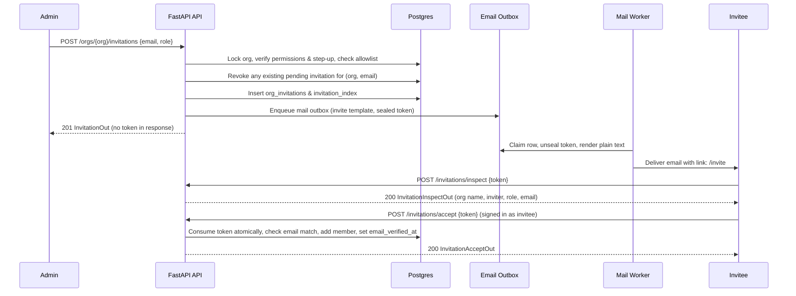

# SPEC: Milestone 11 - Phase 3: Invitations, Email Verification & Registration Modes

## 1. Context & Objectives

Phase 3 transitions CyberLab from direct, unconsented member addition to secure, invitation-based membership. It closes the fundamental security gaps accepted in M1:
- **No Unconsented Membership:** Users must explicitly accept an invitation token sent to their email.
- **Timing & Enumeration Resistance:** Creating an invitation answers `201 Created` with identical timing whether the email is registered or unknown (no user table query).
- **Email Verification:** Email verification tokens are single-use, 24-hour expiring, URL fragment-based (`#t=<token>`), and verify accounts only when signed in as the token's recipient.
- **Registration Modes:** Supports `open` and `invite_only`. In `invite_only` mode, registration without an invitation token immediately returns `403 registration_closed`.
- **Legacy Direct Add Removal:** `POST /orgs/{org}/members` is decommissioned with `410 members_direct_add_removed`.
- **Operator Bootstrap:** `admin_bootstrap.py` creates the first owner invitation for a fresh installation.

---

## 2. Architecture & Data Flow

---

## 3. Detailed Component Specification

### 3.1 Invitation Service & Repository (`app/modules/invitations/`)
1. **`create_invitation(ctx, data, request)`**:
   - `require(Permission.MEMBERS_MANAGE)`.
   - Lock org (`repo.lock_org`).
   - If `role` is `admin` or `owner`: check step-up `StepUpAction.member_elevate`. Only owners can invite owners.
   - Validate `data.email` (refuse special-use domains).
   - Check `OrgSecurityPolicy.invite_domain_allowlist` (if configured and non-empty, raise `422 invite_domain_not_allowed` if domain not in allowlist).
   - Rate limits: `30 / 10m` per actor, `100 / day` per actor, `200 / day` per org.
   - Revoke existing pending invitation for same `(org_id, email)`:
     `UPDATE org_invitations SET revoked_at=now(), revoked_by=ctx.user.id WHERE organization_id=:org_id AND email=:email AND accepted_at IS NULL AND revoked_at IS NULL AND expires_at > now()`.
   - Generate 256-bit token (`secrets.token_urlsafe(32)`), `token_hash = sha256(token)`.
   - Expiry: `now() + interval '7 days'`.
   - Insert `org_invitations` and `invitation_index`.
   - Enqueue outbox: `outbox.enqueue(session, template=MailTemplate.INVITE, to=email, params={...}, secret=token)`.
   - Audit: `invitation.created` (`details={"email": email, "role": role.value}`).
   - Publish outbox after commit (`outbox.publish_after_commit`).
   - Return `InvitationOut` (no token!). **Zero queries on `users` table**.

2. **`list_invitations(ctx, page)`**:
   - `require(Permission.MEMBERS_READ)`.
   - Paginated list with computed status (`pending`, `accepted`, `revoked`, `expired`).

3. **`resend_invitation(ctx, invitation_id, request)`**:
   - `require(Permission.MEMBERS_MANAGE)`.
   - Check `resend_count < 3` per day.
   - Rotate token and hash, update `expires_at = now() + 7 days`, increment `resend_count`.
   - Update `invitation_index`.
   - Enqueue new outbox mail with new token.
   - Audit `invitation.resent`.

4. **`revoke_invitation(ctx, invitation_id, request)`**:
   - `require(Permission.MEMBERS_MANAGE)`.
   - Set `revoked_at = now()`, `revoked_by = ctx.user.id`.
   - Audit `invitation.revoked`.

5. **`inspect_invitation(token)`**:
   - Public route. Rate limit `20 / 10m` per IP.
   - Compute `sha256(token)`, lookup `invitation_index`.
   - If not found -> `404 invitation_invalid`.
   - Open tenant session for `org_id` (vetted in `tenant_session_guard`).
   - Query `org_invitations`. If not pending or expired -> `404 invitation_invalid`.
   - Return `InvitationInspectOut`.

6. **`accept_invitation(user, token, request)`**:
   - Must be signed in as human user (`user.kind == "human"`).
   - Find org via `invitation_index`.
   - Open tenant session for `org_id`.
   - Query `org_invitations`. If invalid/expired -> `404 invitation_invalid`.
   - Check email match: `user.email.lower() == row.email.lower()`. If mismatch -> `409 invitation_email_mismatch` (without consuming!).
   - Atomic consume:
     `UPDATE org_invitations SET accepted_at=now(), accepted_by=:user_id WHERE id=:id AND accepted_at IS NULL AND revoked_at IS NULL AND expires_at > now() RETURNING ...`
   - If user already member: return `InvitationAcceptOut` with current role.
   - Else: insert `OrganizationMember(organization_id=org_id, user_id=user.id, role=row.role)`.
   - Update `users.email_verified_at = coalesce(users.email_verified_at, now())`.
   - Audits: `invitation.accepted`, `member.added` (`{"via": "invitation"}`).
   - Auth event: `invitation_accepted`.

7. **`register_with_invitation(data, password_hash, request)`**:
   - Atomic flow called by `auth.service.register`.
   - Consumes invitation, creates user with `email_verified_at = now()`, creates membership, starts session.

### 3.2 Registration Modes & Auth (`app/modules/auth/service.py`)
- In `register()`:
  - If `settings.registration_mode == "invite_only"` and `not data.invitation_token`:
    Raise `Forbidden("Registration is invite-only", code="registration_closed")`.

### 3.3 Decommission Direct Add & Harden Members (`app/modules/organizations/members.py`)
- Remove `add_member` / route returns `410 members_direct_add_removed`.
- `change_role`: Add step-up `member_elevate` if changing to admin or owner. Refuse if target `user.kind == "service"` (`409 service_account_member`).
- `remove_member`: Add step-up `member_remove`. Refuse if target `user.kind == "service"` (`409 service_account_member`).
- `count_owners`: Filter by `User.kind == "human"`.

### 3.4 Email Verification (`app/modules/identity/email_verify.py` & `router_email.py`)
- `POST /auth/email/verify-request`:
  - Signed in user. Rate limit 3 / hour.
  - Insert `user_action_tokens(purpose="email_verify", email=user.email, expires_at=now() + 24h)`.
  - Enqueue outbox `MailTemplate.EMAIL_VERIFY`.
- `POST /auth/email/verify {token}`:
  - Signed in user.
  - Atomic consume: `UPDATE user_action_tokens SET consumed_at=now() WHERE token_hash=:h AND user_id=:user_id AND purpose='email_verify' AND consumed_at IS NULL AND expires_at > now() RETURNING ...`
  - If no row -> `404 token_invalid`.
  - Update `users.email_verified_at = now()`.
  - Record auth event `email_verified`.

### 3.5 Operator Bootstrap (`app/modules/invitations/admin_bootstrap.py`)
- CLI command: `bootstrap-owner --email <email> --org-name <name> --yes`.
- Creates org with `created_by = SYSTEM_USER_ID`, owner invitation with `invited_by = SYSTEM_USER_ID`.
- Prints registration link `{PUBLIC_BASE_URL}/register#t={token}` once to stdout.

---

## 4. Files to Create / Modify

| File | Status | Description |
|---|:---:|---|
| `app/modules/invitations/service.py` | Overwrite | Full implementation of invitation lifecycle |
| `app/modules/invitations/repository.py` | Create | Database queries for invitations and index |
| `app/modules/invitations/router.py` | Overwrite | Real endpoints replacing 501 stubs |
| `app/modules/invitations/admin_bootstrap.py` | Overwrite | Operator CLI for initial owner bootstrap |
| `app/modules/organizations/members.py` | Modify | 410 direct add, step-up on elevate/remove, human owner counts |
| `app/modules/organizations/router.py` | Modify | Endpoint update for 410 decommission |
| `app/modules/organizations/repository.py` | Modify | Filter human owners in `count_owners` |
| `app/modules/auth/service.py` | Modify | `invite_only` gate and hook `register_with_invitation` |
| `app/modules/identity/email_verify.py` | Create | Logic for request & verify email |
| `app/modules/identity/router_email.py` | Overwrite | Real endpoints replacing 501 stubs |
| `tests/security/idor_cases_invitations.py` | Create | IDOR security test matrix for invitations |
| `tests/integration/test_invitations_create.py` | Create | Test create, limits, allowlist, email outbox |
| `tests/integration/test_invitations_accept.py` | Create | Test inspect, single-use, email mismatch, already member |
| `tests/integration/test_invitations_enumeration.py` | Create | Anti-enumeration timing and query invariants |
| `tests/integration/test_email_verify.py` | Create | Email verify request, scanner protection, verification |
| `tests/integration/test_registration_mode.py` | Create | `invite_only` vs `open` registration modes |
| `tests/integration/test_admin_bootstrap.py` | Create | Bootstrap owner CLI tests |
