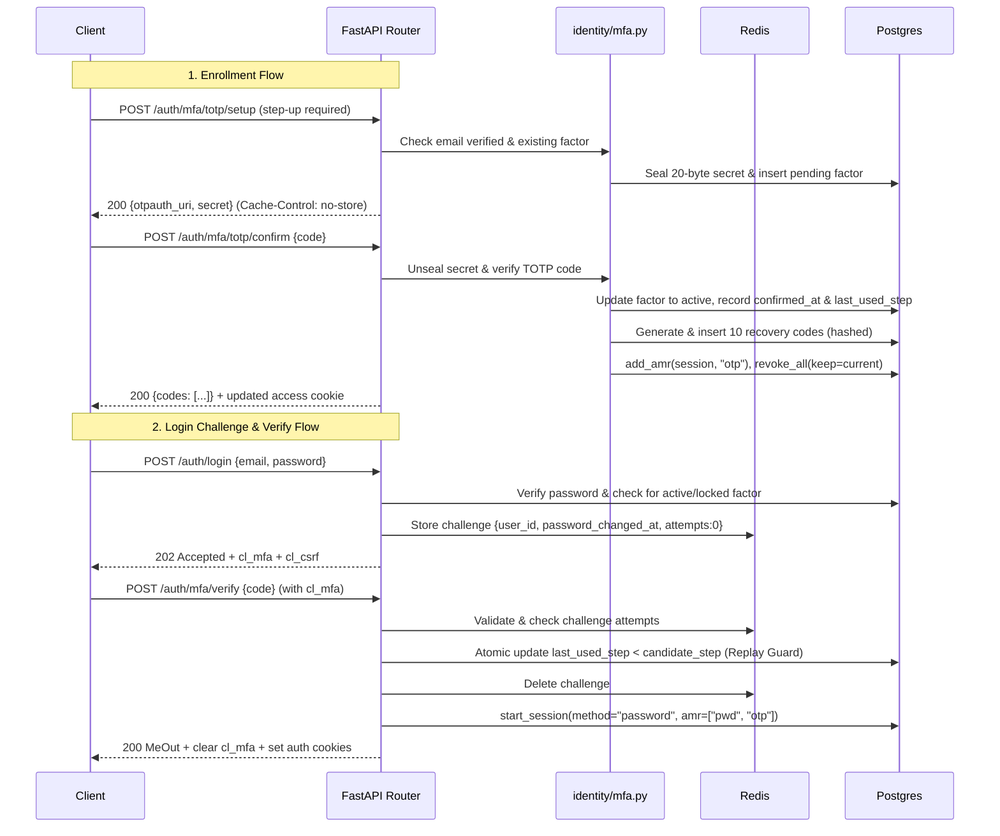

# SPEC: Milestone 11 - Phase 5: TOTP MFA, Recovery Codes, Login Challenge & Step-up

## 1. Context & Objectives

Phase 5 implements two-factor authentication (MFA) and step-up re-authentication:
- **`identity/totp.py`:** RFC 6238 TOTP verifier (SHA-1, 6 digits, 30s period, candidate window ±1). Generates 160-bit (20 bytes) secrets, encodes to Base32, creates RFC-compliant `otpauth://` URIs. Dynamic truncation compares candidate steps using constant-time `hmac.compare_digest`.
- **Recovery Codes:** 10 codes per batch (80-bit entropy, Crockford Base32 `XXXX-XXXX-XXXX-XXXX`). SHA-256 hashed at rest after normalization (strip whitespace/hyphens, uppercase, `I`/`L` -> `1`, `O` -> `0`). Atomic single-use consumption.
- **Enrollment (`identity/mfa.py`, `router_mfa.py`):**
  - Mutating operations (`setup`, `confirm`, `recovery-codes`, `DELETE totp`) reject SSO sessions of password users (`403 local_reauth_required`, RT2).
  - Setup requires verified email (`403 email_verification_required`, RT8) and recent step-up (`StepUpAction.MFA_SETUP`).
  - Secret sealed at rest using `identity/seal.py` (`cyberlab.identity.v1`, provider `totp`, AAD = `user_id`).
  - Confirm verifies code, marks factor `active`, generates 10 recovery codes, adds `otp` to AMR, re-issues access cookie, and revokes other sessions (`RevokedReason.MFA_CHANGE`).
  - Status `GET /auth/mfa` reports TOTP state, remaining recovery codes, email verification, and org requirements.
  - Disable `DELETE /auth/mfa/totp` requires step-up with TOTP or recovery code (not password alone), checks `require_mfa` across caller's orgs (`409 mfa_required_by_org`, RT13), revokes other sessions.
- **Login Challenge (`identity/challenge.py`, `auth/service.py`):**
  - When user has an `active` or `locked` factor, successful password login yields `202 Accepted` (`MfaChallengeOut`) with HttpOnly `cl_mfa` cookie and CSRF token.
  - Redis challenge `{user_id, created, attempts:0, password_changed_at}` with 5-minute TTL.
- **MFA Verify (`POST /auth/mfa/verify`):**
  - Consumes `cl_mfa` cookie. Re-verifies user active status and password freshness (RT26).
  - Throttles: max 5 attempts per challenge, max 10 failures / 15m per user (`auth:mfa:fail:{user_id}`).
  - TOTP path: verification + atomic replay guard `UPDATE user_mfa_factors SET last_used_step=:s, consecutive_failures=0 WHERE id=:f AND status='active' AND last_used_step < :s`.
  - Consecutive failures increment counter; at 100 failures, factor is marked `locked` (NIST 800-63B §3.2.2) and sends notice email. Locked factor only accepts recovery codes.
  - Recovery code path: atomic consumption against current batch.
  - On success: deletes challenge, clears `cl_mfa`, starts session (`amr` includes `pwd` and `otp`/`recovery`), sets auth cookies, returns `MeOut`.
- **Step-up (`identity/stepup_api.py`, `POST /auth/step-up`):**
  - For session principal. SSO sessions return `409 step_up_via_sso`.
  - Users with factor must submit TOTP `code` or `recovery_code`. Users without factor must submit `password`.
  - On success: calls `sessions_store.mark_step_up`, re-issues access cookie, records `step_up_success`.
- **Operator Reset (`identity/admin_mfa.py`):**
  - Command: `pnpm identity:admin reset-mfa --email <e> [--yes]`.
  - Disables factor, deactivates recovery codes, revokes all sessions (`RevokedReason.OPERATOR`), records auth event `mfa_reset_by_operator`, sends notice email.

---

## 2. Architecture & Data Flow

---

## 3. Component Details & Specifications

### 3.1 TOTP Engine (`identity/totp.py`)
- `new_secret() -> bytes`: returns 20 cryptographically secure random bytes (`secrets.token_bytes(20)`).
- `b32(secret: bytes) -> str`: RFC 3548 Base32 encoding without padding or standard uppercase (`base64.b32encode(secret).decode("ascii")`).
- `otpauth_uri(secret: bytes, account: str, issuer: str = "CyberLab") -> str`:
  `otpauth://totp/{quote(issuer)}:{quote(account)}?secret={b32(secret)}&issuer={quote(issuer)}&algorithm=SHA1&digits=6&period=30`.
- `code_at(secret: bytes, step: int, digits: int = 6) -> str`:
  8-byte big-endian packed counter, HMAC-SHA1 dynamic truncation, formatted as `digits`-character zero-padded string.
- `verify(secret: bytes, code: str, now: float | datetime, window: int = 1) -> int | None`:
  Strict validation: 6 ASCII digits (`^\d{6}$`). Computes all candidates in `[step - window, step + window]` in constant time (`hmac.compare_digest`), returning the matched step integer or `None`.

### 3.2 Recovery Code Utilities
- `generate_recovery_codes() -> tuple[list[str], list[str]]`:
  Generates 10 codes. Each code has 80 bits of random data (16 Crockford characters), formatted as `XXXX-XXXX-XXXX-XXXX`.
  Returns `(display_codes, hashes)` where `hash = sha256(normalize(code)).hexdigest()`.
- `normalize_recovery_code(code: str) -> str`:
  Uppercase, remove whitespace and hyphens, replace `I`/`L` with `1`, replace `O` with `0`.

### 3.3 Enrollment & Management (`identity/mfa.py` & `router_mfa.py`)
- **`setup_totp(user, session)`:**
  1. Check SSO scope rule: `user.sso_org_id is not None and user.has_password` -> `403 local_reauth_required`.
  2. Check `user.email_verified_at` -> `403 email_verification_required`.
  3. Step-up check: `require_recent_auth(session, user, action=StepUpAction.MFA_SETUP)`.
  4. Query existing factor:
     - `active` -> `409 Conflict(code="mfa_already_active")`.
     - `locked` -> Allowed only if step-up was via recovery code, then replaced.
     - `pending` -> Replace existing pending row.
  5. Generate 20-byte secret, seal with `seal_totp_secret`, persist in `user_mfa_factors`.
  6. Return `TotpSetupOut(otpauth_uri=..., secret=...)` with header `Cache-Control: no-store`.

- **`confirm_totp(body, user, session, response)`:**
  1. Check SSO scope rule (RT2).
  2. Load user's pending factor (created within last 15 minutes).
  3. Unseal secret with `open_identity_secret`, verify `body.code`. If invalid -> `400 invalid_totp_code`.
  4. Update factor: `status="active"`, `confirmed_at=now()`, `last_used_step=step`, `consecutive_failures=0`.
  5. Generate batch of 10 recovery codes, insert into `user_recovery_codes`, set `factor.recovery_batch_id = batch_id`.
  6. `new_amr = await sessions_store.add_amr(session, user.session_id, "otp")`.
  7. Re-issue access token: `reissue_access(user.id, user.session_id, amr=new_amr, sso_org_id=user.sso_org_id)`, call `set_access_cookie(response, access_token)`.
  8. Revoke all other sessions: `await sessions_store.revoke_all(user.id, reason=RevokedReason.MFA_CHANGE, keep=user.session_id)`.
  9. Record `mfa_enabled` auth event, enqueue `mfa_enabled` email.
  10. Return `RecoveryCodesOut(codes=display_codes)`.

- **`get_mfa_status(user, session)`:**
  1. Query `user_mfa_factors` for user.
  2. Count remaining recovery codes in `factor.recovery_batch_id`.
  3. Query `org_security_policies` where user is member and `require_mfa=True`.
  4. Return `MfaStatusOut`.

- **`regenerate_recovery_codes(user, session)`:**
  1. Check SSO scope rule (RT2).
  2. Require step-up: `require_recent_auth(session, user, action=StepUpAction.RECOVERY_CODES_REGENERATE)`.
  3. Active factor required.
  4. Generate new batch of 10 recovery codes, update `factor.recovery_batch_id`.
  5. Record `recovery_codes_regenerated` auth event. Return `RecoveryCodesOut` with `Cache-Control: no-store`.

- **`disable_totp(body, user, session)`:**
  1. Check SSO scope rule (RT2).
  2. Step-up check: `require_recent_auth(session, user, action=StepUpAction.MFA_DISABLE)` with TOTP or recovery code (verify body code/recovery code).
  3. Check org requirement: if any of user's orgs has `require_mfa=True`, raise `409 mfa_required_by_org`.
  4. Update factor: `status="disabled"`, `disabled_at=now()`, `recovery_batch_id=None`.
  5. Revoke other sessions (`RevokedReason.MFA_CHANGE`).
  6. Record `mfa_disabled` auth event, enqueue `mfa_disabled` email.

### 3.4 Challenge & Verification (`identity/challenge.py` & `auth/service.py`)
- **`create_mfa_challenge(user_id, password_changed_at, methods)`:**
  Store in Redis key `auth:mfa:challenge:{cid}` (TTL 300s): `{"user_id": str(user_id), "password_changed_at": ts, "attempts": 0}`.
- **`verify_mfa(body, request, response)`:**
  1. Read `cl_mfa` cookie -> `cid`. If missing or expired in Redis -> `401 mfa_challenge_invalid`.
  2. Rate limit failure counter per user: `auth:mfa:fail:{user_id}` (10 failures / 15m).
  3. Increment challenge `attempts`. If `attempts > 5`: delete challenge, raise `401 mfa_challenge_invalid`.
  4. Verify user is active and `password_changed_at` matches (RT26).
  5. If TOTP code:
     - Unseal secret and verify code.
     - Race-free atomic replay update: `UPDATE user_mfa_factors SET last_used_step=:s, consecutive_failures=0 WHERE id=:f AND status='active' AND last_used_step < :s RETURNING id`.
     - If no row updated: increment `consecutive_failures`, record `mfa_failure`, raise `401 mfa_code_invalid`.
  6. If Recovery code:
     - Normalize and hash.
     - Atomic update: `UPDATE user_recovery_codes SET used_at=now() WHERE code_hash=:h AND user_id=:u AND batch_id=:b AND used_at IS NULL RETURNING id`.
     - If no row updated: increment `consecutive_failures`, record `mfa_failure`, raise `401 invalid_recovery_code`.
     - On success: send `recovery_code_used` email with remaining count.
  7. If consecutive failures reach 100: update factor `status="locked"`, record `mfa_locked` auth event, send `mfa_locked` email.
  8. Delete Redis challenge, clear `cl_mfa` cookie, issue session (`amr=["pwd", "otp"|"recovery"]`), set auth cookies, return `MeOut`.

### 3.5 Step-up API (`identity/stepup_api.py`)
- `POST /auth/step-up`:
  1. Principal must be session user. If `user.sso_org_id is not None`: raise `409 step_up_via_sso`.
  2. If user has active/locked factor:
     - Requires `code` or `recovery_code`. Password disallowed.
     - Replay guard and throttles apply.
  3. If user has no factor:
     - Requires `password`. Verified via `verify_password_async`.
  4. On success: `sessions_store.mark_step_up(session, user.session_id)`, reissue access token, record `step_up_success`.
  5. On failure: record `step_up_failure`, raise `401 step_up_failed`.

### 3.6 Operator Reset (`identity/admin_mfa.py`)
- CLI entrypoint: `python -m app.modules.identity.admin_mfa --email <e> [--yes]`
- Finds user by email; requires `--yes` for non-interactive execution.
- Disables factor, deactivates recovery codes, revokes all user sessions (`RevokedReason.OPERATOR`), logs `mfa_reset_by_operator` event, enqueues notice email.

---

## 4. Verification & Testing Plan
- `tests/unit/test_totp.py`:
  - RFC 6238 Appendix B test vectors (SHA-1, 8-digit truncation check, 6-digit default).
  - RFC 4226 Appendix D vectors.
  - Window ±1 bounds, reject non-digit strings, length != 6.
  - Cross-check property tests against `pyotp`.
- `tests/integration/test_mfa_enroll.py`:
  - Setup requires verified email (RT8), requires step-up.
  - Setup refused for SSO session of password user (RT2).
  - Setup URI and secret format, Cache-Control no-store.
  - Confirm with valid code -> active factor, 10 recovery codes returned, access token updated with `otp` amr, other sessions revoked.
- `tests/integration/test_mfa_login.py`:
  - Password login with active factor returns 202 MfaChallengeOut + cl_mfa.
  - Verify with valid TOTP code creates session with amr `["pwd", "otp"]`.
  - Challenge invalidation after password reset (RT26).
- `tests/integration/test_mfa_replay.py`:
  - Verify concurrent replay test (two simultaneous requests with same TOTP code -> exactly one succeeds).
  - Next request with same code rejected.
- `tests/integration/test_mfa_throttle.py`:
  - 5-attempt limit per challenge.
  - 10 failures / 15m per user throttle.
  - 100 consecutive failures locks factor -> mfa_locked event & email.
- `tests/integration/test_mfa_recovery.py`:
  - Recovery codes accepted in lowercase and with hyphens.
  - Single-use consumption and remaining count updates.
  - Regenerating recovery codes invalidates prior batch.
- `tests/integration/test_mfa_disable.py`:
  - Refused if org requires MFA (`409 mfa_required_by_org`).
  - Requires step-up with factor (code or recovery code).
  - Disables factor, kills recovery codes, revokes other sessions.
- `tests/integration/test_step_up.py`:
  - Step-up with code, recovery code, and password.
  - Session gets fresh `step_up_at`.
  - API keys and SSO sessions rejected appropriately.
- `tests/integration/test_identity_admin_mfa.py`:
  - Operator reset via admin script, session revocation, email dispatch.
