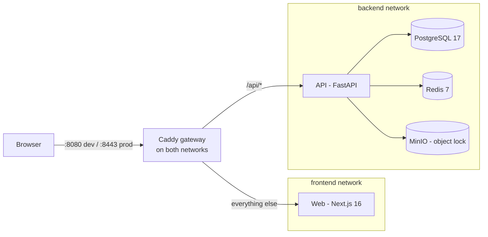
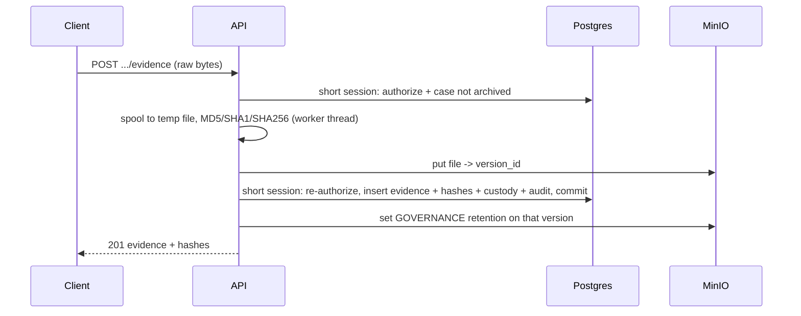
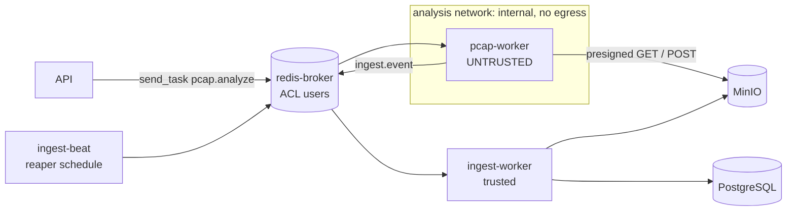
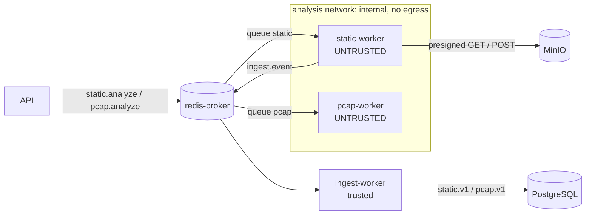
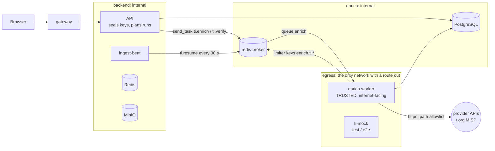

# Architecture

## Components



- **One origin.** The gateway serves both the app and `/api`, so session cookies are first-party and `SameSite=Strict`.
- **Networks.** `web` cannot reach `api` directly; only the gateway (and data services) share the api's network. uvicorn trusts `X-Forwarded-For` from its peers, which is safe only because of this isolation. Since M4 `backend` is `internal` (no egress); only the enrich-worker has a route out ([Networks (M4)](#networks-m4)).
- **Gateway duties.** 1 MiB body cap everywhere except the evidence upload route; early 413 on oversize `Content-Length` (JSON error envelope); security headers; TLS + HSTS in prod.
- **CSP (M3).** The upstreams own it. The web app sets a per-request nonce policy on HTML (`apps/web/proxy.ts`, `lib/csp.ts`): `script-src 'self' 'nonce-…' 'strict-dynamic'`, no `'unsafe-inline'` for scripts; styles keep `'unsafe-inline'` (Radix/sonner inline styles). The root layout awaits `connection()`, so every page renders dynamically with a fresh nonce. API downloads send `CSP: sandbox`. Caddy's `csp_fallback` (`infra/caddy/common.caddy`) adds `default-src 'none'` only to responses that carry no CSP.

## API: modular monolith

```
apps/api/app/
  core/        config, db engine, tenancy (tenant_session), rbac (require/org_session),
               security (argon2, JWT), csrf, rate_limit, errors, storage, hashing, upload_slots
  modules/
    auth/            register, login, sessions (refresh rotation, logout), events (auth_events)
    users/           identity (models + repository only; `/auth/me` serves the profile)
    organizations/   orgs (service.py), memberships (members.py), storage quota (storage.py)
    investigations/  cases, case numbers, status lifecycle
    evidence/        uploads.py, locking.py, transfer.py (download/verify), service.py (custody, archive)
    audit/           audit writer + read API
    analysis/        analysis jobs: request (manual / auto on upload), dispatch per analyzer, lifecycle
    pcap_analysis/   pcap.v1 validation, ingest into tenant tables, read API (also findings / IOCs of every analyzer)
    static_analysis/ static.v1 validation, ingest, read API, JSON report
    threat_intel/    (M4) catalog, normalization, sealing (seal.py: API; unseal.py: enrich worker only),
                     runs, cache, limiter, SSRF checks, provider adapters + HTTP client (enrich worker only),
                     integrations / runs / results API
    attack/          (M4) offline ATT&CK index and label route
  workers/     celery app, ingest + reaper tasks (trusted side of the analysis pipeline);
               enrich_app / enrich_tasks / enrich (M4: the internet-facing enrich worker)
  scripts/     dump_openapi (contracts), reconcile_orphans (report-only)
```

Modules follow `models / schemas / repository / service / router`, keeping only the layers they need.

### Request lifecycle (org-scoped route)

1. Caddy enforces body limits and forwards with `X-Forwarded-For`.
2. `CSRFMiddleware` checks the double-submit token on mutating requests.
3. `current_user` validates the access JWT (signature, `typ`, expiry), the jti / refresh-family denylist in Redis, and that the user is active.
4. `require(permission)` opens **one** `tenant_session(org_id, user_id)` — a transaction with `app.org_id` / `app.user_id` set via `set_config(..., true)` — and checks membership **inside** it (404 for non-members, 403 for missing permission).
5. The handler works in that session; mutations write the audit row in the same transaction and commit before the response is built. The dependency uses `scope="function"`, so the session closes before the response is sent.

Postgres row-level security (forced on every tenant table) is the second line of defence: even a missing `WHERE organization_id = …` cannot leak another tenant's rows.

### Evidence flow



- No DB connection is held while bytes move; every write re-authorizes.
- Failure before commit deletes exactly the stored version; after commit nothing changes the response (retention/lock failure is logged and audited).
- Download and verify always read the **stored version id**, so overwriting the key in MinIO cannot change what is served or verified.
- Per-user slots (Redis ZSET leases) bound concurrent uploads/verifies; storage and hashing run on a dedicated thread limiter.
- **Storage quota (M3).** The declared `Content-Length` is checked against the org quota before the body is read. The actual size is checked again in the insert transaction, under a `FOR NO KEY UPDATE` lock on the org row, so concurrent uploads of one org cannot overshoot it (`413 storage_quota_exceeded`). Usage counts active and archived evidence.

## Web

Next.js 16 App Router, client-rendered signed-in area:

- `AuthGate` (client) calls `/auth/me`; the access cookie is scoped to `/api`, so the Next server never sees it.
- Typed API client (`openapi-fetch` + generated `@cyberlab/contracts`) adds the CSRF header and does single-flight token refresh (ok / expired / unavailable).
- Evidence upload uses XHR (progress) and a sequential client queue.

## Contracts

`pnpm gen:contracts` dumps the OpenAPI schema offline from the API image and regenerates `packages/contracts/src/schema.d.ts`. `pnpm verify` fails on drift.

## Analysis workers (M2)

Analysis runs outside the API process. Details are in [PCAP_ANALYSIS.md](PCAP_ANALYSIS.md).



- **Untrusted side** (`apps/workers/pcap`):
  - The worker holds a broker URL only.
  - Its tools run as uid 10003 with seccomp, rlimits and kill-by-uid cleanup.
  - Output is a versioned `pcap.v1` stream (`packages/py-jobs`).
- **Trusted side** (`apps/api/app/workers`, api image):
  - It authenticates every message (per-job token, org from the job index).
  - It validates the whole result before opening one transaction.
  - It applies only state-valid transitions.
- **Shared contracts**: the `cyberlab_jobs` package is a path dependency of both the API and the worker. It holds the job message, ingest message, limits, result line models and capture magic detection.
- **Separate broker**: the analyzer can never reach the app Redis (token denylist, rate limits).
- **Reaper**: `ingest-beat` schedules it every 60 s. It fails jobs past their queue or run deadline.

## Static analysis (M3)

A second untrusted worker on the same pipeline. Details are in [MALWARE_ANALYSIS.md](MALWARE_ANALYSIS.md).



- **Auto-run on upload** (from the first bytes, after the upload commits):
  - pcap / pcapng → pcap analyzer;
  - PE (`MZ` + in-bounds `PE\0\0`) or ELF (not a core dump) → static, profile `full`;
  - any other non-empty file ≤ `STATIC_MAX_BYTES` (64 MiB) → static, profile `av` (ClamAV + YARA).
- **Per analyzer:** each analyzer has its own Celery task, queue and broker ACL user (`static`, confined like `pcap`). The active-job caps (per org and global) count each analyzer separately, so a full pcap queue never blocks static runs.
- **Engine order:** ClamAV → YARA → facts → PE/ELF → strings → capa → FLOSS. The emulators (capa, FLOSS) run last, so a compromised emulator cannot hide an earlier signature match. The `av` profile stops after facts.
- **Untrusted side** (`apps/workers/static`): built on the shared worker kit (`packages/py-worker-kit`: sandbox, transfer, result writer, bounded readers), the same one the pcap worker uses. Every engine, including the Python probes (pefile, pyelftools, yara-python), runs as uid 10003 under seccomp and `RLIMIT_AS`; root never parses sample bytes.
- **Trusted side:** the ingest worker dispatches by schema version. A `static.v1` stream is validated as a whole (header, caps, trailer hash, and sample hashes that must match the evidence record), then written in one transaction into the `malware_*` tables plus the shared `analysis_findings` and `iocs`.
- **Web:** the Malware Lab (`/o/{org}/malware`, `/malware/{job}`, `/malware/{job}/report`) lists static jobs and shows sample facts, structure, strings, signatures, capabilities, findings and IOCs. It downloads the JSON report and renders a printable one.

## Threat intelligence (M4)

IOC lookups at external providers. Details: [THREAT_INTEL.md](THREAT_INTEL.md).



- **The API never calls a provider** and never resolves an external name. It normalizes values, plans the run (`ti_enrichment_runs`, `ti_run_index`, `ti_run_items`) in one transaction and publishes `ti.enrich` after the commit. It holds only the sealing **public** key.
- **enrich-worker** (api image, uid 10001, read-only rootfs, `cap_drop: ALL`, no-new-privileges): `celery -A app.workers.enrich_app worker -Q enrich --pool solo --without-gossip --without-mingle --without-heartbeat`, remote control and events off. It runs one time slice (≤ 20 s) per message, behind a DB lease, and re-queues unfinished runs at the tail.
- **Least-privilege env** (`x-enrich-env`, never `*api-env`): `PROCESS_ROLE=enrich`, the app DB role, its own broker user and the `TI_*` settings. `Settings` refuses a JWT secret, MinIO credentials or an app Redis URL in that role. The sealing private keys come from the compose secret `ti_seal_private`.
- **Own Celery app and broker user.** `enrich` may touch only `enrich*` / `test.enrich*` keys (queue, unacked bookkeeping, limiter keys), never `trusted.*` or `ingest*`. The `api` and `ingest` users publish to it; the analyzer users cannot.
- **Import guard.** Adapters, the registry, the HTTP client and `unseal` may only be imported from `app/workers/enrich*.py` (AST test).
- **Lifecycle shared with ingest.** `threat_intel/lifecycle.py` finalizes runs for the worker and for the ingest reaper's fallback (runs 10 min past their deadline with no live lease).

### Networks (M4)

| Network | Internal | Members | Why |
|---|---|---|---|
| `frontend` | no | web, gateway, e2e | browser-facing |
| `backend` | **yes** since M4 | postgres, redis, redis-broker, minio, minio-init, migrate, api, ingest-worker, ingest-beat, gateway, api-test | no service here has a route out; the API cannot reach the internet even if compromised |
| `enrich` | yes | postgres, redis-broker, enrich-worker(-test) | the enrich worker's way to its data, and nothing else (no app Redis, MinIO, API or gateway) |
| `egress` | no | enrich-worker(-test), ti-mock | the only route out |
| `analysis` | yes | pcap-worker(-test), static-worker(-test), redis-broker, minio | unchanged |

Runtime egress per service and the operational consequences (no MinIO console port, `UV_NO_SYNC`): [DEPLOYMENT.md](DEPLOYMENT.md#networks-and-egress-m4).

- **Web:** org settings → Integrations (`/o/{org}/settings/integrations`: provider cards, write-only keys, terms acknowledgement, limits, excluded suffixes), Threat Intel (`/o/{org}/intel`: manual lookup with a normalization report, recent runs) and the IOC history (`/o/{org}/intel/ioc`). IOC tabs of pcap and static jobs get an "Enrich IOCs" button and attributed chips (`GET …/iocs?include=enrichment`); ATT&CK ids on capabilities and findings show names and tactics with the MITRE notice.
