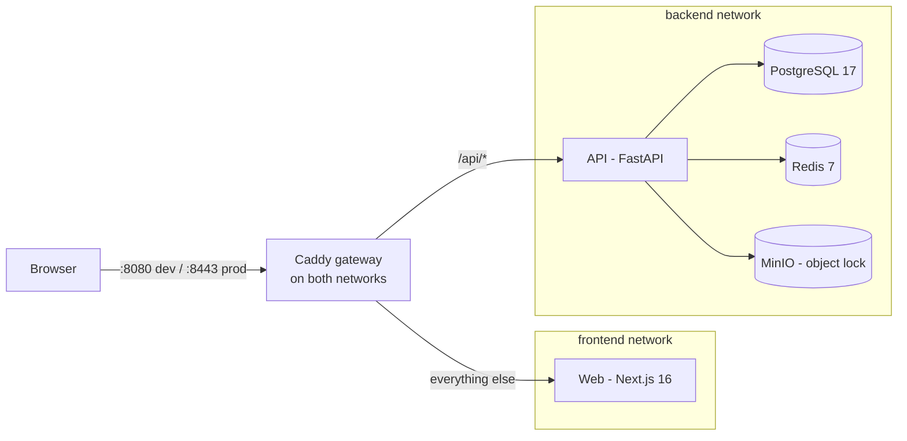
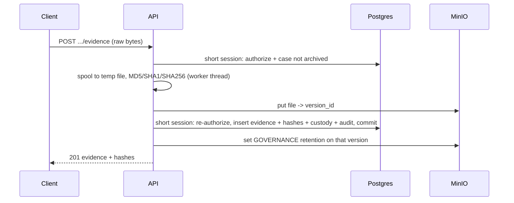
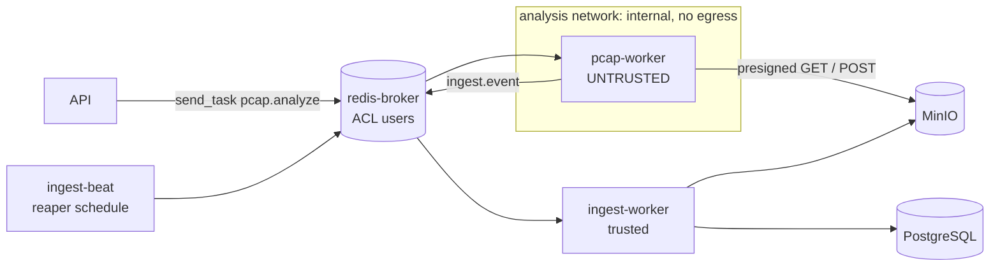
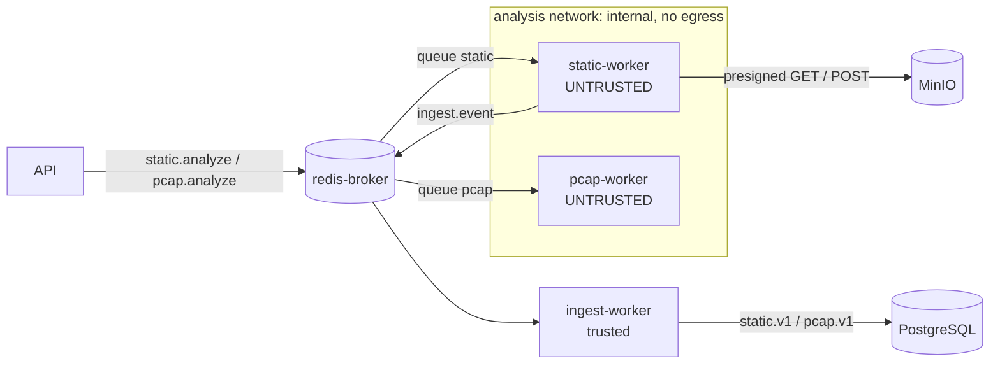
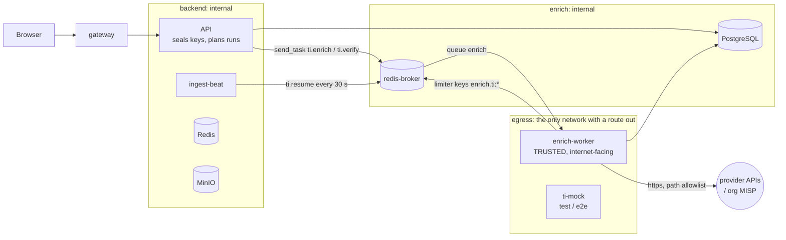
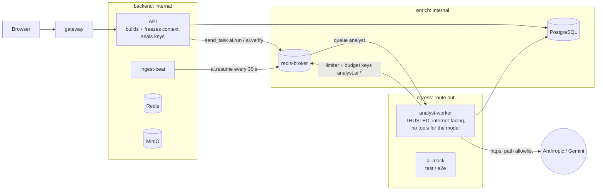
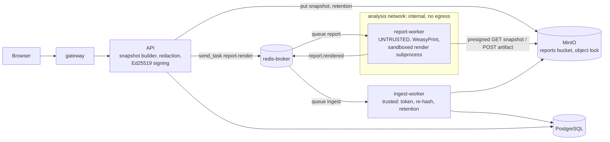
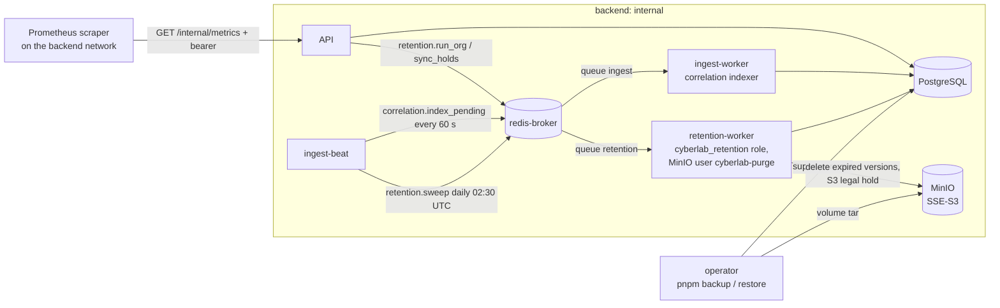
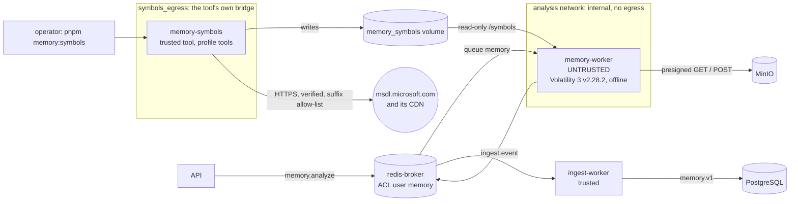

# Architecture

## Components



The analysis, threat-intel, AI, report and retention workers attach to this core; each has its own section below. Platform operations (backup and restore, retention, correlation, search, metrics) are described in [Platform operations (M7)](#platform-operations-m7). Memory forensics (M8, in progress) adds a third analyzer and an operator symbol tool: [Memory forensics (M8)](#memory-forensics-m8).

- **One origin.** The gateway serves both the app and `/api`, so session cookies are first-party and `SameSite=Strict`.
- **Networks.** `web` cannot reach `api` directly; only the gateway (and data services) share the api's network. uvicorn trusts `X-Forwarded-For` from its peers, which is safe only because of this isolation. Since M4 `backend` is `internal` (no egress); only the enrich-worker and (M5) the analyst-worker have a route out ([Networks](#networks-m4-m5-m6)).
- **Gateway duties.** 1 MiB body cap everywhere except the evidence upload route; early 413 on oversize `Content-Length` (JSON error envelope); security headers; TLS + HSTS in prod.
- **CSP (M3).** The upstreams own it. The web app sets a per-request nonce policy on HTML (`apps/web/proxy.ts`, `lib/csp.ts`): `script-src 'self' 'nonce-…' 'strict-dynamic'`, no `'unsafe-inline'` for scripts; styles keep `'unsafe-inline'` (Radix/sonner inline styles). The root layout awaits `connection()`, so every page renders dynamically with a fresh nonce. API downloads send `CSP: sandbox`. Caddy's `csp_fallback` (`infra/caddy/common.caddy`) adds `default-src 'none'` only to responses that carry no CSP.

## API: modular monolith

```
apps/api/app/
  core/        config, db engine, tenancy (tenant_session), rbac (require/org_session),
               security (argon2, JWT), csrf, rate_limit, errors, storage, hashing, upload_slots
  modules/
    auth/            register, login, sessions (refresh rotation, logout), events (auth_events)
    users/           identity (models + repository only; `/auth/me` serves the profile)
    organizations/   orgs (service.py), memberships (members.py), storage quota (storage.py)
    investigations/  cases, case numbers, status lifecycle (M6: reasons + history, TLP), merged
                     timeline, policy.py (the TLP / share-policy resolver, M6)
    evidence/        uploads.py, locking.py, transfer.py (download/verify), service.py (custody, archive),
                     share_policy.py (M6: per-evidence "do not send to AI / TI" flags)
    audit/           audit writer + read API
    analysis/        analysis jobs: request (manual / auto on upload), dispatch per analyzer, lifecycle
    pcap_analysis/   pcap.v1 validation, ingest into tenant tables, read API (also findings / IOCs of every analyzer)
    static_analysis/ static.v1 validation, ingest, read API, JSON report
    memory_analysis/ (M8, in progress) memory.v1 dispatch, ingest, read API, sensitivity (TLP:RED default,
                     release); phase 1: models, schemas, 501 stubs, build_memory_message
    threat_intel/    (M4) catalog, normalization, sealing (seal.py: API; unseal.py: enrich worker only),
                     runs, cache, limiter, SSRF checks, provider adapters + HTTP client (enrich worker only),
                     integrations / runs / results API
    attack/          (M4) offline ATT&CK index and label route
    ai/              (M5) contracts, catalog, output schema, labels, text, sealing (seal.py: API;
                     unseal.py: analyst worker only), context/ (builder, selectors, field
                     allowlists, pseudonymization, reduce), prompt + prompts/, verify,
                     postprocess, budget, ratelimit, lifecycle, providers/ + http (analyst
                     worker only), runs / providers / settings API
    notes/           (M6) analyst notes with append-only versions, typed refs re-checked in scope
    ioc_collections/ (M6) case IOC collections, normalization (M4 normalizer), case-wide IOCs,
                     CSV / JSON / STIX 2.1 exports
    case_attack/     (M6) analyst ATT&CK mappings, suggestions (capa, findings, verified AI), matrix
    case_timeline/   (M6) timeline export (CSV / JSON, formula-safe, TLP-headed)
    reports/         (M6) drafts, snapshot builder + sections, citations, cited-by, redaction,
                     signing wrapper (the only importer of the private-key loader), storage,
                     render dispatch, render ingest, public signing keys
    retention/       (M7) per-org policy (delay, floors), legal holds, the shared candidate
                     selector (select.py: API preview and worker), runs API, purge-user S3 helpers
    correlation/     (M7) deterministic cross-job / cross-case keys: normalize (M6 normalize_item),
                     indexer (beat task on the ingest worker), "also seen in", lookup, related cases
    search/          (M7) org-wide search (POST, Postgres FTS `simple` + trigram), never logged
    ops/             (M7) job outcome error classes, platform metrics (/internal/metrics,
                     Prometheus text), the org operations metrics route
  workers/     celery app, ingest + reaper tasks (trusted side of the analysis pipeline; M6:
               `report.rendered` ingest and the render reaper; M7: `correlation.index_pending`);
               enrich_app / enrich_tasks / enrich (M4: the internet-facing enrich worker);
               analyst_app / analyst_tasks / analyst (M5: the internet-facing AI analyst worker);
               retention_app / retention_tasks / retention (M7: sweep, per-org run, S3 hold sync)
  scripts/     dump_openapi (contracts), reconcile_orphans (report-only: evidence and report objects
               without a row, pinned versions missing without a tombstone), restore_verify (M7: the
               three restore checks), drill_seed (M7: restore-drill data), backfill_correlation (M7)
```

Modules follow `models / schemas / repository / service / router`, keeping only the layers they need.

### Request lifecycle (org-scoped route)

1. Caddy enforces body limits and forwards with `X-Forwarded-For`.
2. `CSRFMiddleware` checks the double-submit token on mutating requests.
3. `current_user` validates the access JWT (signature, `typ`, expiry), the jti / refresh-family denylist in Redis, and that the user is active. Since M7 it also counts the request against the global per-user limit (`RATE_LIMIT_USER_PER_MIN`, 600 / min, Redis fixed window, after the token check and before the DB lookup; `429` + `Retry-After`; a Redis failure fails closed; `GET /auth/me` is exempt).
4. `require(permission)` opens **one** `tenant_session(org_id, user_id)` — a transaction with `app.org_id` / `app.user_id` set via `set_config(..., true)` — and checks membership **inside** it (404 for non-members, 403 for missing permission).
5. The handler works in that session; mutations write the audit row in the same transaction and commit before the response is built. The dependency uses `scope="function"`, so the session closes before the response is sent.

Postgres row-level security (forced on every tenant table) is the second line of defence: even a missing `WHERE organization_id = …` cannot leak another tenant's rows.

### Evidence flow



- No DB connection is held while bytes move; every write re-authorizes.
- Failure before commit deletes exactly the stored version; after commit nothing changes the response (retention/lock failure is logged and audited).
- Download and verify always read the **stored version id**, so overwriting the key in MinIO cannot change what is served or verified.
- Per-user slots (Redis ZSET leases) bound concurrent uploads/verifies; storage and hashing run on a dedicated thread limiter.
- **Storage quota (M3).** The declared `Content-Length` is checked against the org quota before the body is read. The actual size is checked again in the insert transaction, under a `FOR NO KEY UPDATE` lock on the org row, so concurrent uploads of one org cannot overshoot it (`413 storage_quota_exceeded`). Usage counts active and archived evidence.

## Web

Next.js 16 App Router, client-rendered signed-in area:

- `AuthGate` (client) calls `/auth/me`; the access cookie is scoped to `/api`, so the Next server never sees it.
- Typed API client (`openapi-fetch` + generated `@cyberlab/contracts`) adds the CSRF header and does single-flight token refresh (ok / expired / unavailable).
- Evidence upload uses XHR (progress) and a sequential client queue.

## Contracts

`pnpm gen:contracts` dumps the OpenAPI schema offline from the API image and regenerates `packages/contracts/src/schema.d.ts`. `pnpm verify` fails on drift.

## Analysis workers (M2)

Analysis runs outside the API process. Details are in [PCAP_ANALYSIS.md](PCAP_ANALYSIS.md).



- **Untrusted side** (`apps/workers/pcap`):
  - The worker holds a broker URL only.
  - Its tools run as uid 10003 with seccomp, rlimits and kill-by-uid cleanup.
  - Output is a versioned `pcap.v1` stream (`packages/py-jobs`).
- **Trusted side** (`apps/api/app/workers`, api image):
  - It authenticates every message (per-job token, org from the job index).
  - It validates the whole result before opening one transaction.
  - It applies only state-valid transitions.
- **Shared contracts**: the `cyberlab_jobs` package is a path dependency of both the API and the worker. It holds the job message, ingest message, limits, result line models and capture magic detection.
- **Separate broker**: the analyzer can never reach the app Redis (token denylist, rate limits).
- **Reaper**: `ingest-beat` schedules it every 60 s. It fails jobs past their queue or run deadline.

## Static analysis (M3)

A second untrusted worker on the same pipeline. Details are in [MALWARE_ANALYSIS.md](MALWARE_ANALYSIS.md).



- **Auto-run on upload** (from the first bytes, after the upload commits):
  - pcap / pcapng → pcap analyzer;
  - PE (`MZ` + in-bounds `PE\0\0`) or ELF (not a core dump) → static, profile `full`;
  - any other non-empty file ≤ `STATIC_MAX_BYTES` (64 MiB) → static, profile `av` (ClamAV + YARA).
- **Per analyzer:** each analyzer has its own Celery task, queue and broker ACL user (`static`, confined like `pcap`). The active-job caps (per org and global) count each analyzer separately, so a full pcap queue never blocks static runs.
- **Engine order:** ClamAV → YARA → facts → PE/ELF → strings → capa → FLOSS. The emulators (capa, FLOSS) run last, so a compromised emulator cannot hide an earlier signature match. The `av` profile stops after facts.
- **Untrusted side** (`apps/workers/static`): built on the shared worker kit (`packages/py-worker-kit`: sandbox, transfer, result writer, bounded readers), the same one the pcap worker uses. Every engine, including the Python probes (pefile, pyelftools, yara-python), runs as uid 10003 under seccomp and `RLIMIT_AS`; root never parses sample bytes.
- **Trusted side:** the ingest worker dispatches by schema version. A `static.v1` stream is validated as a whole (header, caps, trailer hash, and sample hashes that must match the evidence record), then written in one transaction into the `malware_*` tables plus the shared `analysis_findings` and `iocs`.
- **Web:** the Malware Lab (`/o/{org}/malware`, `/malware/{job}`, `/malware/{job}/report`) lists static jobs and shows sample facts, structure, strings, signatures, capabilities, findings and IOCs. It downloads the JSON report and renders a printable one.

## Threat intelligence (M4)

IOC lookups at external providers. Details: [THREAT_INTEL.md](THREAT_INTEL.md).



- **The API never calls a provider** and never resolves an external name. It normalizes values, plans the run (`ti_enrichment_runs`, `ti_run_index`, `ti_run_items`) in one transaction and publishes `ti.enrich` after the commit. It holds only the sealing **public** key.
- **enrich-worker** (api image, uid 10001, read-only rootfs, `cap_drop: ALL`, no-new-privileges): `celery -A app.workers.enrich_app worker -Q enrich --pool solo --without-gossip --without-mingle --without-heartbeat`, remote control and events off. It runs one time slice (≤ 20 s) per message, behind a DB lease, and re-queues unfinished runs at the tail.
- **Least-privilege env** (`x-enrich-env`, never `*api-env`): `PROCESS_ROLE=enrich`, the app DB role, its own broker user and the `TI_*` settings. `Settings` refuses a JWT secret, MinIO credentials or an app Redis URL in that role. The sealing private keys come from the compose secret `ti_seal_private`.
- **Own Celery app and broker user.** `enrich` may touch only `enrich*` / `test.enrich*` keys (queue, unacked bookkeeping, limiter keys), never `trusted.*` or `ingest*`. The `api` and `ingest` users publish to it; the analyzer users cannot.
- **Import guard.** Adapters, the registry, the HTTP client and `unseal` may only be imported from `app/workers/enrich*.py` (AST test).
- **Lifecycle shared with ingest.** `threat_intel/lifecycle.py` finalizes runs for the worker and for the ingest reaper's fallback (runs 10 min past their deadline with no live lease).

### Networks (M4, M5, M6)

| Network | Internal | Members | Why |
|---|---|---|---|
| `frontend` | no | web, gateway, e2e | browser-facing |
| `backend` | **yes** since M4 | postgres, redis, redis-broker, minio, minio-init, migrate, api, ingest-worker, ingest-beat, gateway, api-test | no service here has a route out; the API cannot reach the internet even if compromised |
| `enrich` | yes | postgres, redis-broker, enrich-worker(-test), analyst-worker(-test) | the trusted internet-facing workers' way to their data, and nothing else (no app Redis, MinIO, API or gateway) |
| `egress` | no | enrich-worker(-test), analyst-worker(-test), ti-mock, ai-mock | the only route out |
| `analysis` | yes | pcap-worker(-test), static-worker(-test), report-worker(-test) (M6), memory-worker(-test) (M8), redis-broker, minio | the untrusted parsers and the renderer: the broker and presigned MinIO URLs only |
| `symbols_egress` | no | memory-symbols, memory-symbols-test (M8, profile `tools`) | the operator symbol tool's own way out (Microsoft's symbol server); used by nothing else: no broker, Postgres, MinIO or other network |

M7 adds `db-bootstrap` (one-shot) and `retention-worker(-test)` to `backend` only: Postgres, the broker and MinIO, no egress, no `analysis` network.

Runtime egress per service and the operational consequences (no MinIO console port, `UV_NO_SYNC`): [DEPLOYMENT.md](DEPLOYMENT.md#networks-and-egress-m4-m5-m6).

- **Web:** org settings → Integrations (`/o/{org}/settings/integrations`: provider cards, write-only keys, terms acknowledgement, limits, excluded suffixes), Threat Intel (`/o/{org}/intel`: manual lookup with a normalization report, recent runs) and the IOC history (`/o/{org}/intel/ioc`). IOC tabs of pcap and static jobs get an "Enrich IOCs" button and attributed chips (`GET …/iocs?include=enrichment`); ATT&CK ids on capabilities and findings show names and tactics with the MITRE notice.

## AI analyst (M5)

Evidence-cited LLM explanations of normalized findings. Details: [AI_ANALYST.md](AI_ANALYST.md).



- **The API never calls a provider.** In the requester's RLS session it selects rows deterministically, sanitizes, pseudonymizes internal names, defangs, assigns short labels and hashes the context (`ai/context/`), then writes the run, its index, the frozen input, the label map and the audit row in one transaction and publishes `ai.run` after the commit. It holds only the AI sealing **public** key.
- **analyst-worker** (api image, uid 10001, read-only rootfs, tmpfs `/tmp`, `cap_drop: ALL`, no-new-privileges): `celery -A app.workers.analyst_app worker -Q analyst --pool solo --without-gossip --without-mingle --without-heartbeat`, remote control and task events off, `task_acks_late`, prefetch 1. **One message = at most one provider call** (≤ 3 per run), behind a DB lease; no DB session is open during the call. Two replicas in prod. It never shares the enrich-worker.
- **Least-privilege env** (`x-analyst-env`, never `*api-env` or `*enrich-env`): `PROCESS_ROLE=analyst`, the app DB role, its own broker user and the `AI_*` settings. `Settings` refuses a JWT secret, MinIO credentials, an app Redis URL and the TI private key file in that role, and refuses the AI private and platform key files in every other role. The AI private keys come from the compose secret `ai_seal_private`.
- **Own Celery app and broker user.** `analyst` may touch only `analyst*` / `test.analyst*` keys (queue, unacked bookkeeping, limiter and budget keys), never `enrich*`, `ingest*` or `trusted.*`. The `api` and `ingest` users publish to it; `pcap`, `static` and `enrich` cannot.
- **Import guard** (`tests/unit/test_ai_import_guard.py`): `ai.unseal`, the provider adapters, the registry, `ai.http` and the vendor SDKs (`anthropic`, `google.genai`, `httpx2`) only from `app/workers/analyst*.py` and the adapter modules; `core.sealbox_open` only from the TI and AI unseal wrappers, so no process role can open both domains.
- **Lifecycle shared with ingest.** `ai/lifecycle.py` changes run statuses for the worker and for the ingest reaper's fallback (`reap_ai_runs`: runs 10 min past their deadline with no live lease).
- **New server reads** (also used by M6): `GET /orgs/{org}/analyses?investigation_id=&latest_per_evidence=`, the merged case timeline `GET /orgs/{org}/investigations/{inv}/timeline`, and `ref=` filters on the pcap and static result lists, so citation chips deep-link to exactly the cited row.
- **Web** (phases 8–9; wording finalized in phase 11): an AI Analyst tab on pcap and malware job pages, a per-row "Explain" drawer on findings and alerts, an incident card on the investigation page, the AI runs list at `/o/{org}/ai-analyst`, and AI provider and privacy cards on the Integrations page. Run views show the context preview, truncation and pseudonymization banners, model, prompt version, tokens and cost, typed statuses, neutral confidence badges, an "AI-generated, verify before acting" banner and citation chips; model text is rendered as plain text only.

## Reports and case management (M6)

Signed, evidence-cited investigation reports, rendered by an isolated worker, plus notes, IOC collections, status history, TLP and the share policy. Details: [REPORTS.md](REPORTS.md).



- **Case management** lives in the API only (`notes`, `ioc_collections`, `case_attack`, `case_timeline`, and `investigations` for TLP, status reasons and the status history). Every write is audited in its transaction; exports are streamed attachments.
- **Share policy:** `investigations/policy.py: load_policy` resolves TLP:RED and the case and evidence flags. It is called at the service choke points of the M4 and M5 modules (AI run and preview, the case context builder, job-scope enrichment) and again by the analyst-worker before every provider request and the enrich-worker before each slice.
- **Finalize** (the API, in the requester's session; RT14): (1) one `REPEATABLE READ READ ONLY` transaction builds the snapshot, redacts it and checks the size and the render budget; (2) outside any transaction the API signs the manifest and puts the snapshot into the object-locked `reports` bucket with a per-object retention; (3) one short write transaction re-checks the revision and the TLP rule, writes the version, citations, the PDF render and the audit row, then publishes `report.render`.
- **report-worker** (`apps/workers/report`, own image; analyzer-class): `analysis` network only, env `BROKER_URL` only (broker user `report`), root Celery process with the analyzers' capabilities, prefork with one task per child. It downloads the snapshot through a presigned GET, checks its sha256, and runs WeasyPrint in a uid-10004 subprocess (its own tool uid, not the static worker's 10003) with seccomp (AF_UNIX sockets only, no io_uring), rlimits, an empty environment and a deny-all URL fetcher. It uploads one artifact through a presigned POST and answers `report.rendered`.
- **Trusted ingest:** `reports/render_ingest.py` takes the org from `report_render_index`, checks the per-render token, re-hashes the stored object (never parses it), sets its retention and marks the render `succeeded`. `workers/reaper.py: reap_report_renders` fails renders past their deadline and re-dispatches lost publishes.
- **Reads:** the viewer gets the verified snapshot JSON (`GET …/versions/{v}/content`) and renders it as React text; renderer HTML is never shown in the app. Downloads are streamed by the API from the exact object version, re-hashed, audited, as sandboxed attachments.
- **Signing keys:** the private key file is a compose secret of the api role only; public keys are published unauthenticated at `GET /api/v1/report-signing-keys` for offline verification (`scripts/verify_report.py`). The prod api checks the key file, the active kid's published public half and the committed dev key at startup (`reports/signing.check_startup_keys`).
- **Case text and AI:** notes and status reasons never enter an AI context (the builder selects the evidence-derived timeline kinds only).
- **Web:** the case workspace (`/o/{org}/investigations/{id}`) gains Notes, IOCs (case IOCs and collections), ATT&CK, Timeline (kinds filter, export) and Reports tabs, the TLP badge and card, the share-policy card, the status control with reasons and history; evidence pages get the evidence share policy. Reports: the org list (`/o/{org}/reports`), the builder (`/o/{org}/reports/{id}`: sections, selections, preview with the render budget, finalize dialog with the acknowledgements and change note) and the version viewer (`/o/{org}/reports/{id}/v/{n}`: TLP banners, integrity strip, renders and downloads).


## Platform operations (M7)

Backup and restore, retention, deterministic correlation, org search and runtime metrics. Operator runbooks: [DEPLOYMENT.md](DEPLOYMENT.md#backup-and-restore-m7). Threats and residuals: [THREAT_MODEL.md](THREAT_MODEL.md#m7-platform-operations). Dynamic analysis is designed but not enabled: [SANDBOX_SECURITY.md](SANDBOX_SECURITY.md).



| Component | Where | Trust and identity |
|---|---|---|
| `db-bootstrap` | one-shot postgres-image service before `migrate` (`infra/postgres/bootstrap.sh`; `init/02-m7-roles.sh` on fresh volumes) | superuser; creates or updates `cyberlab_retention` idempotently; 0014 refuses to run without the role |
| `retention-worker` | api image, `PROCESS_ROLE=retention`, `celery -A app.workers.retention_app worker -Q retention --pool solo`, uid 10001, read-only rootfs, `cap_drop: ALL`, 384 MiB, `backend` only | DB role `cyberlab_retention` (NOBYPASSRLS, per-org tenant sessions), broker user `retention`, MinIO user `cyberlab-purge`; `Settings` refuses the JWT secret, the app Redis, the api MinIO user, every seal / signing / platform key and the metrics token in this role |
| correlation indexer | beat task `correlation.index_pending` on the ingest worker (app role) | trusted; at most `CORRELATION_INDEX_BATCH_JOBS` (5) jobs and `CORRELATION_INDEX_BUDGET_S` (10 s) per tick, because that worker is a solo pool shared with result ingest and the reaper |
| `job_outcomes` triggers | `record_job_outcome()` (`SECURITY DEFINER`) on the terminal transitions of `analysis_jobs`, `ti_enrichment_runs`, `ai_runs`, `report_renders` | system table without org id or tenant data; reaper failures are counted too; an error inside the trigger becomes a WARNING, never a failed transition |
| `/internal/metrics` | API root app, **outside `/api`** | the gateway forwards only `/api/*` (everything else goes to `web`), so this route is **never routed by the gateway**; reachable from the `backend` network only; see [Runtime metrics](#runtime-metrics) |

### Backup and restore

- **Offline, quiesced, single node** (`scripts/backup.mjs`, `scripts/restore.mjs`, `scripts/lib/stack.mjs`). A backup drains in-flight jobs, runs and renders (from the `*_index` tables), stops every writer, dumps Postgres **as the superuser** (FORCE RLS binds the owner, and `pg_dump` runs with `row_security=off`), lists every object version with its retention and legal hold (`objects.json`), stops MinIO and tars its data volume, then writes a hashed `manifest.json` and restarts the stack.
- **Why a volume copy of MinIO:** DB rows pin exact object **version ids** (`evidence.storage_version_id`, `report_versions.object_version_id`, `report_renders.object_version_id`, `analysis_jobs.result_version_id`). Every S3-level copy (`mc mirror`, `mc cp`) mints new version ids and would break every pin, and the evidence pins are immutable by trigger. The volume tar keeps the version ids, per-object retention and legal holds, the SSE metadata and MinIO's IAM. The tar is relative to `MINIO_DATA_DIR`, so it extracts into another MinIO image's data dir.
- **Restore** refuses non-empty volumes, a manifest hash mismatch, a different KMS key fingerprint and a backup newer than the image's alembic head. It checks the result in three phases with `app/scripts/restore_verify.py`: `--db` right after `pg_restore` (catalog security fingerprint and exact row counts, before anything writes), `--objects` after the MinIO untar (every version of `objects.json`, evidence re-hashed against `evidence_hashes`, report snapshots re-hashed and their Ed25519 signatures verified, renders and job results re-hashed), and `--rls` after the stack starts (cross-org probe as `cyberlab_app`, append-only refusals). Refresh tokens are revoked by default.
- **Restore drill** (`scripts/restore-drill.mjs`): seed → backup → `down -v` → restore → verify → log in and download, end to end in the separate compose project `cyberlab-drill`, with the backup kept in a Docker volume. `stack.mjs` refuses `down -v` for any other project.
- **Not covered:** online backup (MinIO replication, Postgres PITR) needs a second site and is deferred.

### Retention, purge and legal hold

- **Policy per org** (`org_retention_policies`; NULL = keep forever, the default): `ti_results_days`, `ai_runs_days`, `closed_case_days`, with floors (30 days; closed cases at least `EVIDENCE_LOCK_DAYS`), so the purge never needs governance bypass.
- **Every loosening waits** `RETENTION_POLICY_DELAY_DAYS` (7): a lowered value, turning `enforce` on and a hold release. `enforce` defaults to off, so scheduled runs are dry runs until an admin acknowledges destruction and the delay passes. The worker reads mode and values from the DB only, never from the task message.
- **One selector** (`retention/select.py`) serves the API's read-only preview and the worker, so a dry run lists exactly what an enforce run on the same data deletes.
- **What can go:** old TI answers (with their run items, only when every referencing run predates the cutoff), whole AI run trees, and for cases closed or archived long enough: evidence **bytes**, the bulk derived rows (`network_flows`, `network_records`, `analysis_timeline`, `malware_strings/sections/imports/exports/resources`), their `results` objects and report **renditions**. Rows cited by a report version are kept (`kept_cited`).
- **What never goes:** case, evidence and job metadata, hashes, custody, audit logs, notes, collections, findings, alerts, IOCs, samples, correlation keys and signed report snapshots.
- **Order per evidence:** tombstone (`evidence_purges`) + custody `purged` + audit in one committed transaction, then the object version delete; a failed or interrupted delete is retried by the next run. Download, verify and new analyses of that evidence then answer `410 evidence_purged`. A purged rendition is marked `purged` (its row, hash and size stay) and frees its slot, so it can be re-rendered from the signed snapshot.
- **Runs:** the daily sweep (02:30 UTC) starts one run per org with an effective policy; an admin can request a manual run (`409 retention_run_active` while one is queued or running) or a preview (recorded as a manual dry run). Runs are time-sliced (`RETENTION_RUN_SLICE_S`) and resumed with the same id; bulk rows go in batches (`RETENTION_BATCH_ROWS` / `RETENTION_BATCH_OBJECTS`), one run item per batch. The sweep also deletes `job_outcomes` rows older than 90 days.
- **Legal hold** (`legal_holds`, scope `org` or `investigation`) excludes held data from every category, while active and for the delay after its release. The API commits the hold and publishes `retention.sync_holds`; the **retention worker** mirrors **case** holds as S3 legal holds on the case's evidence versions and report snapshots (ON while a hold protects, OFF after the delay unless another hold covers the case). An **org** hold is enforced in the DB selector and (phase 11) mirrored as S3 legal holds on every evidence version of the org, oldest first (their GOVERNANCE lock expires first), bounded per sync (an equal budget share per pass, ON passes before OFF passes) and resumable through a keyset cursor `(uploaded_at, id)` per hold (0015); incremental afterwards (new uploads, with a 10-minute overlap before the last pass's start). A sync runs in one transaction under the org's retention advisory lock. A released case hold under an org hold clears its case's report snapshots (the org hold keeps the evidence ON). Report snapshots need no org-hold mirror: neither the api nor the purge user can delete them, and an org hold skips every purge run. The api's own evidence delete (a failed upload's uncommitted version) re-checks the DB and refuses under any protecting hold. The api MinIO user has no legal-hold action, so an API compromise cannot clear an S3 hold; the purge refuses any version whose S3 legal hold is ON or whose retention has not expired.
- The org list comes from the system lookup `retention_policy_index` (RLS binds the retention role, and `organizations` is visible only to members); the API upserts it on every policy PUT and hold placement.

### Correlation

- **Where it lives:** `app/modules/correlation/` (indexer, normalizer, reads) and the tenant tables `correlation_keys` / `correlation_job_state`. Deterministic, counts only, no scores and no AI; every read is RLS-bound, so correlation never crosses an org.
- **Keys:** `kind` ∈ ipv4, ipv6, domain, url, email, md5, sha1, sha256, ja3, ja3s, cert_sha256; `key` is the `ioc_key` from M6 `ioc_collections/normalize.normalize_item`, so it is byte-identical to `ti_results.ioc_key` and `ioc_collection_items.ioc_key`. Sources: `iocs` rows, `malware_samples` hashes and the `evidence_hashes` sha256 (not `network_records`, not registry keys or file paths). At most `CORRELATION_MAX_KEYS_PER_JOB` (20 000) keys per job, in a deterministic order, with `truncated` recorded.
- **Reads:** a job's "also seen in" (other jobs and cases per key, first / last seen, top 5 cases), a lookup of one value (normalized by the server), and related cases ranked by shared keys. A key seen in more than `CORRELATION_COMMON_KEY_JOBS` (50) jobs is flagged `common` and left out of the ranking.
- **Before M7** correlation was AI-mediated only: the M5 `ioc_correlation` task asks a model to relate the IOCs of one context, and its output is an observation to verify. M7's module is the deterministic layer underneath; the AI task is unchanged.
- Keys are never purged: they derive from kept rows, so a closed case keeps correlating after its bulk rows are purged.

### Search

- `POST /orgs/{org}/search` with a JSON body `{q, types, cursor}`. A `GET ?q=` would land in the uvicorn access log, the Next.js request log and browser history; the web page keeps `q` in the URL fragment. The query text is never logged and never audited (recorded decision: IOC queries can be sensitive, and a hashed query is dictionary-reversible).
- **Types:** `observable` (exact normalized key, then trigram on `correlation_keys.value_norm`), `case` (FTS over title and description, trigram on the case number), `evidence` (filename trigram), `finding`, `alert`, `note` (FTS, current version, deleted notes excluded). `malware_strings` and `network_records` are not searched.
- **Bounds:** `q` 2–256 characters, 20 hits per type, `SET LOCAL statement_timeout = 3s` with a savepoint per type (a slow type answers empty and marks the response `partial`), 30 searches / min per user.
- **Indexes vs RLS:** 0014 creates expression GIN indexes (FTS `simple`, `gin_trgm_ops`) for every type. Under the `tenant_isolation` policy Postgres does not use them for `@@`, `%` or `ILIKE`, because those operators are not `LEAKPROOF`; the queries use the `organization_id` btree plus a filter, i.e. a **per-org scan** (`tests/integration/test_search.py` records this as a strict xfail). The exact observable match uses the `(organization_id, kind, key)` btree. Accepted for M7 pending the phase-11 performance numbers; the options (LEAKPROOF wrappers created by a superuser, or a `SECURITY DEFINER` search function with an explicit org filter) are a migration-0015 decision.

### OpenSearch decision

**Not adopted in M7** (`requirement.txt` §3 asks for "OpenSearch for searchable analysis results"). Postgres FTS and trigram cover the M7 search types at this scale with one data store, one backup and RLS-enforced isolation; an OpenSearch cluster would need its own tenant isolation, backups and RAM. Revisit when any of these holds:

- an org passes about **50 M searchable rows**;
- the M7 search benchmark (`tests/integration/test_search_perf.py`) **p95 exceeds 1 s**;
- full-text search over payloads or `malware_strings` is required.

The performance numbers are recorded in [TESTING.md](TESTING.md#m7-metrics).

### Runtime metrics

- `job_outcomes` (kind `pcap` / `static` / `ti` / `ai` / `report`, and `memory` since 0016 (M8), subkind, status, error code, queue and run milliseconds, finished at) is written only by triggers. `ops/error_classes.py` maps every error code to `parse | infra | policy | provider | input | other`; parse success = succeeded / (succeeded + failed `parse`). The retention worker deletes rows older than `RETENTION_JOB_OUTCOMES_DAYS` (90).
- **`GET /internal/metrics`** (Prometheus text 0.0.4, `no-store`): off (404) unless `METRICS_TOKEN_FILE` holds a token; 60 requests / min per peer; then the bearer token, compared in constant time, is the control (401 without it); a request carrying `X-Forwarded-For` or `Forwarded` gets 403 (defence in depth only: a backend caller can omit the header). Series: `cyberlab_jobs`, `cyberlab_job_failure_ratio`, `cyberlab_job_duration_seconds` (p50 / p95 / p99), `cyberlab_parse_success_ratio`, `cyberlab_job_failures_by_class`, `cyberlab_jobs_active`. Every label value comes from a fixed enum; no org id, user or free text.
- **`GET /orgs/{org}/ops/metrics?window=`** (`audit.read`) computes the same numbers for one org from its own tenant tables through RLS, never from `job_outcomes`.
- No Prometheus server runs in compose; DEPLOYMENT has a scrape config.

### Security hardening (M7)

- The global per-user rate limit in `current_user` (above). There is no anonymous or gateway-level flood limit; the unauthenticated routes keep their own limits.
- Evidence detail and custody views are audited (`evidence.viewed`, `evidence.custody_viewed`), deduplicated per user, evidence and action for `EVIDENCE_VIEW_AUDIT_DEDUPE_S` (15 min) through Redis `SET NX EX`. They go to `audit_logs`; custody records handling only.
- Declared vs detected type: at insert the upload records `evidence.declared_type` (the extension family) and `type_mismatch` (against libmagic and the magic routing), write-once; a mismatch is audited `evidence.type_mismatch` and badged in the UI. **Uploads are never rejected.**
- SSE-S3 at rest: MinIO's built-in KMS key (compose secret `minio_kms_key`) and a default bucket encryption on every bucket (`minio-init`). New objects only.

### Dynamic analysis (designed, not enabled)

`packages/py-jobs/src/cyberlab_jobs/dynamic.py` freezes the `dynamic.v1` contract with `DYNAMIC_ENABLED = False`; nothing imports it, and `tests/unit/test_dynamic_gate.py` fails if an analyzer value, queue, broker user, compose service or route appears. The design (CAPE v2 on a dedicated KVM host, sinkhole-only egress, snapshot revert) and the gating checklist are in [SANDBOX_SECURITY.md](SANDBOX_SECURITY.md).

## Memory forensics (M8)

**In progress.** Only the phase-1 foundation is committed (untested in a container); the worker fails every job with `not_implemented` and the memory routes answer 501 until their phases land. Details and the build status per phase: [MEMORY_ANALYSIS.md](MEMORY_ANALYSIS.md).



- **Third analyzer, same pattern.** `Analyzer.MEMORY` (PG enum value `memory`, 0016), its own Celery task `memory.analyze`, queue `memory`, broker ACL user `memory` (`analyzer_keys memory`: its own queue keys, write-only to ingest) and active-job caps (`MEMORY_MAX_ACTIVE_PER_ORG` 1, `MEMORY_MAX_ACTIVE_TOTAL` 2). Job profiles `triage` / `full` and `os_hint` `auto` / `windows` / `linux` (one `JobProfile` enum for static and memory). **Never automatic**: a `kind=memory` upload skips the automatic routing entirely (RT3), and the API refuses an automatic memory job.
- **Untrusted side** (`apps/workers/memory`): the static worker's container isolation on `analysis` only (env `BROKER_URL` only), `mem_limit 3g`, `/work` on the named volume `memory_work`, the symbol store read-only at `/symbols`. Volatility 3 v2.28.2 runs in library mode, offline, one sandboxed process per allow-listed plugin as uid 10006 (seccomp AF_UNIX only without io_uring, a PEP 578 audit hook, a refusing file handler, rlimits, timeouts). Pending phase 2.
- **Symbols offline.** The worker never fetches symbols. `memory-symbols` (the memory image as uid 10005, compose profile `tools`, never part of `up`, `mem_limit 2g`, network `symbols_egress` only, no secrets) is the only writer of the `memory_symbols` volume: it fetches Windows kernel PDBs over verified HTTPS on operator request and imports operator ISFs and local ISF zips (pending phase 5). A missing symbol becomes a diagnostic `memory.v1` result and a failed `symbols_missing` job naming what is needed.
- **Trusted side.** The ingest worker dispatches by schema version: `memory.v1` is validated as a whole with its own framing bounds (RT9), then written in one transaction into `memory_images`, `memory_processes`, `memory_connections`, `memory_injections`, `memory_artifacts` plus the shared `analysis_findings`, `iocs` and `analysis_timeline`. A failed job with `symbols_missing` and a result version goes to the diagnostic ingester. Wired in phase 1 (`SUCCESS_INGESTERS`, `DIAGNOSTIC_INGESTERS`); the ingesters are pending phase 6.
- **Sensitivity.** `memory_sensitivity` per evidence (`restricted` → `released` once) drives the M6 share policy: AI and TI excluded by default, reports include restricted memory rows only at TLP:RED (otherwise counted in `ReportSnapshot.omissions`). Pending phase 8.
- **Analyzer sweep (RT1, built in phase 1).** Every former two-way analyzer branch has a memory arm: job links (`/memory/{job}`), search hrefs, case ATT&CK sources, timeline titles, ops metrics kinds, report citations and redaction, AI outputs; `tests/unit/test_analyzer_exhaustive.py` and `lib/analysis.test.ts` fail when a map misses an analyzer.
- **License boundary.** Every Volatility-specific line stays in `apps/workers/memory/` (a VSL "Addition", see its `NOTICE.md`); the contract, ingest, API and web are tool-agnostic.
- **Web** (pending phase 9): Memory Analysis (`/o/{org}/memory`, `/memory/{job}`) with processes, connections, injections, artifacts, findings, IOCs and timeline tabs, the per-plugin status, the symbols-missing panel and the restricted banner.
