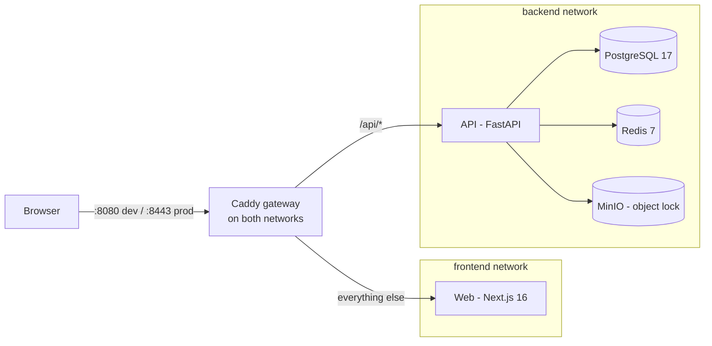
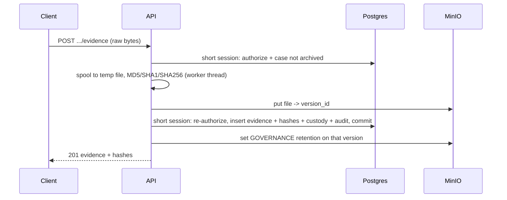

# Architecture (Milestone 1)

## Components



- **One origin.** The gateway serves both the app and `/api`, so session cookies are first-party and `SameSite=Strict`.
- **Networks.** `web` cannot reach `api` directly; only the gateway (and data services) share the api's network. uvicorn trusts `X-Forwarded-For` from its peers, which is safe only because of this isolation.
- **Gateway duties.** 1 MiB body cap everywhere except the evidence upload route; early 413 on oversize `Content-Length` (JSON error envelope); security headers and CSP; TLS + HSTS in prod.

## API: modular monolith

```
apps/api/app/
  core/        config, db engine, tenancy (tenant_session), rbac (require/org_session),
               security (argon2, JWT), csrf, rate_limit, errors, storage, hashing, upload_slots
  modules/
    auth/            register, login, sessions (refresh rotation, logout), events (auth_events)
    users/           identity (models + repository only; `/auth/me` serves the profile)
    organizations/   orgs (service.py) and memberships (members.py)
    investigations/  cases, case numbers, status lifecycle
    evidence/        uploads.py, locking.py, transfer.py (download/verify), service.py (custody, archive)
    audit/           audit writer + read API
  scripts/     dump_openapi (contracts), reconcile_orphans (report-only)
```

Modules follow `models / schemas / repository / service / router`, keeping only the layers they need.

### Request lifecycle (org-scoped route)

1. Caddy enforces body limits and forwards with `X-Forwarded-For`.
2. `CSRFMiddleware` checks the double-submit token on mutating requests.
3. `current_user` validates the access JWT (signature, `typ`, expiry), the jti / refresh-family denylist in Redis, and that the user is active.
4. `require(permission)` opens **one** `tenant_session(org_id, user_id)` — a transaction with `app.org_id` / `app.user_id` set via `set_config(..., true)` — and checks membership **inside** it (404 for non-members, 403 for missing permission).
5. The handler works in that session; mutations write the audit row in the same transaction and commit before the response is built. The dependency uses `scope="function"`, so the session closes before the response is sent.

Postgres row-level security (forced on every tenant table) is the second line of defence: even a missing `WHERE organization_id = …` cannot leak another tenant's rows.

### Evidence flow



- No DB connection is held while bytes move; every write re-authorizes.
- Failure before commit deletes exactly the stored version; after commit nothing changes the response (retention/lock failure is logged and audited).
- Download and verify always read the **stored version id**, so overwriting the key in MinIO cannot change what is served or verified.
- Per-user slots (Redis ZSET leases) bound concurrent uploads/verifies; storage and hashing run on a dedicated thread limiter.

## Web

Next.js 16 App Router, client-rendered signed-in area:

- `AuthGate` (client) calls `/auth/me`; the access cookie is scoped to `/api`, so the Next server never sees it.
- Typed API client (`openapi-fetch` + generated `@cyberlab/contracts`) adds the CSRF header and does single-flight token refresh (ok / expired / unavailable).
- Evidence upload uses XHR (progress) and a sequential client queue.

## Contracts

`pnpm gen:contracts` dumps the OpenAPI schema offline from the API image and regenerates `packages/contracts/src/schema.d.ts`. `pnpm verify` fails on drift.

## Where M2 attaches

Analysis engines will run as separate workers (Celery + Redis) that read evidence by `(bucket, key, version_id)`, never inside the API process, and write normalized findings back through versioned job schemas. The API will never execute or parse evidence itself.
