# Database

PostgreSQL 17. Schema owned by Alembic (`apps/api/alembic/versions`): `0001` is M1, `0002`–`0005` M2 (analysis jobs, pcap results), `0006`–`0008` M3 (static analyzer, malware results, storage quota), `0009`–`0010` M4 (threat intelligence), `0011` M5 (AI analyst), `0012` and `0013` M6 (reports and case management; `0013` adds same-org composite FKs, review L4), `0014` M7 (platform operations: retention, legal holds, correlation, job outcomes, search indexes; see [M7](#platform-operations-m7-migration-0014)), `0015` M7 review (resumable S3 legal-hold sync state on `legal_holds`).

## Roles

| Role | Used by | Rights |
|---|---|---|
| `postgres` | init script only | superuser |
| `cyberlab_owner` | `migrate` service, test setup/cleanup | owns `cyberlab` / `cyberlab_test` and every table |
| `cyberlab_app` | the API process and the trusted workers (ingest, enrich, analyst) | `NOSUPERUSER NOBYPASSRLS`, explicit per-table grants, `idle_in_transaction_session_timeout=60s`, `statement_timeout=30s` |
| `cyberlab_retention` (M7) | the retention worker only | `LOGIN NOSUPERUSER NOBYPASSRLS`; SELECT on what the selector reads, DELETE on the purgeable tables only, INSERT on runs, run items, tombstones, custody and audit, a few column UPDATEs ([grants](#platform-operations-m7-migration-0014)). Created by `infra/postgres/init/02-m7-roles.sh` on a fresh volume and by the idempotent `db-bootstrap` service (`infra/postgres/bootstrap.sh`) on existing volumes, lanes and restores; 0014 fails with a clear message when it is missing |

The API never receives owner credentials (`Settings` has no field for them; compose passes `MIGRATION_DATABASE_URL` only to `migrate` and `api-test`). Backups and `restore_verify` connect as the `postgres` superuser, because FORCE RLS binds the owner (`pg_dump` runs with `row_security=off`).

## Tables

```mermaid
erDiagram
  users ||--o{ organization_members : "member of"
  organizations ||--o{ organization_members : has
  users ||--o{ refresh_tokens : owns
  users ||--o{ auth_events : "logged for"
  organizations ||--o{ investigations : has
  investigations ||--o{ evidence : contains
  evidence ||--o{ evidence_hashes : "hashed as"
  evidence ||--o{ evidence_custody_events : "custody chain"
  organizations ||--o{ audit_logs : records
  users ||--o{ evidence : uploads
  evidence ||--o{ analysis_jobs : "analyzed by"
  analysis_jobs ||--|| analysis_job_index : "system lookup"
  analysis_jobs ||--o{ network_flows : produced
  analysis_jobs ||--o{ network_records : produced
  analysis_jobs ||--o{ network_alerts : produced
  analysis_jobs ||--o{ analysis_findings : produced
  analysis_jobs ||--o{ iocs : produced
  analysis_jobs ||--o{ analysis_timeline : produced
  analysis_jobs ||--o| malware_samples : produced
  analysis_jobs ||--o{ malware_sections : produced
  analysis_jobs ||--o{ malware_imports : produced
  analysis_jobs ||--o{ malware_strings : produced
  analysis_jobs ||--o{ malware_signature_matches : produced
  analysis_jobs ||--o{ malware_capabilities : produced
  organizations ||--o{ ti_provider_configs : "sealed keys"
  organizations ||--o| ti_org_settings : "TI settings"
  analysis_jobs ||--o{ ti_enrichment_runs : "enriched by"
  ti_enrichment_runs ||--|| ti_run_index : "system lookup"
  ti_enrichment_runs ||--o{ ti_run_items : "planned pairs"
  ti_enrichment_runs ||--o{ ti_results : "provider answers"
  ti_results ||--o{ ti_run_items : "answer or cache hit"
  organizations ||--o{ ai_provider_configs : "sealed AI keys"
  organizations ||--o| ai_org_settings : "AI settings"
  analysis_jobs ||--o{ ai_runs : "job scope"
  investigations ||--o{ ai_runs : "investigation scope"
  ai_runs ||--o{ ai_runs : "incident children / supersedes"
  ai_runs ||--|| ai_run_index : "system lookup"
  ai_runs ||--o{ ai_run_inputs : "frozen context (base, reduce)"
  ai_runs ||--o{ ai_context_refs : "label map"
  ai_runs ||--o| ai_outputs : "verified output"
  ai_outputs ||--o{ ai_citations : "checked citations"
  investigations ||--o{ investigation_status_events : "status history"
  evidence ||--o| evidence_share_policies : "share flags"
  investigations ||--o{ analyst_notes : notes
  analyst_notes ||--o{ analyst_note_versions : versions
  investigations ||--o{ ioc_collections : collections
  ioc_collections ||--o{ ioc_collection_items : items
  investigations ||--o{ case_attack_mappings : "ATT&CK mapping"
  investigations ||--o{ reports : "report drafts"
  reports ||--o{ report_versions : "signed versions"
  report_versions ||--o{ report_citations : "C1..Cn"
  report_versions ||--o{ report_renders : renditions
  report_renders ||--|| report_render_index : "system lookup"
```



(`malware_exports` and `malware_resources` hang off `analysis_jobs` the same way.)

| Table | Scope | Notes |
|---|---|---|
| `users` | global | `email` citext unique; argon2id `password_hash` |
| `auth_events` | global | append-only; register/login/logout/refresh-reuse; no read API in M1 |
| `refresh_tokens` | user | sha256 of opaque token, `family_id`, `revoked_reason` (rotated/logout/reuse) |
| `organizations` | tenant | `slug` unique, `next_case_number` counter; `storage_quota_bytes` (NULL = `DEFAULT_STORAGE_QUOTA_BYTES`, set by an operator only) |
| `organization_members` | tenant | unique (org, user); role owner/admin/analyst/viewer |
| `investigations` | tenant | unique (org, case_number); status open/in_progress/closed/archived; M6: `tlp` (`clear` / `green` / `amber` / `amber_strict` / `red`, default `amber`, existing rows backfilled), `ai_excluded`, `ti_excluded` (default false) |
| `evidence` | tenant | object `storage_bucket/key/version_id`; identity columns immutable |
| `evidence_hashes` | tenant | append-only; md5/sha1/sha256 per evidence |
| `evidence_custody_events` | tenant | append-only chain of custody |
| `audit_logs` | tenant | append-only; `organization_id` NOT NULL |
| `analysis_jobs` | tenant | one analyzer run (`pcap` / `static`) over one evidence version; `profile` `full` / `av` for static jobs, NULL otherwise; status machine enforced by trigger (final states and identity columns, incl. `profile`, immutable); `ingest_token_sha256`; `summary` jsonb (tool versions, engine errors, truncation flags, counts) |
| `analysis_job_index` | system lookup | job → org, analyzer, status, deadline for ingest/reaper and the global per-analyzer caps; RLS: sessions without org context see all rows, tenant sessions only their org; app may UPDATE only `status`, `deadline_at` |
| `network_flows` | tenant | Zeek conn records (largest `max_flows` by bytes); `total_bytes` indexed for sorting |
| `network_records` | tenant | `kind` dns/http/tls, `summary` text (searchable), `details` jsonb |
| `network_alerts` | tenant | Suricata alerts (sid, rev, signature, category, severity, community id) |
| `analysis_findings` | tenant | heuristic findings: type, severity, confidence, method@version, evidence refs, attributes |
| `iocs` | tenant | observables with first/last seen, count, source; unique (job, type, md5(value)) |
| `analysis_timeline` | tenant | capture start/end, findings, serious alerts, first contacts |
| `malware_samples` | tenant | one per static job (unique `job_id`): size, md5/sha1/sha256, ssdeep, libmagic type, mime, entropy, `file_format` pe/elf/other, `pe` / `elf` summary jsonb |
| `malware_sections` | tenant | index, name, virtual address (`numeric(20)`: unsigned 64-bit), sizes, entropy, flags |
| `malware_imports` / `malware_exports` | tenant | library + function or ordinal / name, ordinal, address |
| `malware_resources` | tenant | type, name, language, size, entropy, sha256 |
| `malware_strings` | tenant | capped; `encoding` ascii / utf16le / floss_decoded / floss_stack / floss_tight; offset |
| `malware_signature_matches` | tenant | `engine` clamav / yara, name, namespace, tags, meta |
| `malware_capabilities` | tenant | capa rule name, namespace, ATT&CK and MBC ids (jsonb), match count |
| `ti_provider_configs` | tenant | one row per (org, provider); provider check; `enabled`; MISP `base_url` (normalized, required iff `misp`); sealed key `key_kid`, `key_version`, `key_epk`, `key_nonce`, `key_ct`, `key_last4`; `verify_status` unverified/valid/invalid/error, `verified_at`, `last_error_code`; `limits` jsonb (org-lowered); `terms_ack_at`, `terms_ack_by` |
| `ti_org_settings` | tenant | one per org: `excluded_suffixes` (≤ 50 domain suffixes never sent) |
| `ti_enrichment_runs` | tenant | `scope` manual / job, `job_id` (composite FK to `analysis_jobs`), `requested_by`, `providers`, `status` (queued / running / waiting / completed / partial / failed), `summary` jsonb (≤ 16 KiB, counts only), `deadline_at`, `started_at`, `finished_at` |
| `ti_run_index` | system lookup | run → org, `status`, `resume_at`, `deadline_at`, `dispatched_at`, `lease_until`, `lease_owner` for the enrich worker, `ti.resume` and the reaper; same RLS pattern as `analysis_job_index`; index (status, resume_at) |
| `ti_run_items` | tenant | the frozen plan of a run: PK (run_id, provider, ioc_key), `seq`, `ioc_type`, `value_norm`, `state` pending / done / cached / abandoned, `result_id` (this run's answer or the cached one), `reason` rate_limited / quota_exhausted / deadline / auth_failed |
| `ai_provider_configs` | tenant | one row per (org, provider); provider `anthropic` / `gemini` / `mock`; `enabled`, `model` (pattern `^[a-z0-9][a-z0-9._-]{0,63}$`, allowlist in the app); sealed key `key_kid`, `key_version`, `key_epk` (32 bytes), `key_nonce` (12 bytes), `key_ct`, `key_last4` (all or none); `verify_status` unverified/valid/invalid/error, `verified_at`, `last_error_code`; `limits` jsonb object; `terms_ack_at/by`, `paid_tier_ack_at/by`. Checks: `enabled` needs `terms_ack_at`, and for `gemini` `paid_tier_ack_at` (RT5). A sealed key or the dev platform key is required by the app, not the DB |
| `ai_org_settings` | tenant | PK `organization_id`: `ai_enabled` (default false; true needs `privacy_ack_at`), `privacy_ack_at/by`, `default_provider`, `pseudonymize_internal` (true), `internal_cidrs` / `internal_suffixes` (jsonb arrays ≤ 50), `include_strings` (false), `include_ti` (true), `include_case_text` (false), `daily_token_budget` (1 000 000), `run_token_cap` (100 000), `incident_token_cap` (600 000), all > 0 |
| `ai_runs` | tenant | `task` (8 values incl. `job_digest`), `scope` job / investigation with `job_id` iff job and `investigation_id` iff investigation (composite FKs), `target_kind` finding / alert iff `target_id`, `parent_run_id` iff `job_digest` (composite self FK), `supersedes_run_id`, `provider`, `model`, `served_model`, `prompt_version`, `output_schema`, `status` (queued / running / waiting / completed / partial / failed / refused), `error_code`, `context_sha256` (64 hex), `context_stats` ≤ 16 KiB, `usage` ≤ 2 KiB, `metrics` ≤ 4 KiB, `cost_micros` ≥ 0, `price_version`, `requested_by`, `deadline_at`, `created_at`, `started_at`, `finished_at`; indexes (org, created_at), (org, context_sha256), (job_id, created_at), (investigation_id, created_at), (parent_run_id) |
| `ai_run_index` | system lookup | run → org, `status`, `resume_at`, `deadline_at`, `dispatched_at`, `lease_until`, `lease_owner`, `attempts` (529 backoff), `calls` (provider calls made, RT2); same RLS pattern as `ti_run_index`; index (status, resume_at) |
| `ai_run_inputs` | tenant, append-only | PK (run_id, stage `base` / `reduce`): `context` jsonb ≤ 512 KiB (the redacted payload exactly as sent), `context_sha256`, `pseudonym_map` jsonb object ≤ 64 KiB (never sent, never selected by the worker) |
| `ai_context_refs` | tenant, append-only | PK (run_id, label): `stage`, `label` (`^(J[0-9]{1,3}:)?[A-Z][0-9]{1,4}$`), `kind` (16 values), `ref_table`, `ref_id` (uuid text or a Zeek `flow_ref`), `job_id` (composite FK), `fields_sha256`; index (org, kind, ref_id) for M6 "which outputs cite this row" |
| `ai_outputs` | tenant, append-only | `run_id` unique: `body` jsonb ≤ 64 KiB (validated, sanitized `AnalysisOutput`; raw model text is never stored), `verification` ≤ 32 KiB (claim verdicts, citation counts, dropped refs, invalid ATT&CK, truncation, digest reuse), `flags` jsonb array |
| `ai_citations` | tenant, append-only | `output_id`, `run_id`, `claim_path`, `section`, `claim_id`, `claim_status` supported / unsupported / hypothesis, `label`, `kind`, `ref_id`, `job_id`, `status` verified / unverified / invalid, `reason`, `field`, `quote` ≤ 256, `stale`; indexes on `output_id` and (org, kind, ref_id) |
| `investigation_status_events` | tenant, append-only | M6: `investigation_id` (composite FK), `from_status` (NULL or a status), `to_status`, `reason` ≤ 500, `actor_id`, `occurred_at`; index (investigation_id, occurred_at) |
| `evidence_share_policies` | tenant | M6: PK `evidence_id` (composite FK), `ai_excluded`, `ti_excluded`, `updated_by`, `updated_at`; a separate table so the `evidence_immutable` trigger is untouched |
| `analyst_notes` | tenant | M6: `investigation_id`, `created_by`, `current_version` ≥ 1, `pinned`, `include_in_reports`, `deleted_at` / `deleted_by` (both or neither); index (investigation_id, created_at) |
| `analyst_note_versions` | tenant, append-only | M6: PK (note_id, version): `body` 1–20 000 characters, `refs` jsonb array ≤ 20 entries and ≤ 16 KiB, `author_id`, `created_at` |
| `ioc_collections` | tenant | M6: `investigation_id`, `name` 1–120 (unique per case on `lower(name)`), `description` ≤ 2 000, `archived_at` |
| `ioc_collection_items` | tenant | M6: `collection_id`, `ioc_type` (`^[a-z][a-z0-9_]{0,31}$`), `value_norm` 1–2 048, `ioc_key` (64 hex), `source` `job_ioc` / `manual` with `job_id` + `ioc_id` both or neither (and set iff `job_ioc`; `ioc_id` a composite same-org FK since `0013`), `note` ≤ 500, `added_by/at`, `removed_at/by` (both or neither); unique (collection, ioc_key) among items not removed; index (org, ioc_key) to join `ti_results` |
| `case_attack_mappings` | tenant | M6: `investigation_id`, `technique_id` (`^T\d{4}(\.\d{3})?$`), `status` confirmed / suspected / rejected, `rationale` ≤ 2 000, `sources` jsonb array ≤ 32 and ≤ 16 KiB, `created_by`, `updated_by`; unique (investigation, technique) |
| `reports` | tenant | M6: the draft: `investigation_id`, `template` `incident_v1`, `title` 1–200, `tlp`, `profile` internal / external, `draft` jsonb object ≤ 1 MiB, `distribution` ≤ 500, `status` draft / discarded, `revision` ≥ 1, `latest_version` ≥ 0, `created_by`; indexes (org, updated_at), (investigation_id, created_at) |
| `report_versions` | tenant, append-only | M6: unique (report, version): `schema_version` `cyberlab.report.v1`, `tlp`, `profile`, `snapshot_sha256`, `snapshot_bytes`, `object_key`, `object_version_id`, `manifest` jsonb ≤ 4 KiB, `signature` (base64 Ed25519, 88 characters), `kid`, `section_counts` ≤ 4 KiB, `change_note` ≤ 500, `finalized_by/at`; index (org, finalized_at) |
| `report_citations` | tenant, append-only | M6: `version_id`, `cite_no` > 0 (unique per version), `kind`, `ref_table`, `ref_id` (1–64, uuid text or a Zeek `flow_ref`), `job_id`, `fields_sha256`, `source` ai / selection / note / attack, `ai_citation_id` (composite same-org FK to `ai_citations` since `0013`); **index (org, kind, ref_id)** for "which report versions cite this row", next to the M5 `ai_context_refs` and `ai_citations` indexes |
| `report_renders` | tenant | M6: `version_id`, `format` pdf / html / md (DOCX deferred), `status` queued / running / succeeded / failed (failed needs `error_code`), `token_sha256`, `sha256`, `bytes`, `pages`, `object_version_id`, `renderer_version`, `requested_by`, `started_at`, `finished_at`; unique (version, format, renderer version) among non-failed renders; index (org, created_at) |
| `report_render_index` | system lookup | M6: PK `render_id` (composite FK, cascade) → org, `status`, `dispatched_at`, `deadline_at`, `attempts`; the `ai_run_index` RLS pattern; index (status, deadline_at) for the reaper |
| `ti_results` | tenant | append-only provider answers (history = cache): `provider`, `ioc_type`, `value_norm`, `ioc_key` (sha256 of type ‖ 0 ‖ value), `status` ok / not_found / error / auth_failed, `found` (only with ok), `detections`, `score` + `score_scale`, `tags`, `families`, `attack_ids`, `first_seen`, `last_seen`, `summary` (strict per-provider model, ≤ 16 KiB, never the raw body), `permalink` (`https://` only), `error_code`, `latency_ms`, `fetched_at`, `expires_at` (NULL for errors); unique (run_id, provider, ioc_key); index (org, ioc_key, provider, fetched_at DESC) |

All ids are UUIDs (client-generated `uuid4`, server default `gen_random_uuid()`); timestamps are `timestamptz`.
Child rows are pinned to their parent's tenant with composite foreign keys, e.g. `evidence(investigation_id, organization_id) → investigations(id, organization_id)`.

Analysis result tables (migrations 0004/0005):
- They are written only by the trusted ingest worker, in the same transaction that moves the job to `succeeded`; a stream is never partially written.
- The app role has SELECT and INSERT only.
- `flow_ref` is not a foreign key: a referenced flow may have been dropped by the flow cap.

Static results (migration 0007) follow the same rules:
- Every `malware_*` row points at its job with a composite FK `(job_id, organization_id) → analysis_jobs(id, organization_id)`, `ON DELETE CASCADE`.
- Findings and IOCs of static jobs go into the shared `analysis_findings` and `iocs`. The §11 `malware_findings` table is therefore `analysis_findings` of static jobs.
- The static JSON report is still built on demand per job; the persisted, signed case reports are the M6 `reports` tables below.

Threat intel (migrations 0009/0010; details in [THREAT_INTEL.md](THREAT_INTEL.md)):
- `iocs` is unchanged: results join on `ioc_key`, computed in Python.
- Rate-limited, quota and deadline outcomes are item states, never `ti_results` rows; the history shows only what a provider said.
- A cache hit is the newest unexpired `ok` / `not_found` row of the same org (DB clock).
- `ti_results` is append-only; since M7 only the retention worker may delete old answers, together with their run items, under an org policy (`ti_results_days`; see [M7](#platform-operations-m7-migration-0014)), `0015` M7 review (resumable S3 legal-hold sync state on `legal_holds`).

AI analyst (migration 0011; details in [AI_ANALYST.md](AI_ANALYST.md)):
- The API writes a run, its index row, its base input, its refs and the audit row in one transaction (incident children with them); the analyst-worker writes the output, the citations and the run's usage / cost / metrics in one transaction.
- `ai_runs.context_stats` never carries field names, titles or filenames (RT4); `ai_run_inputs.context` is exactly what was sent.
- Since M7 the retention worker may delete whole completed AI run trees (runs, index, inputs, refs, outputs, citations) under an org policy (`ai_runs_days`); runs cited by a report are kept. Nobody else deletes `ai_*` rows.

Reports and case management (migration 0012; details in [REPORTS.md](REPORTS.md)):
- Finalize writes a version, its citations, the PDF render, its index row and the audit row in one short transaction, after the snapshot object was stored and locked outside any transaction; a version whose write fails leaves a logged orphan object, never a row without an object.
- The snapshot bytes live in MinIO (`reports` bucket, exact `object_version_id`); the row keeps their sha256, size, the signed manifest and the signature, so every read is verified.
- `ti_run_items.reason` gains `policy_blocked` (the share-policy outcome of the enrich-worker); `ai_runs.error_code` has no CHECK, so its `policy_blocked` needed no change.
- Notes, collections, mappings, reports and versions are never purged (M7 retention leaves them too); versions and note versions are append-only, and a deleted note keeps its versions. M7 retention may only mark a `succeeded` rendition `purged` and delete its object; the signed snapshot stays.

## Tenant isolation (RLS)

Every tenant table has `ENABLE` **and** `FORCE ROW LEVEL SECURITY` (`test_rls_coverage.py` fails if a table with `organization_id` lacks either).

The request context lives in two transaction-local settings, read through helper functions:

```sql
app_org_id()  = NULLIF(current_setting('app.org_id',  true), '')::uuid
app_user_id() = NULLIF(current_setting('app.user_id', true), '')::uuid
```

| Table | Command | Policy |
|---|---|---|
| investigations, evidence, evidence_hashes, evidence_custody_events, audit_logs, analysis_jobs, pcap result tables, `malware_*`, `ti_*` except `ti_run_index`, `ai_*` except `ai_run_index`, the M6 tables except `report_render_index` | ALL | `organization_id = app_org_id()` (USING + CHECK) |
| the M7 tenant tables (`org_retention_policies`, `legal_holds`, `retention_runs`, `retention_run_items`, `evidence_purges`, `correlation_keys`, `correlation_job_state`) | ALL | `organization_id = app_org_id()` (USING + CHECK) |
| analysis_job_index, ti_run_index, ai_run_index, report_render_index, `retention_policy_index` (M7) | ALL | `app_org_id() IS NULL OR organization_id = app_org_id()`: trusted workers' system sessions see every row, tenant sessions only their org's |
| organization_members | SELECT | `organization_id = app_org_id() OR user_id = app_user_id()` |
| organization_members | INSERT / UPDATE / DELETE | `organization_id = app_org_id()` |
| organizations | SELECT | `id = app_org_id() OR id IN (memberships of app_user_id())` |
| organizations | INSERT / UPDATE (incl. `SELECT … FOR UPDATE`) | `id = app_org_id()` |

Reads and writes are split per command on purpose: a single ALL-command policy would let the "caller's own row" clause authorize **cross-tenant** UPDATE/DELETE of the caller's membership in another org (regression tests in `test_rls.py`).

The helper functions are schema-qualified (`pg_catalog.current_setting`, `pg_catalog.uuid`) and trigger functions pin `search_path = pg_catalog`; `TEMPORARY` on both databases is revoked from PUBLIC so temp objects cannot shadow names.

**RLS trusts `app.org_id`.** It does not check membership itself: any code that opens `tenant_session(org_id, …)` for an org taken from the request sees that org's rows. Only `require()` / `org_session()` (`app/core/rbac.py`) may open a tenant session for a request-supplied org, after verifying membership inside that same session; `tests/unit/test_tenant_session_guard.py` fails if `tenant_session(<org>…)` appears anywhere else besides the auth and org-creation services (which use org ids they just created).

With no context set, tenant tables return zero rows. `INSERT … RETURNING` also evaluates `USING`, so every tenant insert runs with a matching `app.org_id`.

### Setting the context

`app/core/tenancy.py::tenant_session(org_id, user_id)` opens one transaction and runs `set_config('app.user_id', …, true), set_config('app.org_id', …, true)` (`SET LOCAL` cannot take bind parameters). The values reset at commit/rollback, so they never leak to the next user of a pooled connection.

Rules:
- One `tenant_session` = one transaction. A flow needing several transactions opens a new one each time.
- Commit (leave the block) before sending the response; never rely on dependency teardown.
- Non-tenant tables (`users`, `refresh_tokens`, `auth_events`) are used via `tenant_session(None, None)` or `(None, user_id)`.

## Grants

| Table | `cyberlab_app` |
|---|---|
| users | SELECT, INSERT, UPDATE |
| refresh_tokens | SELECT, INSERT, UPDATE, DELETE |
| organizations | SELECT; INSERT on `id, name, slug, next_case_number, created_by, created_at, updated_at`; UPDATE on `name, next_case_number, updated_at` (0008: the app cannot write `storage_quota_bytes`) |
| investigations, evidence | SELECT, INSERT, UPDATE |
| organization_members | SELECT, INSERT, UPDATE, DELETE |
| auth_events, audit_logs, evidence_hashes, evidence_custody_events | SELECT, INSERT |
| pcap result tables, `malware_*` | SELECT, INSERT |
| `ti_provider_configs` | SELECT, INSERT; UPDATE on `enabled, base_url, key_kid, key_version, key_epk, key_nonce, key_ct, key_last4, verify_status, verified_at, last_error_code, limits, terms_ack_at, terms_ack_by, updated_at`; **no DELETE** (0010) |
| `ti_org_settings` | SELECT, INSERT; UPDATE on `excluded_suffixes, updated_by, updated_at` |
| `ti_enrichment_runs` | SELECT, INSERT; UPDATE on `status, summary, deadline_at, started_at, finished_at` |
| `ti_run_items` | SELECT, INSERT; UPDATE on `state, result_id, reason` |
| `ti_run_index` | SELECT, INSERT; UPDATE on `status, resume_at, deadline_at, dispatched_at, lease_until, lease_owner` |
| `ti_results` | SELECT, INSERT |
| `ai_provider_configs` | SELECT, INSERT; UPDATE on `enabled, model, key_kid, key_version, key_epk, key_nonce, key_ct, key_last4, verify_status, verified_at, last_error_code, limits, terms_ack_at, terms_ack_by, paid_tier_ack_at, paid_tier_ack_by, updated_at` (the sealed columns also for the analyst's lazy re-seal); **no DELETE** |
| `ai_org_settings` | SELECT, INSERT; UPDATE on `ai_enabled, privacy_ack_at, privacy_ack_by, default_provider, pseudonymize_internal, internal_cidrs, internal_suffixes, include_strings, include_ti, include_case_text, daily_token_budget, run_token_cap, incident_token_cap, updated_by, updated_at` |
| `ai_runs` | SELECT, INSERT; UPDATE on `status, error_code, served_model, usage, cost_micros, price_version, metrics, started_at, finished_at` |
| `ai_run_index` | SELECT, INSERT; UPDATE on `status, resume_at, deadline_at, dispatched_at, lease_until, lease_owner, attempts, calls` |
| `ai_run_inputs`, `ai_context_refs`, `ai_outputs`, `ai_citations` | SELECT, INSERT |
| `investigation_status_events`, `analyst_note_versions`, `report_versions`, `report_citations` | SELECT, INSERT (append-only) |
| `evidence_share_policies` | SELECT, INSERT; UPDATE on `ai_excluded, ti_excluded, updated_by, updated_at` |
| `analyst_notes` | SELECT, INSERT; UPDATE on `current_version, pinned, include_in_reports, deleted_at, deleted_by, updated_at` |
| `ioc_collections` | SELECT, INSERT; UPDATE on `name, description, archived_at, updated_at` |
| `ioc_collection_items` | SELECT, INSERT; UPDATE on `removed_at, removed_by, note` |
| `case_attack_mappings` | SELECT, INSERT; UPDATE on `status, rationale, sources, updated_by, updated_at` |
| `reports` | SELECT, INSERT; UPDATE on `title, tlp, profile, draft, distribution, status, revision, latest_version, updated_at` |
| `report_renders` | SELECT, INSERT; UPDATE on `status, error_code, sha256, bytes, pages, object_version_id, renderer_version, started_at, finished_at` |
| `report_render_index` | SELECT, INSERT; UPDATE on `status, dispatched_at, deadline_at, attempts` |

No M6 table has a DELETE grant. `investigations` keeps its table-wide UPDATE (M1), which covers the new `tlp`, `ai_excluded` and `ti_excluded` columns; the rules for them (downgrade, turning a flag off) are enforced by the API.

The enrich and analyst workers use the same `cyberlab_app` role as the API (no dedicated role yet; accepted residual, see THREAT_MODEL). The app role can never UPDATE `organization_id`, `provider`, `task` or `created_at` of an `ai_*` row.

## Triggers

- `forbid_mutation()` — `BEFORE UPDATE OR DELETE` on the four append-only tables, on `investigation_status_events`, `analyst_note_versions`, `report_versions`, `report_citations` (M6) and on `retention_run_items`, `evidence_purges` (M7); it fires for the owner too. Since M7, `ti_results` (M4) and `ai_run_inputs`, `ai_context_refs`, `ai_outputs`, `ai_citations` (M5) use `forbid_mutation_except_retention()` instead ([M7](#platform-operations-m7-migration-0014)).
- `analyst_note_guard()` (M6) — `BEFORE UPDATE` on `analyst_notes`: `current_version` never decreases, `deleted_at/by` are set once, identity columns (id, org, case, creator, `created_at`) are immutable.
- `ioc_collection_item_guard()` (M6) — `BEFORE UPDATE` on `ioc_collection_items`: the removal is set once; type, value, key, source, job, IOC, adder and `added_at` are immutable.
- `report_guard()` (M6) — `BEFORE UPDATE` on `reports`: a discarded report is final; `revision` increases by exactly one per update; `latest_version` never decreases; a report with versions cannot be discarded; identity columns (id, org, case, template, creator, `created_at`) are immutable.
- `report_render_transition()` (M6) — `BEFORE UPDATE` on `report_renders`: only `queued → running / failed` and `running → succeeded / failed`; final states never change; id, org, version, format, `token_sha256`, requester and `created_at` are immutable.
- `ti_run_transition()` — `BEFORE UPDATE` on `ti_enrichment_runs`: only `queued → running / partial / failed`, `running → waiting / completed / partial / failed`, `waiting → running / partial / failed`; final states never change; identity columns (`id`, org, `scope`, `job_id`, `requested_by`, `providers`, `created_at`) are immutable.
- `ti_key_version_guard()` — `BEFORE UPDATE` on `ti_provider_configs`: `key_version` never decreases; new sealed columns need a higher `key_version`, except a re-seal of the same key (same version and last4) under another kid. Clearing a key keeps the version, so an old ciphertext can never be put back (RT18).
- `ai_run_transition()` — `BEFORE UPDATE` on `ai_runs`: only `queued → running / failed`, `running → waiting / completed / partial / failed / refused`, `waiting → running / failed`; final states (`completed`, `partial`, `failed`, `refused`) never change; identity columns (id, org, task, scope, job, investigation, target, parent, provider, model, prompt and schema versions, `context_sha256`, `context_stats`, requester, `supersedes_run_id`, `deadline_at`, `created_at`) are immutable, even for the owner.
- `ai_key_version_guard()` — `BEFORE UPDATE` on `ai_provider_configs`: the same rules as `ti_key_version_guard()` (RT18).
- `evidence_immutable()` — `BEFORE UPDATE` on `evidence`; every column except `status` and `description` is immutable (incl. `id`, detected type, storage location/version, uploader, timestamps).

**Trust boundary:** grants + triggers stop the app role (and accidental owner `UPDATE`/`DELETE`). The table owner can still `TRUNCATE` or drop triggers; it is a trusted admin identity and its credentials never reach the API. Test cleanup relies on owner `TRUNCATE` against `cyberlab_test` only (the harness refuses any database not ending in `_test`).

## Platform operations (M7, migration 0014)

`0014_m7_platform_ops` follows the M4–M6 conventions: FORCE RLS on every tenant table, composite same-org FKs, SELECT / INSERT grants plus per-column UPDATE, named checks, **no DELETE grant to the app role**. It also runs `CREATE EXTENSION IF NOT EXISTS pg_trgm` and seeds one system user. Later schema needs go into `0015`.

### Tables

| Table | Scope | Notes |
|---|---|---|
| `org_retention_policies` | tenant (PK org) | `ti_results_days`, `ai_runs_days`, `closed_case_days` (NULL = keep forever; checks: NULL or 30–36 500; the API also enforces closed cases ≥ `EVIDENCE_LOCK_DAYS`, `422 policy_floor`); `pending_*` + `effective_at` for a lowered value; `enforce`, `pending_enforce`, `enforce_effective_at` (turning enforce on waits for the delay, RT1); `updated_by/at` |
| `retention_policy_index` | system lookup (PK org) | `updated_at`; upserted by the API in the same transaction as every policy PUT and every hold placement (an org with holds but no policy still gets its S3 hold sync); the sweep's org list (RT3) |
| `legal_holds` | tenant | `scope` org / investigation (`investigation_id` NULL exactly for org scope, composite FK), `reason` 1–500, `placed_by/at`, `released_by/at` (set together), `release_reason`, `s3_synced_at`, `s3_full_synced_at`, `s3_sync_cursor_at/_id`, `s3_sync_pass_at` (retention worker's S3 sync state, `0015`); index on (org, released_at) for "active or released within the delay" |
| `retention_runs` | tenant | `mode` dry_run / enforce, `trigger` schedule / manual (manual ⇔ `requested_by`), `status` queued / running / completed / partial / failed, `policy` jsonb ≤ 4 KiB (the values used), `counts` jsonb ≤ 8 KiB, `sample` jsonb ≤ 64 KiB, `error` code, `started_at`, `finished_at` |
| `retention_run_items` | tenant, append-only | `run_id`, `category` ti_results / ai_runs / closed_case, `ref_table`, `ref_id`, `job_id`, `rows`, `bytes`, `object_key` + `object_version_id` (set together), `outcome` purged / skipped_hold / skipped_locked / object_delete_failed / kept_cited |
| `evidence_purges` | tenant, append-only (PK `evidence_id`, composite FK) | the tombstone: `run_id`, `object_version_id`, `sha256`, `purged_at`. The evidence row itself never changes; `EvidenceOut.purged_at` and the `410 evidence_purged` answers come from here. `reconcile_orphans.py` reports a tombstoned version still stored as `purged_pending_delete` and a pinned version missing **without** a tombstone as `missing_unexplained` |
| `correlation_keys` | tenant | `investigation_id`, `evidence_id`, `job_id`, `kind` (ipv4, ipv6, domain, url, email, md5, sha1, sha256, ja3, ja3s, cert_sha256), `key` (sha256 hex: the M6 `normalize_item` `ioc_key`), `value_norm` ≤ 2 048, `source_table` iocs / malware_samples / evidence_hashes, `source_id`, `first_seen`, `last_seen`; unique (job_id, kind, key); index (org, kind, key); trigram GIN on `value_norm` |
| `correlation_job_state` | tenant (PK `job_id`) | `indexed_at`, `keys`, `truncated`: a job is indexed exactly once |
| `job_outcomes` | system (no org id, no tenant data, no RLS) | `kind` pcap / static / ti / ai / report (`memory` since 0016), `subkind` (profile, provider or format; sanitized to `other`), `status`, `error_code` (sanitized), `queue_ms`, `run_ms`, `finished_at`; indexes (finished_at), (kind, finished_at) |
| `evidence` (+ columns) | existing | `declared_type` (≤ 32, the extension family) and `type_mismatch`, nullable, write-once (see triggers) |
| `evidence_custody_events` | existing | the enum `custody_action` gains `purged` and `sent_to_sandbox` (reserved) in an autocommit block; the downgrade cannot drop enum values and leaves them |
| `report_renders` | existing | `status` gains `purged`; the dedupe index `ux_report_renders_version_id_format_renderer` is recreated `WHERE status NOT IN ('failed', 'purged')`, so a purged rendition can be re-rendered (RT11) |
| `users` (seed row) | existing | the fixed system user `retention@system.invalid` (`00000000-0000-4000-8000-00000000a7e0`), inactive, with a non-argon2 hash nobody can log in with: the custody actor of purges (RT12) |

**Search indexes** (plain `CREATE INDEX` in the migration transaction, RT20; FTS config `simple`, every nullable column wrapped in `coalesce(…, '')`, and the search queries use the identical expressions): FTS on `investigations` (title ‖ description), `analysis_findings` (title ‖ description), `network_alerts` (signature), `analyst_note_versions` (body); trigram on `investigations.case_number::text`, `evidence.original_filename` and `correlation_keys.value_norm`. **Under RLS these GIN indexes are not used** (`@@`, `%` and `ILIKE` are not `LEAKPROOF`, so the planner cannot push them below the `tenant_isolation` qual): search is a per-org scan for now, see [ARCHITECTURE](ARCHITECTURE.md#search).

### Grants (M7)

| Table | `cyberlab_app` | `cyberlab_retention` |
|---|---|---|
| `org_retention_policies` | SELECT, INSERT; UPDATE on the values, `pending_*`, `effective_at`, `enforce`, `pending_enforce`, `enforce_effective_at`, `updated_by`, `updated_at` | SELECT |
| `retention_policy_index` | SELECT, INSERT; UPDATE on `updated_at` | SELECT |
| `legal_holds` | SELECT, INSERT; UPDATE on `released_by, released_at, release_reason` | SELECT; UPDATE on `s3_synced_at` and (`0015`) `s3_full_synced_at, s3_sync_cursor_at, s3_sync_cursor_id, s3_sync_pass_at` |
| `retention_runs` | SELECT, INSERT (a manual or preview run requested through the API) | SELECT, INSERT; UPDATE on `status, counts, sample, started_at, finished_at, error` |
| `retention_run_items`, `evidence_purges` | SELECT | SELECT, INSERT |
| `correlation_keys`, `correlation_job_state` | SELECT, INSERT | none (never purged, RT9) |
| `job_outcomes` | SELECT (rows come from the `SECURITY DEFINER` trigger) | SELECT, DELETE (rows older than 90 days) |
| `evidence_custody_events`, `audit_logs` | (M1) | SELECT, INSERT |
| bulk derived rows: `network_flows`, `network_records`, `analysis_timeline`, `malware_strings`, `malware_sections`, `malware_imports`, `malware_exports`, `malware_resources` | (M2/M3) | SELECT, DELETE |
| `ti_results`, `ti_run_items` | (M4) | SELECT, DELETE |
| `ai_runs`, `ai_run_index`, `ai_run_inputs`, `ai_context_refs`, `ai_outputs`, `ai_citations` | (M5) | SELECT, DELETE |
| `report_renders` | (M6) | SELECT; UPDATE on `status` (`succeeded → purged` only, by trigger) |
| `investigations`, `investigation_status_events`, `evidence`, `evidence_hashes`, `analysis_jobs`, `analysis_job_index`, `ti_enrichment_runs`, `reports`, `report_versions`, `report_citations` | — | SELECT only |

The retention role also has `USAGE` on the schema and `EXECUTE` on `app_org_id()` / `app_user_id()`. It is bound by RLS like the app (the policies have no `TO` clause) and works in per-org tenant sessions; its only system read is `retention_policy_index` (and `job_outcomes`, which has no RLS). It has no DELETE on any metadata table, on `correlation_*`, on audit, custody or hashes, or on report versions and citations.

### Triggers (M7)

- `forbid_mutation_except_retention()` — replaces `forbid_mutation()` on `ti_results`, `ai_run_inputs`, `ai_context_refs`, `ai_outputs`, `ai_citations`: **DELETE only when `current_user = 'cyberlab_retention'`**, UPDATE never. Not `SECURITY DEFINER`, so `current_user` is the role running the statement. Referential actions run as the table owner, so no cascade from another table can delete from these tables; the purge deletes children explicitly in FK order (RT10). Every other append-only table keeps `forbid_mutation()`, and `audit_logs` refuses DELETE even for the retention role.
- `forbid_mutation()` on `retention_run_items` and `evidence_purges`.
- `org_retention_policy_touch()` — `BEFORE UPDATE`: org and `created_at` immutable; sets `updated_at`.
- `legal_hold_guard()` — `BEFORE UPDATE`: a hold is released once; scope, case, reason, placer and `placed_at` are immutable.
- `retention_run_guard()` — `BEFORE UPDATE`: final runs (`completed`, `partial`, `failed`) never change; mode, trigger, requester, policy and `created_at` are immutable.
- `record_job_outcome()` — `AFTER UPDATE OF status` on `analysis_jobs` (→ succeeded / failed), `ti_enrichment_runs` (→ completed / partial / failed), `ai_runs` (→ completed / partial / failed / refused) and `report_renders` (→ succeeded / failed); `SECURITY DEFINER` (owner), `REVOKE ALL … FROM PUBLIC`; copies codes and durations only, and turns any error into a WARNING so it never fails the transition it observes.
- `report_render_transition()` (updated) — adds the edge `succeeded → purged`, for `cyberlab_retention` only and changing the status only; `purged` is final.
- `evidence_immutable()` (updated) — `declared_type` and `type_mismatch` are write-once: a NULL may become a value only in the transaction that inserted the row.

### §11 table names → implementation

`requirement.txt` §11 names tables that the platform implements under other names or as computed views. The mapping:

| §11 name | Implemented as | Notes |
|---|---|---|
| `users`, `organizations`, `organization_members`, `investigations`, `evidence`, `evidence_hashes`, `analysis_jobs`, `network_flows`, `network_alerts`, `malware_samples`, `iocs`, `analyst_notes`, `reports`, `audit_logs` | same names | |
| `analysis_results` | the per-type result tables (`network_flows`, `network_records`, `network_alerts`, `analysis_timeline`, `malware_*`, `analysis_findings`, `iocs`) + `analysis_jobs.summary` + the job's object in the `results` bucket (pinned by `analysis_jobs.result_version_id`) | one validated `pcap.v1` / `static.v1` stream per job, ingested in one transaction |
| `malware_findings` | `analysis_findings` of static jobs | shared with the pcap analyzer (M3) |
| `threat_intelligence` | `ti_results` (+ `ti_enrichment_runs`, `ti_run_items`, `ti_run_index`, `ti_provider_configs`, `ti_org_settings`) | append-only answers; the history is the cache (M4) |
| `attack_techniques` | the pinned offline JSON index `apps/api/app/modules/attack/data/attack_enterprise_v20.0.json` (not a table) + `case_attack_mappings` for the analyst-confirmed case links | read-only reference data; rebuilt with `scripts/build_attack_index.py` |
| `investigation_timeline` | computed: `analysis_timeline` rows merged with status, custody and note events in `investigations/timeline.py` (`GET …/investigations/{id}/timeline`) | no stored timeline table |
| `api_keys` | the **sealed provider keys** in `ti_provider_configs` and `ai_provider_configs` (sealed boxes per domain; the API encrypts only) | **platform API keys** (programmatic or service-account access to CyberLab) are not implemented: ROADMAP "Later" |
| `memory_findings` | `analysis_findings` of memory jobs (M8, schema in `0016`) | shared with the pcap and static analyzers; the memory ingest that writes them is pending (M8 phase 6) |
| `forensic_artifacts` | memory: `memory_artifacts` (M8, `0016`; with `memory_processes`, `memory_connections`, `memory_injections`, `memory_images`). Disk (M9, `0017`): `disk_files` (the file listing), `disk_events` (parsed artifact events) and `disk_partitions`, with `disk_images` per job | findings of both stay in `analysis_findings`; M9 is in progress (see [Disk forensics (M9, migration 0017)](#disk-forensics-m9-migration-0017)) |
| `analysis_results` of reverse jobs (M10) | `re_programs` (one per job) and the bulk `re_functions`, `re_call_edges`, `re_imports`, `re_import_refs`, `re_strings`, `re_string_refs`, `re_decompilations`, `re_function_capabilities` (`0018`), plus the shared `analysis_findings` and `iocs` | RE results are analysis results of `reverse` jobs: one validated `re.v1` stream per job, ingested in one transaction; M10 is in progress (see [Reverse engineering (M10, migration 0018)](#reverse-engineering-m10-migration-0018)) |

## Memory forensics (M8, migration 0016)

**In progress:** written in M8 phase 1 and not yet run in a container (`test_migrations.py` 0016 down / up, `test_m8_schema.py`, `test_rls_coverage.py` and `test_append_only.py` are written but pending their first run). Nothing writes the memory tables until the phase-6 ingest lands. `0016_m8_memory_forensics` revises `0015` (the M7 hold-sync revision) and follows the M4–M7 conventions: FORCE RLS on every tenant table (`organization_id = app_org_id()`), composite `(id, organization_id)` same-org FKs, SELECT / INSERT grants plus per-column UPDATE, named checks with `octet_length` caps, **no DELETE grant to the app role**. Later M8 schema needs go into `0017`. Details of the analyzer: [MEMORY_ANALYSIS.md](MEMORY_ANALYSIS.md).

### Changes to existing tables

| Table / type | Change |
|---|---|
| `analyzer` enum | `ADD VALUE 'memory'` in an autocommit block (the 0006 rule; later SQL compares `analyzer::text`); the downgrade cannot drop it |
| `analysis_jobs.profile` | `ck_analysis_jobs_profile_valid` (`full` / `av` / `triage`) and `ck_analysis_jobs_profile_matches_analyzer` (static ∈ `full`, `av`; memory ∈ `triage`, `full`; NULL for pcap) replace the 0006 checks |
| `analysis_jobs.os_hint` | new, `auto` / `windows` / `linux` (`ck_analysis_jobs_os_hint_valid`), NOT NULL exactly for memory jobs (`ck_analysis_jobs_os_hint_iff_memory`); write-once with the profile in the job guard |
| `job_outcomes.kind` | `ck_job_outcomes_kind` gains `memory` (the M7 trigger already copies `analyzer::text`) |

### Tables

| Table | Scope | Notes |
|---|---|---|
| `memory_images` | tenant (PK `job_id`, composite FK to the job) | one per memory job, also for a `symbols_missing` diagnostic: `os`, `arch`, `layer` (≤ 64, e.g. `LimeLayer>Intel32e`), `engine` (`volatility3` / `replay`), `nt_build`, `kernel_banner` (≤ 512), `pdb_name`, `pdb_guid`, `pdb_age`, `system_time`, `symbols_status` (`resolved` / `missing`), `isf_sha256`, `volatility_version`, `plugins` jsonb (≤ 16 KiB, per-plugin status), `counts` jsonb (≤ 4 KiB) |
| `memory_processes` | tenant, bulk | `id`, `organization_id`, `job_id` (every bulk table carries these three: retention counts by them and citations reference `id`, RT23); `pid`, `ppid`, `name` ≤ 64, `offset`, `create_time`, `exit_time`, `threads`, `handles`, `session_id`, `wow64`, `sources` (bitmask pslist 1 / psscan 2 / pstree 4), `cmdline` ≤ 4 096, `image_path` ≤ 1 024; unique (`job_id`, `pid`, `offset`); index (`job_id`, `ppid`) |
| `memory_connections` | tenant, bulk | `proto` (tcp / udp / raw / unix / other), `local_addr` / `remote_addr` (inet), ports, `state`, `pid`, `owner`, `created`, `offset` |
| `memory_injections` | tenant, bulk | `pid`, `process`, `start`, `end`, `protection`, `tag`, `private`, `commit_charge`, `has_pe`, `head_hex` ≤ 128 hex chars, `disasm` ≤ 1 024 |
| `memory_artifacts` | tenant, bulk | `type` (`module`, `service`, `hive`, `userassist`, `ldr_unlinked`, `bash`, `open_file`, `syscall_hook`, `hidden_module`; no `handle` or `yara`, RT8 / RT9), `pid` (nullable), `attributes` jsonb ≤ 4 KiB with **scalar values only** (`memory_attributes_scalar(jsonb)`); index (`job_id`, `type`, `id`) |
| `memory_sensitivity` | tenant (PK `evidence_id`, composite FK) | `state` `restricted` / `released`, `defaulted_by` / `defaulted_at`, `released_by` / `released_at`, `release_reason`; drives the M6 share policy (AI / TI excluded while restricted) |

Addresses (`offset`, `start`, `end`) are `NUMERIC(20,0)`: unsigned 64-bit addresses exceed `bigint`. The columns `offset`, `start` and `end` are SQL keywords: quote them in raw SQL. Findings, IOCs and the timeline of memory jobs use the shared `analysis_findings`, `iocs` and `analysis_timeline`; the job-level summary is `analysis_jobs.summary`.

### Grants and triggers (M8)

| Table | `cyberlab_app` | `cyberlab_retention` |
|---|---|---|
| `memory_images` | SELECT, INSERT | SELECT |
| `memory_processes`, `memory_connections`, `memory_injections`, `memory_artifacts` | SELECT, INSERT | SELECT, DELETE (closed-case purge of bulk rows; `BULK_TABLES` joins in M8 phase 8) |
| `memory_sensitivity` | SELECT, INSERT; UPDATE on `state, released_by, released_at, release_reason` | SELECT |

- `memory_sensitivity_guard()` — `BEFORE UPDATE OR DELETE` on `memory_sensitivity`: the only change is `restricted → released`, once, setting the release columns; every other UPDATE and every DELETE is refused, also for the owner.
- The app role also gets `EXECUTE` on `memory_attributes_scalar(jsonb)`.

## Disk forensics (M9, migration 0017)

**In progress:** written in M9 phase 1 and not yet run in a container (`test_migrations.py` 0017 down / up, `test_m9_schema.py`, `test_rls_coverage.py`, `test_append_only.py` and the disk ingest tests are written but pending their first run). `0017_m9_disk_forensics` revises `0016` and follows the M4–M8 conventions: FORCE RLS on every tenant table (`organization_id = app_org_id()`), composite `(id, organization_id)` same-org FKs, SELECT / INSERT grants plus per-column UPDATE, named checks with `octet_length` caps, **no DELETE grant to the app role**. `0017` is frozen; later schema needs take the next number (M10 expects `0018`, M11 `0019`). Details of the analyzer: [DISK_FORENSICS.md](DISK_FORENSICS.md).

### Changes to existing tables

| Table / type | Change |
|---|---|
| `analyzer` enum | `ADD VALUE 'disk'` in an autocommit block (the 0006 rule; later SQL compares `analyzer::text`); the downgrade cannot drop it |
| `analysis_jobs.profile` | the 0016 checks gain disk ∈ (`triage`, `full`, `extract`); `extract` is a file-export job, never an analysis |
| `analysis_jobs.os_hint` | `ck_analysis_jobs_os_hint_iff_analyzer` replaces the M8 check: NOT NULL exactly for `memory` and `disk` jobs (`auto` for `extract`); still write-once in the job guard |
| `job_outcomes.kind` | `ck_job_outcomes_kind` gains `disk` |
| `custody_action` enum | phase 10 (in progress): `export_requested`, `export_promoted` (on every source segment) and `derived_from` (on the new evidence), added in the autocommit block; the downgrade cannot drop them |
| `memory_sensitivity` | + `source` (`memory` / `disk` / `derived`, checked, default `memory` for every existing row). **Not renamed** (RT2): it is the evidence-level sensitivity table despite its name; the rename is a "Later" cleanup. Its guard, policy and grants are unchanged (the app's table-level INSERT covers the new column) |

### Tables

| Table | Scope | Notes |
|---|---|---|
| `analysis_job_segments` | tenant (PK `job_id`, `ordinal`) | the ordered segment set of a disk job: `ordinal` 0..63 (0 = `analysis_jobs.evidence_id`), `organization_id`, `evidence_id` (composite FKs to the job and the evidence, same org); unique (`job_id`, `evidence_id`); the trigger `analysis_job_segments_guard()` checks that every segment's investigation equals the job's and refuses UPDATE / DELETE (insert-only, also for the owner) |
| `disk_images` | tenant (PK `job_id`) | one per disk job, also for a diagnostic stream: `format` (`raw` / `split_raw` / `ewf`), `segments` 1..64, `media_size` (`numeric(20,0)`), `sector_size`, `media_sha256`, `ewf_md5`, `ewf_sha1` (lowercase hex, checked), `media_hash_status` (`matched` / `mismatch` / `absent` / `not_verified`; **worker-reported**, RT17; NOT NULL exactly for `ewf`), `ewf_meta` jsonb object ≤ 2 KiB (inert acquisition text), `volume_system` (`dos` / `gpt` / `none`), `stages` jsonb array ≤ 16 KiB (per-stage and per-partition status), `counts` ≤ 4 KiB, `tool_versions` ≤ 2 KiB, `hashsets` array ≤ 4 KiB (name, kind, count and manifest sha256 of every set used), `engine` (`tsk`), `timeline_engine` (`plaso` / `replay` / `none`), `truncated` |
| `disk_partitions` | tenant, bulk-shaped (never purged) | `index` 0..127 (unique per job), `start_sector`, `length_sectors` (`numeric(20,0)`), `description`, `vs_flags` (`alloc` / `unalloc` / `meta` / `none`), `fs_type` (`ntfs`, `fat12`, `fat16`, `fat32`, `exfat`, `ext2`, `ext3`, `ext4`), `fs_status` (`ok` / `unsupported` / `encrypted` / `undetermined` / `error` / `truncated`), `fs_label`, `fs_uuid`, `block_size`, `os` (`windows` / `linux` / `none`), `os_name` (inert text), `error_code`, `counts` jsonb |
| `disk_files` | tenant, bulk | `id`, `organization_id`, `job_id` (every bulk table carries these three: retention counts by them and citations reference `id`); `partition_index`, `meta_addr` (`numeric(20,0)`), `meta_seq`, `stream` ≤ 255 (NTFS named stream), `path` ≤ 4 096, `parent_addr` (`numeric(20,0)`), `name` ≤ 1 024, `ext` ≤ 32, `type` (`reg` / `dir` / `lnk` / `other`), `flags` (bitmask 0..127: 1 allocated, 2 deleted, 4 orphan, 8 reallocated, 16 name_lossy, 32 path_truncated, 64 hard_linked), `size`, `mode`, `uid`, `gid`, `mtime` / `atime` / `ctime` / `crtime`, `time_basis` (`utc` / `local_unknown`), `magic` (`pe` / `elf` / `script` / `archive` / `document` / `other` / `empty`), `hash_status`, `md5`, `sha1`, `sha256` (hex, checked; a deleted entry is never hashed: `ck_disk_files_deleted_unhashed`), `known` (`good` / `bad` / `notable`) with `known_set` (both or neither), `yara_rules` text[] ≤ 16 |
| `disk_events` | tenant, bulk | `ts`, `ts_desc` ≤ 64, `artifact` (the frozen `DiskArtifact` values), `parser` ≤ 64, `data_type` ≤ 64, `partition_index`, `path` ≤ 1 024, `file_id` (a soft reference resolved at ingest by natural key, no FK: retention deletes `disk_files` rows per job), `ordinal` (the event's position in the worker's export; findings cite it), `message` ≤ 2 048 characters, `attributes` jsonb ≤ 4 KiB with **scalar values only** (`memory_attributes_scalar()` of 0016) |
| `disk_exports` | tenant | `export_job_id`, `source_job_id` (composite FKs), `file_id` (soft reference) and `path` (snapshot), `state` (`pending` / `ready` / `failed` / `promoted` / `expired`), `object_key`, `object_version_id` (the exact version the retention worker deletes, RT19), `size` ≤ 64 MiB, `worker_sha256` (**untrusted, display only**), `evidence_id` (after promotion; composite FK), `requested_by`, `promoted_by` / `promoted_at`, `error_code`, `object_deleted_at`, `created_at`; checks tie `promoted` to the evidence and promoter columns and `failed` to an error code |

**Indexes and why** (RT13, RT14):
- `disk_files (job_id, partition_index, parent_addr, id)`: directory listing by the walked directory's `meta_addr`. A path hash was rejected: truncated paths collide, and a B-tree entry cannot hold a 4 KiB path.
- `disk_files (job_id, partition_index, meta_addr)`: every name of an inode (hard links, RT7), used by the never-collected check of exports.
- `disk_files (job_id, sha256)`; partial `(job_id, flags) WHERE flags <> 1` for flagged rows.
- One `(job_id, <time>, id)` index per time column `mtime`, `atime`, `ctime`, `crtime`: the merged timeline reads all four (and `disk_events (job_id, ts, id)`) in index order instead of sorting 500 000 rows past the 5 s statement timeout.
- `disk_events (job_id, artifact, ts, id)` for the per-artifact filter; `disk_exports (source_job_id, created_at)`, `(export_job_id)` and `(state, created_at)` for the expiry sweep.

**Size at the caps:** not measured yet (phase 7's measurement needs Docker). The plan's estimate is about 0.5–1 GiB of Postgres per job with indexes at 500 000 files and 250 000 events; DEPLOYMENT will state the measured figure.

Findings, IOCs and the timeline of disk jobs use the shared `analysis_findings`, `iocs` and `analysis_timeline`; the job-level summary is `analysis_jobs.summary` (≤ 32 KiB).

### Grants and triggers (M9)

| Table | `cyberlab_app` | `cyberlab_retention` |
|---|---|---|
| `analysis_job_segments`, `disk_images`, `disk_partitions` | SELECT, INSERT | SELECT |
| `disk_files`, `disk_events` | SELECT, INSERT | SELECT, DELETE (closed-case purge of bulk rows; in `BULK_TABLES`) |
| `disk_exports` | SELECT, INSERT; UPDATE on `state, object_key, object_version_id, size, worker_sha256, evidence_id, promoted_by, promoted_at, error_code, object_deleted_at` | SELECT; UPDATE (`object_deleted_at`) |
| `memory_sensitivity` | unchanged (M8) | unchanged |

- `analysis_job_segments_guard()` — `BEFORE INSERT OR UPDATE OR DELETE`: the segment's evidence must be in the job's investigation; UPDATE and DELETE are refused.
- `disk_exports_transition()` — `BEFORE UPDATE OR DELETE`: forward-only states (`pending → ready | failed`, `ready → promoted | expired`; phase 10 adds `ready → failed` for a promotion whose trusted re-hash differs), `object_deleted_at` set once, identity columns (`id`, org, jobs, `file_id`, `path`, `requested_by`, `created_at`) immutable.
- Phase 10 (in progress) adds the policy `system_read` on `disk_exports`: a system session (no org context: the expiry beat, the retention sweep) may SELECT every row to find the orgs to act on, never write one; both then act per org in tenant sessions.
- Never purged by retention: `disk_images`, `disk_partitions`, `disk_exports`, `analysis_job_segments`, `memory_sensitivity`, findings and IOCs.

## Reverse engineering (M10, migration 0018)

**In progress:** written in M10 phase 1 and not yet run in a container (an offline DDL dry-run with the Postgres dialect compiled every table and kept every name ≤ 63 characters; `test_migrations.py` 0018 down / up, `test_m10_schema.py`, `test_rls_coverage.py`, `test_append_only.py` and the RE ingest tests are written but pending their first run). `0018_m10_reverse_engineering` revises `0017` and follows the M4–M9 conventions: FORCE RLS on every tenant table (`organization_id = app_org_id()`), composite `(id, organization_id)` same-org FKs, SELECT / INSERT grants, named checks with `octet_length` caps, **no UPDATE or DELETE grant to the app role** on any RE table. `0018` is frozen; later schema needs take the next number (M11 expects `0019`). Details of the analyzer: [REVERSE_ENGINEERING.md](REVERSE_ENGINEERING.md).

### Changes to existing tables

| Table / type | Change |
|---|---|
| `analyzer` enum | `ADD VALUE 'reverse'` in an autocommit block (the 0006 rule; later SQL compares `analyzer::text`); the downgrade cannot drop it |
| `analysis_jobs.profile` | `ck_analysis_jobs_profile_valid` gains `quick`; `ck_analysis_jobs_profile_matches_analyzer` gains reverse ∈ (`quick`, `full`) (RT10: no `targeted`) |
| `analysis_jobs.source_job_id`, `analysis_jobs.re_params` | new; NOT NULL exactly for reverse jobs (`ck_analysis_jobs_re_fields_iff_reverse`). `source_job_id` has a composite same-org FK to `analysis_jobs` (CASCADE) and the `BEFORE INSERT` trigger `analysis_jobs_re_source()` (not SECURITY DEFINER: read under the caller's RLS) requires a **static job of the same evidence**. `re_params` = `{"decompile_addresses": [decimal strings]}` ≤ 2 KiB, checked by `re_params_valid(jsonb, text)` (≤ 64 unique unsigned 64-bit values, non-empty only for `full`); the job guard keeps both write-once |
| `job_outcomes.kind` | `ck_job_outcomes_kind` gains `reverse` |
| `ai_runs`, `ai_context_refs`, `ai_citations` | the checks gain the task `explain_function`, the target kind `function` and the ref kinds `function` (G) and `code` (Q) |
| `malware_capabilities` | + `locations` jsonb (default `[]`; `capability_locations_valid(jsonb)`: ≤ 32 decimal strings, sorted and unique) and a unique `(id, organization_id)` for the link FK; additive (RT18): rows ingested before M10 keep `[]` |
| `malware_samples` | + `capa_base_address` `NUMERIC(20,0)` NULL (capa's analysis base; NULL for older results) |

### Tables

| Table | Scope | Notes |
|---|---|---|
| `re_programs` | tenant (PK `job_id`, composite FK to the job) | one per RE job, also for a diagnostic stream: `format` (`pe` / `elf`), `arch` (`x86` / `x86_64` / `other`), `machine`, `bits`, `endianness`, `language_id`, `compiler_spec`, `image_base`, **`preferred_base`** (the file's own base: PE `ImageBase`, ELF lowest `PT_LOAD`; RT8), `entry`, `analysis_status` (`complete` / `timeout` / `failed` / `not_run`), `peak_memory_bytes` (cgroup, RT14), `engine` (`ghidra` / `radare2` / `replay`), `engine_version`, `code_kind` (`pseudo_c` / `disasm`), jsonb `stages` ≤ 8 KiB, `counts` ≤ 4 KiB (incl. `capa_linked`, `capa_unlocated`), `truncated` ≤ 2 KiB, `tool_versions` ≤ 2 KiB, `audit` ≤ 2 KiB (audit-hook counts), `jvm_args` ≤ 16 KiB (the effective JVM arguments) |
| `re_functions` | tenant, bulk | `id`, `organization_id`, `job_id` (every bulk table carries these three: retention counts by them and citations reference `id`); `entry`, `rva`, `name` ≤ 255, `name_source` (`export`, `import`, `symbol`, `debug`, `fid_library`, `generated`), `size`, `body` jsonb ≤ 16 ranges, `body_truncated`, `is_thunk`, `is_external`, `is_library`, `signature` ≤ 512, `calling_convention`, `instructions`, `callers`, `callees`, `decompile_status` (the decompile statuses + `not_selected`), `priority_rank` 0..19 999; unique (`job_id`, `entry`); indexes (`job_id`, `name`), (`job_id`, `priority_rank`) |
| `re_call_edges` | tenant, bulk | `caller_entry`, `callee_entry`, `sites` ≥ 1; unique (`job_id`, `caller_entry`, `callee_entry`); index (`job_id`, `callee_entry`) |
| `re_imports` / `re_import_refs` | tenant, bulk | imports: `library` ≤ 128, `name` ≤ 255 or `ordinal` 0..65 535, `address`; refs: `import_id` (the stream-local index mapped to the row id at ingest), `function_entry`, `count` ≥ 1 |
| `re_strings` / `re_string_refs` | tenant, bulk | strings: `address`, `encoding`, `value` ≤ 1 024 characters, `length`; index (`job_id`, `address`); refs: `string_id`, `function_entry`, `count` ≥ 1; index (`job_id`, `function_entry`) |
| `re_decompilations` | tenant, bulk | `function_entry`, `status` (`ok`, `timeout`, `failed`, `truncated`, `skipped_budget`), `code_kind`, `code` text ≤ 65 536 octets (TOAST-compressed), `lines`, `code_sha256`, `truncated_bytes`, `duration_ms`; `code` present iff `ok` / `truncated`, and the sha256 iff the code; unique (`job_id`, `function_entry`) |
| `re_function_capabilities` | tenant, bulk | `function_entry`, `capability_id` (composite same-org FK to `malware_capabilities`), `file_va` (the lowest linked capa location, RT8); unique per (job, function, capability); indexes (`capability_id`), (`job_id`, `function_entry`). Written only by the trusted ingest's join, never sent by the worker |

Addresses (`entry`, `rva`, bases, `address`, `file_va`, …) are `NUMERIC(20,0)` checked to 0..2⁶⁴ − 1 (the M3 rule). Findings and IOCs of RE jobs use the shared `analysis_findings` and `iocs`; the job-level summary is `analysis_jobs.summary` (≤ 32 KiB). **Size at the caps:** not measured yet (phase 12).

### Grants and triggers (M10)

| Table | `cyberlab_app` | `cyberlab_retention` |
|---|---|---|
| `re_programs` | SELECT, INSERT | SELECT (never DELETE: the program facts stay) |
| `re_functions`, `re_call_edges`, `re_imports`, `re_import_refs`, `re_strings`, `re_string_refs`, `re_decompilations`, `re_function_capabilities` | SELECT, INSERT | SELECT, DELETE (closed-case purge of bulk rows; in `BULK_TABLES`, refs before their parents) |

- `analysis_jobs_re_source()` — `BEFORE INSERT` on `analysis_jobs`: the source of an RE job is a static job of the same evidence and org.
- The job guard (updated) keeps `source_job_id` and `re_params` write-once with the profile.
- The check functions `re_params_valid(jsonb, text)` and `capability_locations_valid(jsonb)` are created by the migration (no new grant).

## Migrations

```bash
docker compose run --rm migrate uv run alembic revision --autogenerate -m "..."   # then hand-review
docker compose run --rm migrate uv run alembic upgrade head
docker compose run --rm migrate uv run alembic check                                # models vs. migrations
```

M3 migrations:

| Revision | Changes |
|---|---|
| `0006` static analyzer | `ALTER TYPE analyzer ADD VALUE 'static'` inside `autocommit_block()`: `env.py` runs all pending migrations in one transaction, and Postgres cannot use an enum value added in a transaction that has not committed. Later SQL compares `analyzer::text`, never the `'static'` literal as an enum. Adds `analysis_jobs.profile` with checks `ck_analysis_jobs_profile_valid` (`full` / `av`) and `ck_analysis_jobs_profile_iff_static`, adds `profile` to the immutable identity columns of the job trigger, and adds `analysis_job_index.analyzer` (backfilled `pcap`) with index `(analyzer, status)`. Downgrade cannot remove the enum value. |
| `0007` static results | the eight `malware_*` tables, with RLS ENABLE + FORCE, `tenant_isolation` policy and SELECT/INSERT grants, as for the pcap tables |
| `0008` storage quota | `organizations.storage_quota_bytes` (nullable, check ≥ 0); replaces the app's table-wide INSERT/UPDATE on `organizations` with column grants, so the app cannot raise its own quota |

M4 migrations:

| Revision | Changes |
|---|---|
| `0009` threat intel | the six `ti_*` tables with checks (provider list, statuses, `permalink LIKE 'https://%'`, summary ≤ 16 KiB, 64-char `ioc_key`, `found` only with `ok`, sealed-column shapes), composite tenant FKs, RLS ENABLE + FORCE with `tenant_isolation` (and `run_index_scope` on `ti_run_index`), per-column UPDATE grants, the run-transition, key-version and append-only triggers |
| `0010` TI hardening | revokes the app's DELETE on `ti_provider_configs` (deleting a row reset the `key_version` floor); `ti_run_index.run_id` now references `(id, organization_id)` of the run, so an index row cannot name another org |

M5 migration:

| Revision | Changes |
|---|---|
| `0011` AI analyst | the eight `ai_*` tables with checks (provider and task lists, statuses, scope / target / parent shapes, model pattern, label grammar, hash shapes, jsonb size caps, sealed-column shapes, enable-needs-acknowledgement), composite tenant FKs (incl. the run self-references), RLS ENABLE + FORCE with `tenant_isolation` (and `run_index_scope` on `ai_run_index`), table grants without DELETE plus per-column UPDATE grants, the run-transition, key-version and append-only triggers |

M6 migration:

| Revision | Changes |
|---|---|
| `0012` reports and case management | `investigations` gains `tlp` (check, default `amber`, backfilled), `ai_excluded`, `ti_excluded`; `ti_run_items.reason` accepts `policy_blocked`; the eleven tenant tables `investigation_status_events`, `evidence_share_policies`, `analyst_notes`, `analyst_note_versions`, `ioc_collections`, `ioc_collection_items`, `case_attack_mappings`, `reports`, `report_versions`, `report_citations`, `report_renders` plus the system lookup `report_render_index`, with named checks (length caps with `char_length` / `octet_length`, jsonb shapes, hash and signature shapes), composite tenant FKs, RLS ENABLE + FORCE (`tenant_isolation`; the run-index pattern on `report_render_index`), SELECT / INSERT plus per-column UPDATE grants and no DELETE, the four guard triggers and `forbid_mutation()` on the four append-only tables. Indexes include `report_citations (organization_id, kind, ref_id)` and `ioc_collection_items (organization_id, ioc_key)`. `0012` stays frozen: later M6 schema fixes go into `0013` |
| `0013` same-org FKs (M6 review L4) | `iocs` and `ai_citations` gain the unique constraints `uq_iocs_id_organization_id` / `uq_ai_citations_id_organization_id` (the `id` is the primary key, so they always hold), and the two plain FKs of 0012 become composite `(column, organization_id)` FKs: `ioc_collection_items.ioc_id → iocs` and `report_citations.ai_citation_id → ai_citations`. MATCH SIMPLE leaves NULL references unchecked; creating the FKs validates existing rows, so a cross-org row (only writable past RLS) fails the upgrade |

M8 migration (in progress):

| Revision | Changes |
|---|---|
| `0016` memory forensics | the `memory` analyzer value (autocommit block), the memory profile and `os_hint` checks on `analysis_jobs`, `memory` in `ck_job_outcomes_kind`, the six memory tables above with RLS, grants, `memory_attributes_scalar()` and `memory_sensitivity_guard()`. Written in phase 1, not yet run in a container; later M8 schema needs go into `0017` |

M9 migration (in progress):

| Revision | Changes |
|---|---|
| `0017` disk forensics | the `disk` analyzer value (autocommit block), the disk profiles and the `os_hint` iff check on `analysis_jobs`, `disk` in `ck_job_outcomes_kind`, `source` on `memory_sensitivity`, the six tables of [Disk forensics (M9)](#disk-forensics-m9-migration-0017) with RLS, grants, `analysis_job_segments_guard()` and `disk_exports_transition()`. Written in phase 1, not yet run in a container. The downgrade drops the tables and the column and restores the 0016 checks `NOT VALID` (recorded disk jobs keep `analyzer = 'disk'`, which Postgres cannot drop from the enum) |

asyncpg executes one statement per call, so raw SQL in migrations is issued statement by statement. `citext` is created by migration `0001` (trusted extension, created by the database owner); `gen_random_uuid()` is built in.

ORM notes: `Timestamps` models use `eager_defaults` so `updated_at` is fetched with `RETURNING` and stays loaded after the `tenant_session` block commits. `refresh_tokens.replaced_by` is a `DEFERRABLE INITIALLY DEFERRED` self-reference so rotation can mark the old token before inserting its successor.
