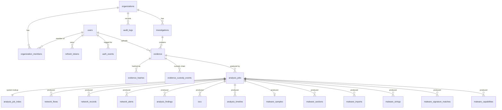

# Database

PostgreSQL 17. Schema owned by Alembic (`apps/api/alembic/versions`): `0001` is M1, `0002`–`0005` M2 (analysis jobs, pcap results), `0006`–`0008` M3 (static analyzer, malware results, storage quota).

## Roles

| Role | Used by | Rights |
|---|---|---|
| `postgres` | init script only | superuser |
| `cyberlab_owner` | `migrate` service, test setup/cleanup | owns `cyberlab` / `cyberlab_test` and every table |
| `cyberlab_app` | the API process | `NOSUPERUSER NOBYPASSRLS`, explicit per-table grants, `idle_in_transaction_session_timeout=60s`, `statement_timeout=30s` |

The API never receives owner credentials (`Settings` has no field for them; compose passes `MIGRATION_DATABASE_URL` only to `migrate` and `api-test`).

## Tables



(`malware_exports` and `malware_resources` hang off `analysis_jobs` the same way.)

| Table | Scope | Notes |
|---|---|---|
| `users` | global | `email` citext unique; argon2id `password_hash` |
| `auth_events` | global | append-only; register/login/logout/refresh-reuse; no read API in M1 |
| `refresh_tokens` | user | sha256 of opaque token, `family_id`, `revoked_reason` (rotated/logout/reuse) |
| `organizations` | tenant | `slug` unique, `next_case_number` counter; `storage_quota_bytes` (NULL = `DEFAULT_STORAGE_QUOTA_BYTES`, set by an operator only) |
| `organization_members` | tenant | unique (org, user); role owner/admin/analyst/viewer |
| `investigations` | tenant | unique (org, case_number); status open/in_progress/closed/archived |
| `evidence` | tenant | object `storage_bucket/key/version_id`; identity columns immutable |
| `evidence_hashes` | tenant | append-only; md5/sha1/sha256 per evidence |
| `evidence_custody_events` | tenant | append-only chain of custody |
| `audit_logs` | tenant | append-only; `organization_id` NOT NULL |
| `analysis_jobs` | tenant | one analyzer run (`pcap` / `static`) over one evidence version; `profile` `full` / `av` for static jobs, NULL otherwise; status machine enforced by trigger (final states and identity columns, incl. `profile`, immutable); `ingest_token_sha256`; `summary` jsonb (tool versions, engine errors, truncation flags, counts) |
| `analysis_job_index` | system lookup | job → org, analyzer, status, deadline for ingest/reaper and the global per-analyzer caps; RLS: sessions without org context see all rows, tenant sessions only their org; app may UPDATE only `status`, `deadline_at` |
| `network_flows` | tenant | Zeek conn records (largest `max_flows` by bytes); `total_bytes` indexed for sorting |
| `network_records` | tenant | `kind` dns/http/tls, `summary` text (searchable), `details` jsonb |
| `network_alerts` | tenant | Suricata alerts (sid, rev, signature, category, severity, community id) |
| `analysis_findings` | tenant | heuristic findings: type, severity, confidence, method@version, evidence refs, attributes |
| `iocs` | tenant | observables with first/last seen, count, source; unique (job, type, md5(value)) |
| `analysis_timeline` | tenant | capture start/end, findings, serious alerts, first contacts |
| `malware_samples` | tenant | one per static job (unique `job_id`): size, md5/sha1/sha256, ssdeep, libmagic type, mime, entropy, `file_format` pe/elf/other, `pe` / `elf` summary jsonb |
| `malware_sections` | tenant | index, name, virtual address (`numeric(20)`: unsigned 64-bit), sizes, entropy, flags |
| `malware_imports` / `malware_exports` | tenant | library + function or ordinal / name, ordinal, address |
| `malware_resources` | tenant | type, name, language, size, entropy, sha256 |
| `malware_strings` | tenant | capped; `encoding` ascii / utf16le / floss_decoded / floss_stack / floss_tight; offset |
| `malware_signature_matches` | tenant | `engine` clamav / yara, name, namespace, tags, meta |
| `malware_capabilities` | tenant | capa rule name, namespace, ATT&CK and MBC ids (jsonb), match count |

All ids are UUIDs (client-generated `uuid4`, server default `gen_random_uuid()`); timestamps are `timestamptz`.
Child rows are pinned to their parent's tenant with composite foreign keys, e.g. `evidence(investigation_id, organization_id) → investigations(id, organization_id)`.

Analysis result tables (migrations 0004/0005):
- They are written only by the trusted ingest worker, in the same transaction that moves the job to `succeeded`; a stream is never partially written.
- The app role has SELECT and INSERT only.
- `flow_ref` is not a foreign key: a referenced flow may have been dropped by the flow cap.

Static results (migration 0007) follow the same rules:
- Every `malware_*` row points at its job with a composite FK `(job_id, organization_id) → analysis_jobs(id, organization_id)`, `ON DELETE CASCADE`.
- Findings and IOCs of static jobs go into the shared `analysis_findings` and `iocs`. The §11 `malware_findings` table is therefore `analysis_findings` of static jobs.
- Reports are built on demand; there is no `reports` table yet.

## Tenant isolation (RLS)

Every tenant table has `ENABLE` **and** `FORCE ROW LEVEL SECURITY` (`test_rls_coverage.py` fails if a table with `organization_id` lacks either).

The request context lives in two transaction-local settings, read through helper functions:

```sql
app_org_id()  = NULLIF(current_setting('app.org_id',  true), '')::uuid
app_user_id() = NULLIF(current_setting('app.user_id', true), '')::uuid
```

| Table | Command | Policy |
|---|---|---|
| investigations, evidence, evidence_hashes, evidence_custody_events, audit_logs, analysis_jobs, pcap result tables, `malware_*` | ALL | `organization_id = app_org_id()` (USING + CHECK) |
| organization_members | SELECT | `organization_id = app_org_id() OR user_id = app_user_id()` |
| organization_members | INSERT / UPDATE / DELETE | `organization_id = app_org_id()` |
| organizations | SELECT | `id = app_org_id() OR id IN (memberships of app_user_id())` |
| organizations | INSERT / UPDATE (incl. `SELECT … FOR UPDATE`) | `id = app_org_id()` |

Reads and writes are split per command on purpose: a single ALL-command policy would let the "caller's own row" clause authorize **cross-tenant** UPDATE/DELETE of the caller's membership in another org (regression tests in `test_rls.py`).

The helper functions are schema-qualified (`pg_catalog.current_setting`, `pg_catalog.uuid`) and trigger functions pin `search_path = pg_catalog`; `TEMPORARY` on both databases is revoked from PUBLIC so temp objects cannot shadow names.

**RLS trusts `app.org_id`.** It does not check membership itself: any code that opens `tenant_session(org_id, …)` for an org taken from the request sees that org's rows. Only `require()` / `org_session()` (`app/core/rbac.py`) may open a tenant session for a request-supplied org, after verifying membership inside that same session; `tests/unit/test_tenant_session_guard.py` fails if `tenant_session(<org>…)` appears anywhere else besides the auth and org-creation services (which use org ids they just created).

With no context set, tenant tables return zero rows. `INSERT … RETURNING` also evaluates `USING`, so every tenant insert runs with a matching `app.org_id`.

### Setting the context

`app/core/tenancy.py::tenant_session(org_id, user_id)` opens one transaction and runs `set_config('app.user_id', …, true), set_config('app.org_id', …, true)` (`SET LOCAL` cannot take bind parameters). The values reset at commit/rollback, so they never leak to the next user of a pooled connection.

Rules:
- One `tenant_session` = one transaction. A flow needing several transactions opens a new one each time.
- Commit (leave the block) before sending the response; never rely on dependency teardown.
- Non-tenant tables (`users`, `refresh_tokens`, `auth_events`) are used via `tenant_session(None, None)` or `(None, user_id)`.

## Grants

| Table | `cyberlab_app` |
|---|---|
| users | SELECT, INSERT, UPDATE |
| refresh_tokens | SELECT, INSERT, UPDATE, DELETE |
| organizations | SELECT; INSERT on `id, name, slug, next_case_number, created_by, created_at, updated_at`; UPDATE on `name, next_case_number, updated_at` (0008: the app cannot write `storage_quota_bytes`) |
| investigations, evidence | SELECT, INSERT, UPDATE |
| organization_members | SELECT, INSERT, UPDATE, DELETE |
| auth_events, audit_logs, evidence_hashes, evidence_custody_events | SELECT, INSERT |
| pcap result tables, `malware_*` | SELECT, INSERT |

## Triggers

- `forbid_mutation()` — `BEFORE UPDATE OR DELETE` on the four append-only tables.
- `evidence_immutable()` — `BEFORE UPDATE` on `evidence`; every column except `status` and `description` is immutable (incl. `id`, detected type, storage location/version, uploader, timestamps).

**Trust boundary:** grants + triggers stop the app role (and accidental owner `UPDATE`/`DELETE`). The table owner can still `TRUNCATE` or drop triggers; it is a trusted admin identity and its credentials never reach the API. Test cleanup relies on owner `TRUNCATE` against `cyberlab_test` only (the harness refuses any database not ending in `_test`).

## Migrations

```bash
docker compose run --rm migrate uv run alembic revision --autogenerate -m "..."   # then hand-review
docker compose run --rm migrate uv run alembic upgrade head
docker compose run --rm migrate uv run alembic check                                # models vs. migrations
```

M3 migrations:

| Revision | Changes |
|---|---|
| `0006` static analyzer | `ALTER TYPE analyzer ADD VALUE 'static'` inside `autocommit_block()`: `env.py` runs all pending migrations in one transaction, and Postgres cannot use an enum value added in a transaction that has not committed. Later SQL compares `analyzer::text`, never the `'static'` literal as an enum. Adds `analysis_jobs.profile` with checks `ck_analysis_jobs_profile_valid` (`full` / `av`) and `ck_analysis_jobs_profile_iff_static`, adds `profile` to the immutable identity columns of the job trigger, and adds `analysis_job_index.analyzer` (backfilled `pcap`) with index `(analyzer, status)`. Downgrade cannot remove the enum value. |
| `0007` static results | the eight `malware_*` tables, with RLS ENABLE + FORCE, `tenant_isolation` policy and SELECT/INSERT grants, as for the pcap tables |
| `0008` storage quota | `organizations.storage_quota_bytes` (nullable, check ≥ 0); replaces the app's table-wide INSERT/UPDATE on `organizations` with column grants, so the app cannot raise its own quota |

asyncpg executes one statement per call, so raw SQL in migrations is issued statement by statement. `citext` is created by migration `0001` (trusted extension, created by the database owner); `gen_random_uuid()` is built in.

ORM notes: `Timestamps` models use `eager_defaults` so `updated_at` is fetched with `RETURNING` and stays loaded after the `tenant_session` block commits. `refresh_tokens.replaced_by` is a `DEFERRABLE INITIALLY DEFERRED` self-reference so rotation can mark the old token before inserting its successor.
