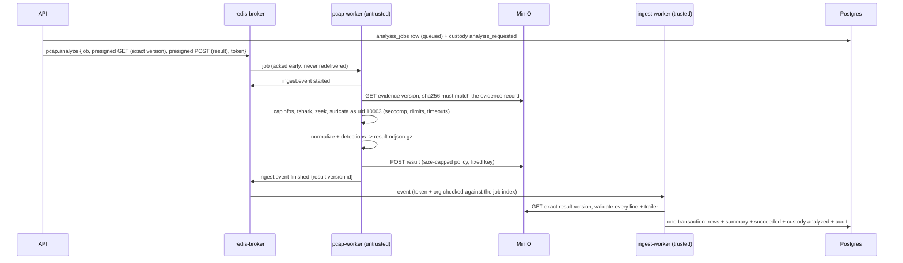

# PCAP Analysis (Milestone 2)

The first analysis engine: uploaded PCAP/PCAPNG evidence is analyzed by Zeek, Suricata and
TShark in an isolated worker. Zeek does most of the work (flows, DNS / HTTP / TLS records, file
hashes); Suricata adds signature alerts and JA3; **TShark contributes only the protocol hierarchy**
(`-z io,phs`) and capinfos the capture facts. Results are normalized into a versioned stream (`pcap.v1`), ingested by a
trusted worker into tenant tables, and shown in the PCAP Analyzer UI.

## Pipeline

- **Automatic**: uploads whose first bytes are a pcap (µs/ns, either byte order) or pcapng
  magic are analyzed automatically (best effort, after the upload commits). Analysts can re-run
  (`POST /orgs/{org}/evidence/{id}/analyses`); earlier jobs stay as history.
- **States**: `queued → running → succeeded | failed` (also `queued → failed` / `succeeded`).
  The database refuses any other transition, and final states never change. A reaper fails
  jobs past their deadline: `never_started` after the 6 h queue TTL, `timed_out` after the run timeout.
- **Limits** (settings → `JobLimits` in every job):
  - capture ≤ 512 MiB (`PCAP_MAX_BYTES`), job ≤ 15 min, tool ≤ 10 min;
  - 100 k flows, 100 k records per kind, 5 k findings;
  - result ≤ 256 MiB;
  - at most 5 active jobs per org and 50 in total; auto-runs are limited to 30 per user per 10 min.

## Isolation of the parser

Parsing attacker-controlled packets is the riskiest code path in the platform. The
untrusted side is designed so that a parser exploit gains as little as possible:

| Layer | Control |
|---|---|
| Credentials | pcap-worker has only a broker URL. Evidence is fetched and results stored via presigned URLs (exact version; fixed key with a size cap). It has no database credentials, no MinIO credentials and no app Redis. |
| Network | `analysis` network is `internal` (no egress); only redis-broker and MinIO are on it. Tools additionally get seccomp: no AF_INET/AF_INET6/AF_PACKET sockets. |
| Privileges | The Celery process (root, `cap_drop: ALL` + 6 caps, `no-new-privileges`, read-only rootfs) never parses capture bytes. Every tool runs as uid 10003 with no capabilities, a minimal environment, `TMPDIR` in its own job directory, and rlimits on CPU, file size, open files and core dumps. |
| Filesystem | The capture is root-owned and read-only. Tools can write only to `out/`. Root reads tool output through `dir_fd` + `O_NOFOLLOW` (regular files only) and creates files with `O_EXCL`. |
| Persistence | After every engine and every job, all uid-10003 processes are killed (helper `kill(-1)` as the tool uid, verified via `/proc/*/status`) and `/work` is wiped. If a process survives, the container stops itself (fail closed). |
| Broker | Per-component ACL users. The analyzer may only touch its own queue keys and write (not read) the ingest queue. Ingest messages are authenticated by a per-job token whose sha256 is stored on the job. |
| Integrity | The worker refuses evidence whose sha256 or size differ from the record. Ingest re-derives the result key and reads the exact version reported. |

Residual risks are listed in [THREAT_MODEL.md](THREAT_MODEL.md).

## Engines

| Engine | Version | Used for |
|---|---|---|
| capinfos | Wireshark 4.4.19 | packets, bytes, start/end, duration, link type; detects captures cut short |
| tshark | 4.4.19 | protocol hierarchy (`-z io,phs`) |
| Zeek | 8.0.10 (`engines/cyberlab.zeek`) | flows (conn), DNS, HTTP, TLS + x509, transferred files (hashes), community id |
| Suricata | 7.0.10, ET Open snapshot (sha256 in every result) | signature alerts, JA3/JA3S (eve limited to `alert` + `tls`) |

- **Zeek is required**: if it fails, the job fails, so an empty result is never shown as clean. The exception is a capture cut short mid-packet: the partial logs are kept and flagged `zeek_cut_short`.
- **Suricata is optional per job**: a failure, a timeout or lack of time is reported in `engine_errors`.
- **Rules**: ET Open is fetched only at image build. Loading it takes about 40 s per job, and Suricata peaks at about 605 MiB.

## Result stream `pcap.v1`

The result is gzip NDJSON; `packages/py-jobs/src/cyberlab_jobs/results.py` is the contract.

1. `header`: job id, capture format, tool versions (incl. rule snapshot), `engine_errors`,
   `truncated` flags (every cap that was hit, so a partial result is never shown as complete).
2. `stats`: packets/bytes/timestamps, protocol hierarchy, top sources/destinations/ports,
   counts (incl. records skipped as malformed).
3. `flow`, `dns`, `http`, `tls`, `alert` records.
4. `finding`, `ioc`, `timeline` lines (detections below).
5. `trailer`: line count + sha256 of everything before it.

Values are bounded:
- text is length-capped and NUL-free;
- timestamps are aware, within 1970..2100, and stored in UTC;
- counters fit a bigint and floats are finite;
- IP addresses carry no IPv6 zone id.

Records link to flows by `flow_ref` (Zeek uid). Alerts and JA3 are joined to Zeek by community id and time, because a 5-tuple can be reused.

## Detections

Heuristics describe behaviour, never maliciousness. Every finding includes:
- `detection_method` (`heuristic:<name>@<version>`);
- severity and confidence;
- evidence refs (up to 50 flow uids);
- the measured values that triggered it.

Suricata alerts stay alerts; reputation is never used (M4).

| Detector | Finding types | Rule (version 1) |
|---|---|---|
| beaconing | `beaconing` | Same (src, external dst, port, proto): ≥ 8 connections, mean interval ≥ 5 s, interval CV ≤ 0.15, size CV ≤ 0.25 |
| port_scan | `port_scan_vertical`, `port_scan_horizontal` | ≥ 20 ports on one target, or ≥ 15 targets on one port, with ≥ 70% failed attempts (Zeek S0 / REJ / RST* / SH / OTH); high severity at ≥ 100 |
| dns_anomaly | `dns_tunneling_like`, `dns_nxdomain_burst` | Per (src, last-two-labels domain): ≥ 10 queries with long (≥ 40) or high-entropy (≥ 3.5 bits, ≥ 20 chars) labels; else ≥ 10 NXDOMAIN at ratio ≥ 0.5 |
| suspicious_traffic | `http_to_ip_literal`, `executable_over_http`, `tls_self_signed`, `tls_expired_certificate`, `tls_legacy_version`, `service_on_nonstandard_port` | Zeek facts: Host header is an IP; executable MIME type over HTTP; subject == issuer; not-after < use time; SSLv2/3 or TLS 1.0/1.1; Zeek service on a port outside its usual set |

Flow detectors see every flow read, even beyond the flow cap. Detector state is capped at 50 k keys (`truncated.detector_state`).

**IOCs** are observables only:
- external IPs, domains, URLs;
- JA3/JA3S, certificate sha256;
- md5/sha1/sha256 of files Zeek saw transferred.

Each IOC records first/last seen, count and source.

**Timeline** entries:
- capture start/end;
- findings;
- Suricata alerts of severity 1–2;
- first contact with up to 100 external hosts.

## Quality on the synthetic dataset

The dataset is described in `apps/workers/pcap/dataset/README.md`; it is generated, never captured. Results with local test rules:

| Detector | TP | FP | FN | Precision | Recall |
|---|---|---|---|---|---|
| beaconing | 1 | 0 | 0 | 1.0 | 1.0 |
| port_scan | 2 | 0 | 0 | 1.0 | 1.0 |
| dns_anomaly | 1 | 0 | 0 | 1.0 | 1.0 |
| suspicious_traffic | 5 | 0 | 0 | 1.0 | 1.0 |

- Parsing success is 100% on valid captures, and analysis takes about 1.2–1.4 s per scenario.
- Benign scenarios (`normal_web`, `dns_traffic`) produce no findings.
- Fuzz-lite: 50 mutated captures all end cleanly: 23 results, 22 `unparseable_capture`, 3 `unsupported_capture_format`, 2 `zeek_failed`.

These numbers show that the detectors behave as specified on controlled traffic. They are
**not** real-world precision or recall. The labels are few and were designed together with the
detectors.

## Limitations

- **Parsers:** tool vulnerabilities are contained, not prevented. The tools are the Debian 13 packages and the Zeek 8 image; updating means rebuilding the image.
- **Rules:** ET Open drifts between builds. The snapshot digest is recorded in every result.
- **Approximations:**
  - The "registered domain" is the last two labels (no public-suffix list).
  - Thresholds are static.
  - There are no allow-lists yet (e.g. known updaters for beaconing).
- **Flows are Zeek `conn.log` connection records.** There is no TCP stream reassembly for the analyst (no follow-stream view, no payload search) and no file carving: transferred files appear as Zeek file records with hashes, never as extracted files.
- **Not covered in M2:**
  - TCP stream reassembly and file carving (ROADMAP "Later").
  - Compressed captures (refused).
  - Interfaces other than Ethernet/IP (not tested).
  - JA4.
  - OpenSearch (results live in Postgres; M7 adds org-wide Postgres search and deterministic correlation of the IOCs, JA3 and hashes, see [ARCHITECTURE.md](ARCHITECTURE.md#platform-operations-m7)).
  - Per-org fair scheduling (one FIFO queue).
