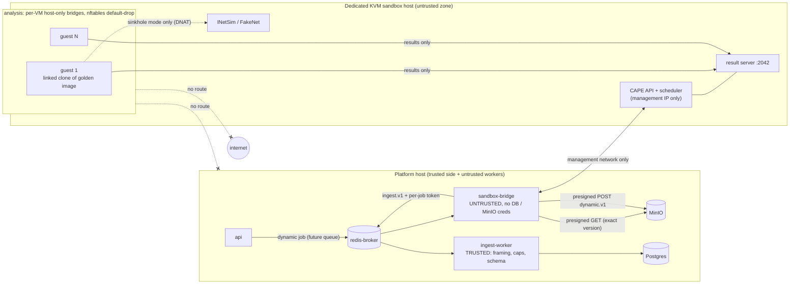

# Sandbox Security (dynamic analysis)

## 1. Status

**Designed in M7, not enabled.**

Nothing executes samples today:

- no analyzer value, queue, broker user, compose service or API route exists for dynamic analysis;
- the contract `packages/py-jobs/src/cyberlab_jobs/dynamic.py` (`dynamic.v1`) is frozen but imported by nothing, and `DYNAMIC_ENABLED` is `False`;
- `apps/api/tests/unit/test_dynamic_gate.py` fails as soon as any of that is wired.

Dynamic analysis may be enabled only when **every** item of the [gating checklist](#9-gating-checklist-acceptance-tests-before-enabling) passes on the target infrastructure, and the parent records the result (date, host, image digests, reviewer) in [ROADMAP.md](ROADMAP.md). Enabling it is a code change and a release: it is never a configuration flag.

The contract is engine-neutral and is marked "subject to one revision when a bridge is built". Engine specifics (CAPE) stay in the future `sandbox-bridge`.

## 2. Scope and non-goals

**Scope.** Detonate one evidence file in a disposable, network-isolated VM and bring back a bounded behaviour report: processes, file and registry activity, attempted network activity, engine signatures and dropped-file hashes. The engine is **CAPE v2** on KVM/libvirt (ROADMAP "Gated", `requirement.txt` §4 "CAPE Sandbox as a later isolated integration").

**Non-goals and hard exclusions:**

- **No execution on the platform.** Samples never run on the application host, on Docker Desktop or WSL2, or in a shared API, ingest or analyzer container. The static and pcap analyzers parse samples but never execute them, and they stay that way.
- **No unrestricted internet.** The only route modes are `none` (the default) and `sinkhole`. `internet`, Tor, VPN and SOCKS routing are forbidden: the contract cannot express them, and the bridge refuses them.
- **No memory forensics, PCAP or screenshot export in v1** (see [section 7](#7-data-handling)).
- **No VM, bridge or CAPE code in M7.** This document and the contract are the whole deliverable.

## 3. Topology

The sandbox runs on a **dedicated KVM host**: bare metal, or a VM with nested virtualization on hardware that runs nothing else of the platform. The host is a separate trust zone. From the platform's point of view everything on it is untrusted, CAPE included.

The host has three kinds of network:

| Network | Members | Purpose |
|---|---|---|
| **management** | CAPE API (bound to this interface only) ↔ `sandbox-bridge` | job submission, status polling, report download; nothing else is routed |
| **analysis** | one host-only Linux bridge **per VM**, with no physical port | guest ↔ CAPE result server and guest agent only; nftables `policy drop` |
| **sinkhole** | INetSim / FakeNet bound to the analysis bridges on the sandbox host | fake DNS, HTTP(S), SMTP and other services in `sinkhole` mode |

The rules that make it work:

- **No route out of a VM network.** There is no route from any VM network to the platform networks, the management network or the internet. IP forwarding from the analysis bridges to any other interface is dropped in the nftables `forward` chain, whatever the sysctl says.
- **IPv6 is disabled on the analysis bridges** (`disable_ipv6=1`) and dropped by nftables, so a missed IPv4-only rule cannot be bypassed over IPv6.
- **The management network is not the uplink.** The host's uplink (patching) is a separate interface, and the analysis bridges can never reach it. CAPE's API and web UI listen on the management address only, behind an API token. The web UI is not used.

## 4. §7 requirement → control

| §7 requirement | Control | Verified by (section 9) |
|---|---|---|
| Disposable VMs | A golden image per guest OS (read-only base, sha256 pinned) and a **per-job linked clone**: a fresh qcow2 overlay on the base, destroyed after the job. CAPE's stock KVM machinery reverts a libvirt snapshot of a long-lived VM, so a pre-analysis host hook rebuilds the VM's overlay from the golden base instead. | G3 |
| Strict network isolation | Per-VM host-only bridges with no physical port; nftables `policy drop` on `input` and `forward`; only guest → result server (TCP 2042) and host → guest agent (TCP 8000) are allowed; no route to the platform, management or internet; IPv6 off. | G1, G2 |
| Snapshot rollback | Revert before each job and destroy after it. The revert is **verified**: the base image's sha256 equals the pinned golden digest, and the overlay is freshly created with no allocated data before boot. The proof is recorded as `revert_verified` in `DynamicSummaryV1`, and a run without it can never be `succeeded`. | G3 |
| Resource limits | libvirt caps: vCPU (2), RAM (4 GiB, no balloon), overlay size (40 GiB, `qemu-img create` size), `blkiotune` / `<iotune>` I/O caps, a cgroup CPU quota per domain. A per-job wall clock of ≤ 300 s (`DynamicJobV1.timeout_s`, `le=300`), then `virsh destroy` (a hard kill, not a guest shutdown). | G4 |
| No host filesystem sharing | No `<filesystem>` devices: no virtio-fs and no 9p shares. The sample enters only through the guest agent's upload, and results leave only through the result server. | G1 |
| No shared clipboard | No SPICE agent or `spicevmc` / vdagent channel; guest additions and VM tools removed; no drag-and-drop; no USB controller and no USB redirection; the display (VNC) is bound to localhost on the sandbox host, never published. | G1 |
| Controlled egress | Route modes `none` (default: CAPE's `drop` routing plus the nftables default-drop) and `sinkhole` (CAPE's `inetsim` routing: all guest traffic DNATed to INetSim on the host). CAPE's own `none` mode is **never** used: it does not restrict traffic, it only does no routing. `internet` / Tor / VPN / SOCKS are forbidden by the contract (`RouteMode = Literal["none", "sinkhole"]`) and refused by the bridge before submission. | G2 |
| Execution time limits | The per-job wall clock above, enforced on the sandbox host (CAPE timeout plus a host watchdog that destroys the domain at `timeout_s` + a 15 s grace). `duration_ms` is capped at 300 000 in the contract. | G4 |
| Sample integrity verification | The bridge verifies sha256 and size of the presigned GET body against `DynamicJobV1.evidence_sha256` / `evidence_bytes` before submission. The guest agent wrapper verifies the sha256 again inside the guest before executing. A mismatch fails the run with `error_code = "integrity"`. | G5 |
| Full audit logs | Custody event `sent_to_sandbox` (reserved in M7, `CustodyAction.SENT_TO_SANDBOX`) when the bridge submits; the normal job audit (created, started, finished, outcome); the CAPE task logs retained on the sandbox host; and the route mode recorded in the result header, on every network line and in the summary. | G6 |

## 5. Integration pattern

Dynamic analysis reuses the M2/M3 presigned-URL and trusted-ingest pipeline. Nothing new is trusted.

1. **API.** The API creates the job and publishes a `DynamicJobV1` to a future dynamic queue. The message carries:
   - `job_id`, `org_id`, `evidence_id`;
   - `evidence_sha256` and `evidence_bytes`;
   - `sample_url`: a presigned GET of the **exact evidence version**;
   - `route` (default `none`) and `timeout_s` (≤ 300);
   - `upload`: a presigned POST for the result object;
   - `token`: the per-job ingest token (stored hashed);
   - `deadline`: the bridge refuses a job received after it, so a queued job never detonates late.

   **The API never talks to CAPE.**
2. **`sandbox-bridge`** is a new **untrusted** worker, analyzer-class. It runs:
   - on its own internal network, which reaches the broker and MinIO's S3 endpoint (for the presigned URLs, as `analysis` does for the analyzers) and the management network. Nothing else.
   - as a non-root uid, with a read-only rootfs, `cap_drop: ALL`, and a broker ACL user confined to its own queue keys and write-only to `ingest*` (the analyzer pattern of `infra/redis-broker/entrypoint.sh`).

   **It holds no DB role, no MinIO credentials, no JWT secret and no seal or signing keys.** It can only:
   - fetch the sample with the presigned GET and verify its hash and size;
   - refuse any route but `none` / `sinkhole`;
   - submit to the CAPE API over the management network, with a per-host API token;
   - poll and download the CAPE report;
   - convert it to `dynamic.v1` lines: a header, records, one summary, and the hashed trailer;
   - upload the stream gzipped through the presigned POST;
   - send `ingest.v1` with the per-job token.

   **The CAPE report parser lives here**, in the untrusted zone: a hostile report can at worst produce a hostile stream, and the trusted ingest refuses that.
3. **Trusted ingest** validates the stream exactly like `static.v1`:
   - the shared framing reader (`app/modules/analysis/result_stream.py`: gzip, decompressed-size cap, gzip-bomb limits, line length, trailer count and sha256);
   - every line against the contract;
   - `DynamicStreamCheck`:
     - the header names this job and route;
     - every network line carries the job's route;
     - at most 200 000 records;
     - exactly one summary, as the last body line;
     - the summary's counts equal the stream's.

   Then it writes everything in one all-or-nothing transaction. Unknown fields, unknown kinds, control characters and oversize text are refused.

## 6. Threat model

| Threat | Mitigation | Residual risk / honest limit |
|---|---|---|
| **VM escape** (QEMU / KVM / libvirt CVEs, device-model bugs) | Minimal device model: virtio-net and virtio-blk only; no floppy, sound, USB, SPICE or SLiRP user networking. QEMU runs under libvirt sVirt (AppArmor or SELinux per-domain labels) with QEMU's seccomp sandbox on. **No nested virtualization for guests** (`vmx` / `svm` disabled in the guest CPU model). Host patch cadence: monthly, and within 72 h for a hypervisor CVE rated high or above. The sandbox host is dedicated, so an escape lands on a host holding no platform secrets. | A 0-day escape gives the attacker the sandbox host: CAPE, other in-flight samples and the CAPE API token. It does **not** give them a route to the platform (the management network only exposes the bridge's outbound client side), DB or MinIO credentials, or the internet beyond the patch uplink, which the analysis bridges cannot reach. Rotate the CAPE token and rebuild the host after any suspected escape. |
| **Sandbox detection and evasion** | Guest images without VM tools; realistic hardware strings and user artefacts (CAPE's KVM hardening guidance); a wall clock long enough for common sleeps (≤ 300 s); CAPE's anti-evasion hooks. | **Honest limit:** evasive malware can detect the VM, stall past 300 s, or wait for user activity or real network answers (the sinkhole is not the internet). An empty or benign-looking dynamic report is **never** evidence of benignity, and the UI and AI context must say so. Dynamic results add observations; they never clear a sample. |
| **Malicious CAPE output** (the engine's report is shaped by the sample: crafted process names, paths, giant or nested JSON) | The parser runs in the untrusted bridge. The output is bounded `dynamic.v1` text: length caps, no NUL, C0, DEL or C1 controls, `extra="forbid"`, discriminated kinds and integer bounds. The ingest re-validates it all. Values are shown as text in the UI, never as HTML. | A compromised bridge can forge a plausible but wrong report for its **own** job (the per-job token blocks the others). Results are labelled "observed in sandbox" and are not trusted hashes. |
| **Network egress abuse** (DDoS, spam, C2 through the sinkhole) | Default route `none`: everything dropped. `sinkhole` answers locally: INetSim has no upstream, and DNAT targets only the host's INetSim address. nftables default-drop on `forward`, and no route to the uplink. Per-VM bridges keep guests apart. | INetSim answers can mislead the sample: behaviour seen under `sinkhole` may differ from the real world. |
| **Credential theft from guests** | Golden images hold **no real credentials, tokens, licences, SSH keys or domain joins**: a throwaway local user only. The CAPE API token never enters a guest. | Stolen guest artefacts are worthless by design. |
| **Data exfiltration through the result stream** (smuggling sample bytes or host data into the platform) | Dropped files are **hashes only** in v1 (`DroppedRecord` has no content field). No screenshots, PCAP or memory dumps. Text caps and 200 000 records bound the stream, the framing reader bounds the decompressed size, and the schema forbids unknown fields. | Bounded text can still carry a few KiB of attacker-chosen strings into the case. This is the same exposure as `static.v1` strings. |
| **Operator mistakes** (wrong route, a VM left running, a reused clone) | The route defaults to `none`, and there is no `internet` value to select. `revert_verified` is required for success. A host watchdog destroys any domain past its deadline. The kill switch is in [section 8](#8-operations). The gating checklist reruns after any host or image change. | Infrastructure drift after enabling is caught only by rerunning the checklist (quarterly, and after any change). |
| **Sample swap between fetch and run** | Presigned GET pins the version; the bridge hashes the body; the guest wrapper re-hashes before execution. | None beyond the hash function. |

## 7. Data handling

- **Dropped files: hashes only in v1** (sha256, size and path), so no sample-derived bytes leave the sandbox host. A hash can be enriched by TI like any `file_sha256` IOC.
- **Screenshots, PCAPs and memory dumps are deferred.** They need their own caps, a malware-safe image pipeline and a retention review before any v2.
- **On the sandbox host:**
  - CAPE's copies of the sample and the analysis directories are deleted once the result is ingested, or at the job deadline plus 1 h.
  - CAPE task logs are kept 30 days for audit. They contain no sample bytes.
  - Golden images are kept with their build manifests.
- **On the platform:** `dynamic.v1` rows follow the M7 retention policy like the other job results. They are purged with the case after `closed_case_days`, and legal holds apply.

## 8. Operations

- **Image building.** Guest images are built offline and reproducibly from vendor ISOs whose sha256 is recorded, with a scripted install (Packer or `virt-install` plus an answer file):
  - VM tools removed;
  - the CAPE agent and the hash-verifying launcher installed;
  - no real credentials;
  - updates applied once, then the image is frozen.

  The resulting base qcow2 is set read-only, and its sha256 is **the golden digest**: it is recorded in a signed manifest and copied into every result as `vm_image_digest` (`sha256:<hex>`).
- **Patching.**
  - The host kernel, QEMU, libvirt and CAPE: monthly, and within 72 h for a high-or-above hypervisor CVE.
  - Guest images: rebuilt quarterly, which produces a new digest.
  - **Any change reruns the gating checklist.**
- **Golden-image provenance.** The manifest records the ISO hash, the build script commit, the installed agent version and the image digest, and a second operator reviews it. The trusted ingest refuses a summary whose `vm_image_digest` is not in the configured allowlist of current digests (the bridge is untrusted, so the check cannot live there).
- **Kill switch.** All of these are drilled (G7):
  1. Disable the bridge's broker ACL user (`user <bridge> off`, then `ACL LOAD`): queued jobs stop being consumed.
  2. Keep `DYNAMIC_ENABLED = False`, or set it back with a release: the API refuses to create jobs.
  3. On the sandbox host, destroy all domains (`virsh destroy`) and load an nftables ruleset that drops everything on the analysis bridges.

  Running jobs are failed by the reaper like any stale job.
- **Capacity.** The default guest takes 2 vCPU and 4 GiB. A host with 16 cores and 64 GiB runs about 6 concurrent guests and keeps headroom for the host and INetSim. The platform caps active jobs per org and globally, exactly as it does for the analyzers (per-org and global active caps).

## 9. Gating checklist (acceptance tests before enabling)

Every item runs on the **target** sandbox host with the **current** golden images. The results are recorded in ROADMAP. One failure blocks enabling.

| # | Test | Pass criterion |
|---|---|---|
| G1 | **Escape assumptions.** From inside a guest, probe the host's management IP, every platform IP and subnet (API, broker, MinIO, Postgres), and the host's uplink gateway. List the devices (`lspci`, `lsusb`, `Get-PnpDevice`), shares, clipboard channels and guest tools. | Every connection times out or is refused. Only the result server and agent ports answer, and only on the analysis bridge. There is no virtio-fs or 9p, no USB controller, no SPICE / vdagent channel, and no guest tools. |
| G2 | **Egress, per route mode.** In `none` and in `sinkhole`, run external probes: TCP 80 / 443 / 25 / 6667, UDP 53 / 123, DNS to 8.8.8.8 and to the system resolver, ICMP, and IPv6. Then check that `internet`, `tor`, `vpn` and `socks5` are refused. | `none`: every external probe fails, DNS included. `sinkhole`: no packet leaves the host (capture on the uplink shows nothing); INetSim answers DNS and HTTP. The other route values are refused by the contract (`test_dynamic_contract.py`) **and** by the bridge before submission. |
| G3 | **Snapshot-revert proof.** Job A writes a marker file and a registry key, then job B runs on the same VM slot. | Job B finds no marker and no key. Before each boot, the base sha256 equals the golden digest and the overlay has no allocated data. `revert_verified = true` in both summaries. |
| G4 | **Resource limits.** Run a fork bomb, a memory hog, a disk fill and a CPU spin past `timeout_s`. | Each guest is capped or killed at its limit or at the deadline (`virsh destroy`). Host load, memory and disk stay within the reserve, and a concurrent job on another VM finishes normally. |
| G5 | **Integrity mismatch.** Alter the presigned body (via a proxy in the test rig) and, separately, the file inside the guest before launch. | The bridge refuses before submission, and the guest launcher refuses before execution. Both end as failed `integrity`, with no execution observed. |
| G6 | **Audit completeness.** Run one job end to end. | The custody event `sent_to_sandbox` exists, the job audit trail is complete, the CAPE task log is retained, and the route mode appears in the header, every network line and the summary. The stream passes the trusted ingest. |
| G7 | **Kill-switch drill.** With jobs running, apply the three kill-switch steps. | Consumption stops, running domains are destroyed, the analysis bridges drop all traffic, and the API refuses new dynamic jobs. Recovery is documented. |
| G8 | **Red-team review.** Someone other than the builder reviews topology, nftables, libvirt XML, images and the bridge (STRIDE, plus an escape-assumption tabletop). | The review is written down, every high finding is fixed or formally accepted by the parent, and it is linked from ROADMAP. |

Before enabling, `test_dynamic_gate.py` is **replaced** (not deleted) by a test that asserts the reviewed wiring: exactly one bridge service, user and queue, and the route set still `{none, sinkhole}`.

## 10. Requirement traceability

| Requirement | Where |
|---|---|
| §4 `dynamic_analysis` module "with a clear interface" | `cyberlab_jobs/dynamic.py` (`dynamic.v1`), sections 5 and 7 |
| §4 "CAPE Sandbox as a later isolated integration" | sections 2 and 3 |
| §7 "Design a separate sandbox integration" | sections 3 and 5 (a dedicated host, an untrusted bridge, no API ↔ CAPE path) |
| §7 dedicated disposable VMs | section 4 "Disposable VMs", G3 |
| §7 strict network isolation | section 3, section 4, G1, G2 |
| §7 snapshot rollback | section 4, `DynamicSummaryV1.revert_verified`, G3 |
| §7 resource limits | section 4, G4 |
| §7 no host filesystem sharing | section 4, G1 |
| §7 no shared clipboard | section 4, G1 |
| §7 controlled network egress | section 4, `RouteMode`, G2 |
| §7 execution time limits | section 4 (`timeout_s ≤ 300`, `duration_ms ≤ 300 000`), G4 |
| §7 sample integrity verification | section 4, error code `integrity`, G5 |
| §7 full audit logs | section 4, custody `sent_to_sandbox`, G6 |
| §7 "Never execute malware on the application host or shared API containers" | section 2, section 3, the gate test (no compose service or worker) |
| §7 "Do not enable unrestricted internet access for malware samples" | `RouteMode`, section 4 "Controlled egress", G2 |
| §7 "must not be enabled until isolation is tested" | section 1, section 9, `DYNAMIC_ENABLED = False`, `test_dynamic_gate.py` |
| §13 Test: "Sandbox escape assumptions" | section 6 "VM escape", G1, G8; M7 proves the not-wired assumption with `test_dynamic_gate.py`, and the hostile contract input with `test_dynamic_contract.py` |
| §15 `/docs/SANDBOX_SECURITY.md` | this document |

**Sources consulted (2026-11-06):** the CAPE v2 documentation (per-analysis routing: `none` does not restrict traffic, `drop` locks it down, `inetsim`, `internet`, `tor`, `vpn` and `socks5` exist; the rooter uses iptables; the result server is on TCP 2042), and the libvirt domain XML reference (`<filesystem>`, `<channel>`, `<iotune>`, `<seclabel>`). These are settings to verify on the installed versions when the bridge is built.
